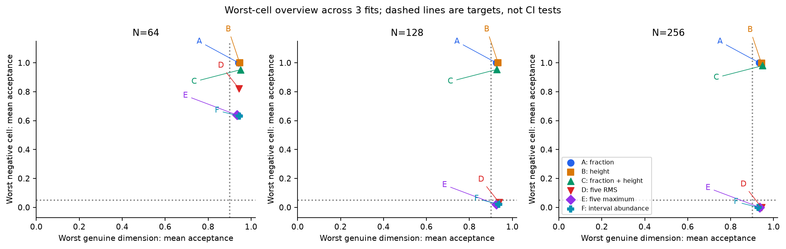
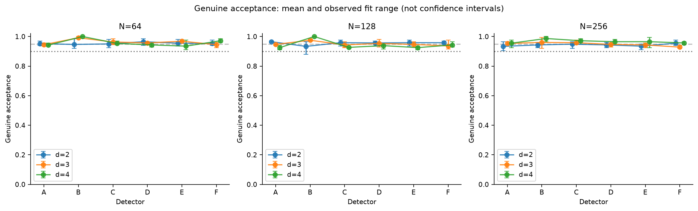
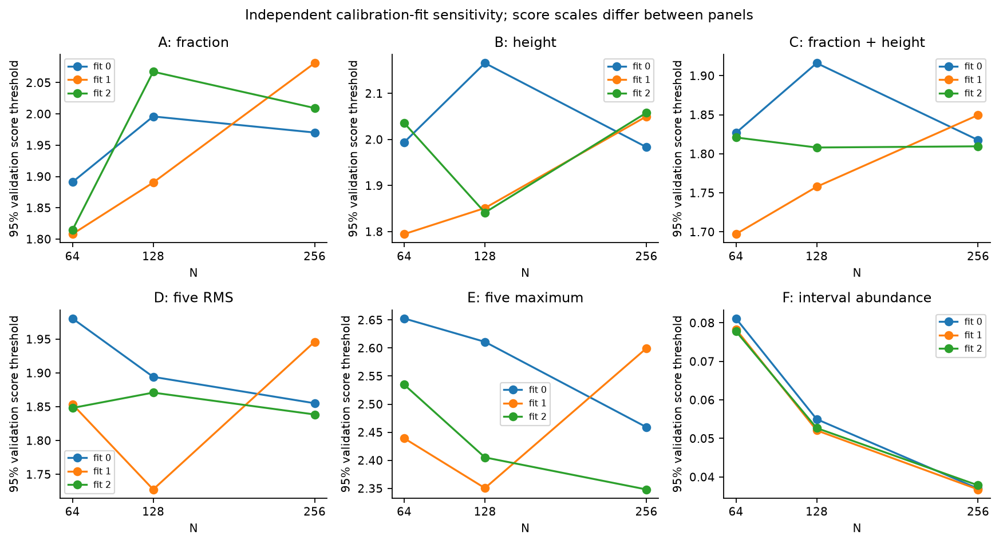
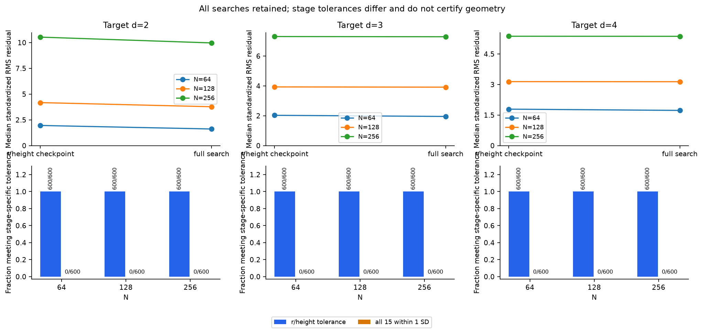
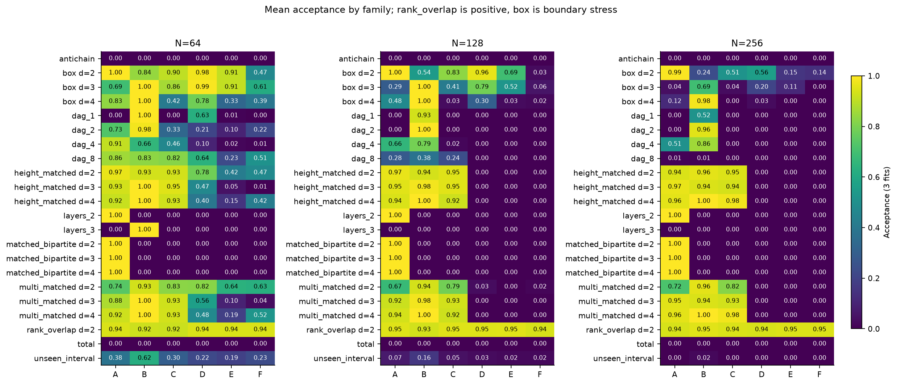
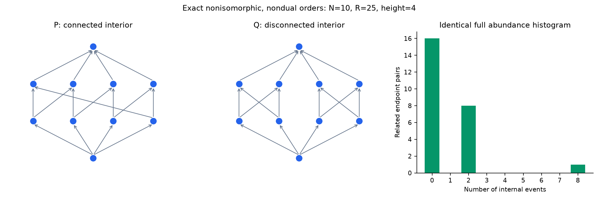

# Experiment 3: adversarial geometry and statistical identifiability

2026-10-25. This report concerns finite numerical probability models of causal
orders. “Genuine” means samples from the registered flat Alexandrov-interval
model, not measured evidence about the microscopic structure of our universe.

**Scientific conclusion:** none of the six detectors meets the registered
advancement benchmark. Height alone repairs the easy two-layer failure, while
harder controls still fool richer summaries. All 5,400 initial search checkpoints matched height
and ordering fraction, but **zero** met the full 15-component, one-SD matching
criterion. Failed searches nonetheless sometimes passed every detector. The
experiment validates specific tools and exposes their limits; it does not
establish emergent spacetime, gravitational dynamics or singularity resolution.

The interval-abundance detector F has the most supported benchmark cells and the
fewest failed cells descriptively, but **there is no qualifying winner**. It is
not uniformly better than E, and all models fail on N=64 adversaries. No primary
comparison meets the full registered improvement rule. A prespecified higher
acceptance target gives some local gains over the two-feature baseline, without
turning the primary failure into a success.

## Registration, audit and methodology

Work began from merged Experiment 2 at `c121da2`, on
`experiment/adversarial-geometry-v1`. The [protocol](ADVERSARIAL_GEOMETRY_PROTOCOL.md),
[independent audit](ADVERSARIAL_GEOMETRY_AUDIT.md) and initial
[mathematical analysis](ADVERSARIAL_GEOMETRY_THEORY.md) were committed as
`351c8b9` before implementation or primary outcomes. Implementation and the
resource-only pilot were committed as `e4dfbc0` before the primary run.
No previous implementation or archived result was changed.

The audit replayed all 4,806 Experiment 2 evaluation records exactly. It confirmed
the 1,800 ordering-fraction false acceptances, the height-two shortcut, the 49/200
DAG acceptances including 36 regressions, the single-fit uncertainty limitation,
exact summary degeneracy and size-dependent movement outside the calibrated
dimension range. No error affecting the published results was found. A Boolean
count-validation inconsistency was hardened in the new statistics API without
altering the historical results.

The primary design uses d=2,3,4 and N=64,128,256, master seed 20261025, three
independently calibrated fits and separate final sets for each fit. Each d/N/fit
has 100 calibration, 100 development, 200 validation and 200 genuine final orders.
Calibration fits templates; development supplies adversarial targets and q;
validation chooses thresholds. Final outcomes cannot influence any of these.
All inference receives order features, with true/target dimensions used only by
training or subsequent evaluation. Candidate-template labels, MM labels and
structural acceptance are separate quantities.

| Detector | Score, minimized across calibrated candidate dimensions |
|---|---|
| A | Absolute standardized ordering-fraction residual |
| B | Absolute standardized height/N residual |
| C | RMS of the two residuals in A and B |
| D | Original Experiment 2 RMS over five features |
| E | Maximum absolute residual over those five features, within one template |
| F | Hellinger distance between ten-category interval-abundance probability vectors |

D preserves the previous score and pooled-quantile method, including its
compensating behavior; its new templates are refitted independently. E removes
within-template averaging but has a separately calibrated cutoff, so its accepted
set need not be a subset of A's. F uses incomparable pairs and internal-cardinality
bins 0,1,2,3,4–7,8–15,16–31,32–63,64+, normalized by all unordered pairs. It is a
finite-N engineering diagnostic motivated by
[Glaser and Surya's interval-abundance analysis](https://arxiv.org/abs/1309.3403),
not a theorem certifying geometry. The original five features are ordering
fraction, height/N, link fraction, normalized mean internal cardinality and the
fraction of intervals with at least four internal events. These correlated
features are not five independent physical measurements.

Every detector uses the same nominal pooled genuine-validation target, primarily
95%, with 90% and 97.5% sensitivity analyses fixed in advance. Quantile ties,
especially for height, can change achieved validation acceptance. Test acceptance
is neither forced to match nor retuned after inspection.

The negative families are total/antichain, iid two/three-layer orders, closed DAGs
at p=c/N for c=1,2,4,8, mean-r-matched bipartite orders, height/r-matched layered
backbone orders, their multi-statistic optimized checkpoints, and the unseen
random interval-order family. Each stochastic cell has 200 independent orders per
fit; exact total/antichain controls occur once per fit and have no binomial CI.
The two search checkpoints share their search ID and retain their dependence.

Each search selects a target with replacement from its independent development
pool and protects its exact height
with a backbone, spends 12 evaluations on ordering-fraction matching and 52 on
annealing the 15-component feature discrepancy. It retains failed matches and
the best objective found. The full-match tolerance is at most one calibration SD
in every component, with the registered numerical floor. A failure within 64
evaluations is not proof that matching is impossible. The optimizer receives
donor features and dimension-cell calibration scales, not coordinates or final
detector decisions; test-label metadata never enters detector inference.

Two separate controls prevent overinterpretation. Intersecting two random rankings
has exactly the d=2 diamond order law and is therefore a **positive overlap
control**. Uniform flat-spacetime samples in a box retain the Lorentzian causal
relation but change the boundary; they are a secondary sensitivity test, excluded
from the primary genuine/negative gate. Calling either family a required
non-geometric rejection would misstate the experiment.

## Uncertainty and advancement rules

Each stochastic cell has a two-sided 95% Wilson interval within each fit, conditional
on that fitted model and development pool. Across fits, equal-fit means, observed
ranges and 2,000 hierarchical bootstrap resamples capture some refitting variation:
resample fits, then entire orders within each selected fit. Detector comparisons
resample paired decisions on the same orders. Optimization-stage comparisons pair
the two checkpoints by search ID. No pooled Wilson interval treats repeated fits
as one iid binomial experiment.

Only three fits were sampled. Their bootstrap intervals are pointwise exploratory
uncertainty estimates, with limited information about the tails of calibration
variation. They do not cover model misspecification or untested adversaries.
Constant empirical bootstrap results can give zero-width intervals; per-fit
Wilson bounds remain nondegenerate and govern advancement.

A detector advances only if every registered positive cell in every fit has a
Wilson lower bound at least 90%, every stochastic negative cell has an upper
bound at most 5%, and all exact negative controls reject. Bounds crossing a target
are inconclusive; bounds wholly on the adverse side fail it. This intersection
of pointwise conditions is not a claim of simultaneous 95% confidence.

A local complexity gain must have a paired rejection-gain lower bound above five
percentage points, meet the genuine acceptance gate, and have an upper bound on
additional genuine rejection no greater than two points in every dimension at
that N. A supported regression elsewhere prevents a claim of general added value.
This makes a highest-average-score ranking insufficient to declare a winner.

## Executed workload and primary outcome

The complete run records **52,218 orders**: 10,800 calibration/development/validation
orders, 5,400 genuine final orders, 28,800 stochastic negative orders, 1,800 rank
overlap controls, 5,400 box-boundary samples and 18 exact controls. The 5,400
searches contribute two checkpoints each and use **345,600 candidate evaluations**,
plus two relabeling integrity checks per search. Separate timing streams add 81
benchmark orders; these are not scientific test observations.

All six models fail the primary benchmark. The table counts 66 designated groups
(12 positive, 54 negative), each assessed across all three fits. Inconclusive
cells are retained, not counted as successes. No genuine group has a per-fit
Wilson upper bound below 90%; missed genuine lower bounds are **inconclusive**,
not evidence that genuine acceptance is definitively below 90%.

| Detector | Supported cells | Failed cells | Inconclusive cells | Observed genuine per-fit range | Primary result |
|---|---:|---:|---:|---:|---|
| A | 18 | 38 | 10 | 90.5–97.5% | Failed |
| B | 26 | 32 | 8 | 88.0–100.0% | Failed |
| C | 33 | 23 | 10 | 92.0–98.5% | Failed |
| D | 43 | 11 | 12 | 91.5–98.5% | Failed |
| E | 44 | 8 | 14 | 91.0–99.5% | Failed |
| F | 47 | 7 | 12 | 91.5–98.5% | Failed |



### Genuine acceptance and calibration variation

Values below are mean acceptance percentages across fits, followed by the observed
fit range. **Ranges are not confidence intervals.** All per-fit Wilson and
hierarchical intervals are retained in the linked data. The number of genuine
fit/d/N cells missing the 90% lower-bound requirement is A=11, B=5, C=8, D=7,
E=11, F=10 out of 27. For example B at d=2,N=128,fit 2 accepts 176/200=88%,
Wilson [82.77%,91.80%], still inconclusive against 90%.

| N | Dimension or target | A | B | C | D | E | F |
|---:|---:|---:|---:|---:|---:|---:|---:|
| 64 | 2 | 95.2 [94.0–97.0] | 94.7 [92.0–98.5] | 95.0 [92.5–98.0] | 96.5 [94.0–98.5] | 95.5 [93.5–98.0] | 95.3 [94.0–97.5] |
| 64 | 3 | 94.5 [93.5–95.5] | 99.2 [98.5–100.0] | 96.3 [94.5–98.5] | 95.7 [95.0–96.5] | 96.8 [96.5–97.5] | 94.5 [92.5–96.0] |
| 64 | 4 | 94.2 [93.5–95.5] | 100.0 [100.0–100.0] | 95.3 [94.5–97.0] | 94.3 [93.0–95.5] | 93.5 [91.0–97.5] | 97.2 [96.0–98.5] |
| 128 | 2 | 96.5 [96.0–97.0] | 93.3 [88.0–96.5] | 95.8 [93.5–97.5] | 95.7 [93.5–97.0] | 95.8 [93.5–97.5] | 95.8 [95.0–97.0] |
| 128 | 3 | 94.7 [94.0–95.0] | 97.5 [97.0–98.0] | 94.3 [92.5–96.5] | 95.3 [93.0–98.0] | 94.7 [93.0–96.5] | 93.7 [91.5–97.5] |
| 128 | 4 | 92.5 [91.0–94.0] | 100.0 [100.0–100.0] | 92.7 [92.0–93.0] | 93.8 [91.5–95.0] | 92.5 [91.0–93.5] | 94.3 [93.0–96.5] |
| 256 | 2 | 93.3 [90.5–96.5] | 94.3 [92.5–96.0] | 94.8 [92.0–96.5] | 94.3 [92.5–96.0] | 93.5 [91.0–95.0] | 95.5 [94.0–97.5] |
| 256 | 3 | 95.3 [94.5–96.5] | 96.0 [92.0–99.5] | 95.8 [95.0–97.5] | 94.7 [93.0–95.5] | 94.3 [92.5–95.5] | 92.8 [92.0–94.0] |
| 256 | 4 | 95.5 [92.5–97.5] | 98.7 [96.5–100.0] | 97.2 [95.0–98.5] | 96.5 [94.5–98.0] | 96.5 [92.5–99.5] | 95.7 [94.5–96.5] |

At the nominal 95% target, pooled validation acceptance is exactly 95% for A,D,F;
95–95.17% for C; 95–95.50% for E; and **96.17–98.50% for B** because of height
score ties. These are matched nominal targets, not identical achieved rates.
B's broader acceptance contributes to both its genuine retention and its poor
adversarial rejection. No tie-breaking or threshold rule was retuned afterward.

F's thresholds across the three fits are 0.08114/0.07834/0.07781 at N64,
0.05500/0.05208/0.05269 at N128 and 0.03697/0.03676/0.03782 at N256. Stable-looking
cutoffs do not ensure stable decisions: its N64,d=2-targeted full-search acceptance
is 67.5%,57.5%,64.5% across fits. D's N64,p=1/N DAG acceptance spans 54.5–77.0%.
These observed differences combine calibration, development-pool and independent
test-set variation; they cannot be attributed solely to changing the threshold.




### Easy controls, feature ablations and harder matching

All 5,400 matched bipartite controls pass A; none pass B–F. The same A-only pattern
holds for the two-layer controls. Total orders and antichains reject throughout.
Thus extra interval features add no demonstrated value on the original easy
bipartite failure: height already suffices. B sometimes accepts three-layer orders,
which C–F reject.

All 5,400 height/fraction checkpoints meet exact height and absolute r-error<=.02.
Mean absolute r error is 0.001810; maximum is 0.012401. Neither q saturation nor
an unattainable r target occurred. Each 200/200 cell has conditional Wilson
success interval [98.115%,100%]. These controls pass B at 93.33–100% and C at
92.33–98% across target/count cells. At N64,d=2, D/E/F accept 78.33/42.00/47.50%.
At N128 and N256 those richer detectors largely reject this search family.

The next table gives mean acceptance percentages after the full bounded search.
The raw family name `multi_matched` denotes the **attempted** multifeature family;
it does not certify successful matching. Every row includes all failed searches.

| N | Dimension or target | A | B | C | D | E | F |
|---:|---:|---:|---:|---:|---:|---:|---:|
| 64 | 2 | 74.2 | 93.3 | 82.7 | 82.2 | 63.8 | 63.2 |
| 64 | 3 | 87.7 | 100.0 | 92.8 | 56.3 | 9.5 | 3.5 |
| 64 | 4 | 92.3 | 100.0 | 93.3 | 47.5 | 19.0 | 52.0 |
| 128 | 2 | 67.3 | 93.7 | 78.7 | 3.3 | 0.2 | 1.5 |
| 128 | 3 | 91.8 | 98.2 | 93.2 | 0.0 | 0.0 | 0.0 |
| 128 | 4 | 93.5 | 100.0 | 92.5 | 0.0 | 0.0 | 0.0 |
| 256 | 2 | 71.8 | 95.8 | 81.7 | 0.0 | 0.0 | 0.0 |
| 256 | 3 | 95.3 | 94.3 | 93.2 | 0.0 | 0.0 | 0.0 |
| 256 | 4 | 96.0 | 99.7 | 98.0 | 0.0 | 0.0 | 0.0 |

**Zero of 5,400 searches** meets every one of the 15 one-SD constraints. There are
3,882 searches that improve their initial objective, and 28,548 annealing proposals that leave the order
unchanged, out of 280,800 proposals. Median full-search RMS discrepancies at
N64/128/256 are d2: 1.615/3.775/9.969; d3: 1.955/3.916/7.294; d4: 1.729/3.137/5.366.
Small-interval abundances and link fractions remain important mismatches. This
is a failure of this construction and budget, not a proof of infeasibility.
Each 0/200 cell has conditional Wilson success interval [0%,1.8845%]; the
observed zero rate does not establish a zero success probability.

Acceptance nevertheless remains high in several cells. For F at d2,N64, the
mean is **63.17%**, hierarchical 95% interval **[57.33%,69.00%]**. Its per-fit counts
are 135/200,115/200,129/200, with Wilson intervals [60.73%,73.61%],
[50.57%,64.15%], and [57.65%,70.80%]. E accepts 63.83% and D 82.17% in that same
cell. F accepts 52% at d4,N64, whereas E accepts 19%: richer interval information
is not uniformly the best discriminator.

Post hoc descriptive inspection finds **361 N64 search outputs accepted by all
six detectors**: 291/600 target-d2, 9/600 target-d3 and 61/600 target-d4. This is
not a new preregistered ensemble detector. One explicit d2 example, fit0/repeat1,
has sample ID `a00bd5540f6770f172e46092cbd11f4ebc2d4fd0b760a42400ce19476b79ced2`,
r=0.5297619, height=11, link fraction=0.1535581, MM estimate=1.92257 and label2.
Its largest donor discrepancy is 4.268 SD in the one-internal-event abundance.
The donor-match criterion and the calibrated-template acceptance rule test
different conditions, so this is not an arithmetic contradiction.

Optimization increases F acceptance for d2,N64 by **15.67 percentage points**,
paired hierarchical interval **[10.00,21.00]**; E increases by 21.83 points
[16.17,28.00]. At d4,N64 F increases by 10.00 points [7.33,12.83]. The same d2,N64
search lowers A acceptance by 22.50 points [17.17,27.83] and C by 10.67 points
[8.17,13.50], while B is unchanged because height is protected. Optimizing a
joint target can sacrifice one marginal match; this tradeoff is retained.

At larger N, the fixed 52 edge-toggle proposals act on a growing space of
possible generator adjacency edges; one toggle can change many closure relations.
Residuals increase rather than stay matched. Therefore
higher rejection cannot be isolated from an increasingly weak adversary under
this fixed budget. It is not evidence of universal asymptotic identifiability.



### Compensation, unseen controls and complexity

At N64, DAG acceptance percentages for c=1,2,4,8 in p=c/N are:

| c | A | B | C | D | E | F |
|---:|---:|---:|---:|---:|---:|---:|
| 1 | 0.00 | 99.83 | 0.00 | 62.83 | 1.17 | 0.00 |
| 2 | 73.00 | 98.17 | 33.50 | 21.00 | 10.00 | 21.83 |
| 4 | 90.83 | 65.83 | 46.33 | 10.00 | 1.83 | 0.83 |
| 8 | 85.67 | 83.00 | 81.83 | 64.17 | 23.00 | 51.00 |

D admits **62.83 percentage points more** p=1/N controls than C, paired interval
[52.67,75.84]. Across all 7,200 DAGs, A-rejected samples become accepted by D in
487 cases, E in 69, F in 2. E reduces compensation-related regressions but does
not eliminate A-regressions: its cutoff is separately calibrated. At p=2/N,N64,
D newly accepts 35/34/32 samples in the three fits that A rejected; E newly accepts
21/12/22. Classification remains separate: across the DAG sweep, accepted but
MM-unclassified counts are A201, B3104, C158, D501, E67, F56.

The unseen interval-order family yields:

| N | Dimension or target | A | B | C | D | E | F |
|---:|---:|---:|---:|---:|---:|---:|---:|
| 64 | — | 38.2 | 62.3 | 30.0 | 22.2 | 19.5 | 23.3 |
| 128 | — | 7.2 | 16.2 | 4.5 | 2.8 | 2.0 | 2.2 |
| 256 | — | 0.2 | 2.3 | 0.0 | 0.0 | 0.0 | 0.0 |

At N64, F's 23.33% acceptance has hierarchical interval [19.67%,27.17%], with
per-fit counts 43,49,48 out of 200. At N128, E accepts only 4/200 in each fit,
but its Wilson upper bound is **5.0287%**, just above the 5% requirement: this is
inconclusive, not a pass. At N256, A,C,D,E,F meet this negative-control bound;
B remains inconclusive. The mean ordering fraction stays near 1/3, corresponding
to MM dimension about 2.527. All N256 interval controls receive an MM label2 or3,
but A rejects 599/600. Moving away from the *integer candidate distributions*
can explain rejection without an inversion-domain or classification failure.

F rejects d2,N64 search controls 30.17 points more often than B, paired interval
[23.83,37.34], and 19.50 points more often than C [13.83,26.33]. These are supported
adversarial contrasts. However, every complex model misses the complete genuine
lower-bound gate at every N, so **none qualifies as a primary meaningful gain**
under the registered rule. This is not proof that complexity is useless.

The preregistered **97.5% sensitivity target** changes that qualification: at
N128, D/E/F each has seven admissible local gains over C (the c=8 DAG cell and
both search stages at all three target dimensions). For example, on full-search
d2,N128 controls the rejection gains over C are D55.50 points [39.50,71.50],
E80.83 [76.83,84.84], and F70.00 [64.67,75.50]. No corresponding admissible gain
over B is established, no model passes globally, and the N64 failures persist.
These sensitivity findings do not replace the primary target or justify tuning
on its final holdouts.



### Exact overlap and boundary specificity

Rank-overlap acceptance is broadly similar to d2 genuine acceptance, as its
identical order law requires in distribution. Across the three N cells, F accepts
94.50%,93.83%,94.67%; the finite realized rates need not equal those of separate
genuine samples. No claim of distinguishing these equivalent constructions is
possible from orders alone.

Box-boundary results demonstrate reference-model specificity. In d2, uniform unit
spacetime boxes also have E[r]=1/2: |Δt| and |Δx| are iid continuous triangular
variables, so either exceeds the other with probability one-half. All 1,800 d2 box
samples receive MM label2 and A accepts 99.83/99.67/99.50% at N64/128/256.
F instead accepts 46.67/3.00/13.83%, a nonmonotonic size response. Its N128 and
N256 hierarchical intervals are [1.67%,4.50%] and [10.33%,17.67%]. At N256 it
rejects every d3 and d4 box sample; each 0/200 per-fit Wilson interval still has
upper bound 1.8845%. These are valid samples of flat Lorentzian geometry with
different boundaries. Their rejection is not proof that they lack spacetime.

## Exact mathematical findings

Two ten-event orders are neither isomorphic nor dual-isomorphic, yet both have
R=25, height=4 and complete interval histogram `(16,0,8,0,0,0,0,0,1)`.
Removing their unique minimum and maximum leaves a connected eight-cycle in one
case and two disconnected four-cycles in the other. All six detectors receive
identical selected features. The full proof and matrices are in the
[theory](ADVERSARIAL_GEOMETRY_THEORY.md) and archived exact examples. This proves
that these summaries are not a complete invariant of arbitrary finite orders;
it does not prove that no finite statistic can characterize any restricted
geometric class.

The rank-two overlap result is stronger in a different direction: independent
uniform null-coordinate rankings give the same probability law as intersecting
two independent permutations. **No order-only statistic can identify which of
those two sampling procedures generated the order.** Calling one implementation
coordinate-free does not make its distribution non-geometric.

The unseen interval-order family has no induced 2+2, whereas d=2 diamond samples
can realize that pattern with positive probability. This exact distinction was
derived and tested before the primary run but was not added to any frozen
detector. It identifies information that future motif statistics could exploit.
The fixed-count d=2 abundance formula was independently validated against
geometric quadrature and exact small rank ensembles, rather than assuming a
Poisson formula at finite N.

## Interpretation and decision for Experiment 4

**A. Can artificial orders imitate multiple geometric observables?** Yes: every
initial search checkpoint matched ordering fraction and height, and some finite-budget outputs
passed every tested detector. The stronger 15-component match was never achieved.
These are distinct findings. An accepted score is weaker than matching every
feature of an individual target, and neither establishes an embedding.

**B. Does complexity meaningfully improve discrimination?** It changes rejection
substantially on selected families, and the 97.5% secondary target supports some
local gains over C. At the primary target no comparison meets the complete
registered genuine-retention and improvement rule. Height alone solves the easy
bipartite case; D exhibits a large adverse regression; F and E trade advantages.
Neither “complexity always helps” nor “complexity is useless” follows.

**C. How much does calibration matter?** Some decisions vary by 10–22.5 percentage
points across fits, while small Wilson-bound shortfalls determine formal
advancement. Three fits expose sensitivity but do not characterize it precisely.
New test samples and development pools vary with the fit, so this design does
not isolate threshold variation alone. Discrete height ties also prevent exact
achieved-rate matching; future randomized boundary decisions would need a new
preregistration and independent holdouts.

**D. What remains indistinguishable?** Selected N64 search and unseen-family
orders remain accepted under these observables; this is finite test compatibility,
not equality of their full distributions. The nondual ten-event pair is exactly
indistinguishable under these summaries. Rank-two and d2 geometric sampling are
exactly indistinguishable under every order-only statistic because their laws
coincide. The latter is a provenance-identifiability limit, not a detector defect.

**E. Do the observables justify a growth experiment?** **No-go for advancing on the
claim that continuum-like geometry has been validated.** The registered gate was
not met. A coordinate-free growth law could still be studied as an explicitly
exploratory mathematical model, with these failures carried into its controls;
the present summaries would not warrant interpreting its output as emergent
physical geometry. The recommended Experiment 4 is a preregistered diagnostic
study: induced motifs such as 2+2, interval order types/overlaps, joint feature
dependence, better calibrated acceptance, and search budgets that scale with N.

**F. Which problems are computational, and which need more mathematics?** More
independent fits, exact treatment of ties, stronger searches, larger motif
catalogues and boundary/curvature benchmarks are computationally approachable.
Their sufficiency for faithful embedding, controlled continuum limits,
universality and reconstruction requires explicit mathematical assumptions and
proofs. A law of growth or gravity requires additional dynamics; it is not
supplied by selecting a classifier with a good finite test score.

**G. What would make gravitational or black-hole claims meaningful?** A proposed
model would need a specified causal dynamics, controlled continuum and curved
limits, correct invariant sampling/causal benchmarks, recovery of established
gravitational behavior, physical units and independently testable predictions.
Black-hole interiors require consistent horizon/exterior limits and a justified
treatment of curvature and singular behavior. A finite network or missing
divergence alone establishes none of these. This study supplies no Einstein
dynamics, emergent-spacetime proof or singularity-resolution result.

## Artifacts, verification and computational cost

Curated outputs are under
[experiments/adversarial-geometry-v1/](experiments/adversarial-geometry-v1/):

- [All order features and full histograms](experiments/adversarial-geometry-v1/raw.jsonl.gz),
  including split, fit, seed-derived ID, MM status/label, six scores, candidate
  labels and decisions at all three targets.
- [Every search](experiments/adversarial-geometry-v1/searches.jsonl.gz), including
  targets, calibrated scales, both achieved vectors, failures, budgets and IDs.
- [Fitted models](experiments/adversarial-geometry-v1/models.json),
  [per-fit rates and Wilson bounds](experiments/adversarial-geometry-v1/rates.csv),
  [hierarchical summaries](experiments/adversarial-geometry-v1/summary.json),
  [paired detector tables](experiments/adversarial-geometry-v1/paired.jsonl.gz),
  [paired search effects](experiments/adversarial-geometry-v1/search_effects.json),
  [classification counts](experiments/adversarial-geometry-v1/classification.csv),
  and [registered criterion decisions](experiments/adversarial-geometry-v1/advancement.json).
- [Exact matrices](experiments/adversarial-geometry-v1/exact_counterexamples.json),
  [prespecified first search examples](experiments/adversarial-geometry-v1/examples.json),
  [phase and detector timings](experiments/adversarial-geometry-v1/resources.csv),
  [metadata and hashes](experiments/adversarial-geometry-v1/metadata.json), and
  [resource-only pilot](experiments/adversarial-geometry-v1/pilot_assessment.json).

The [verification record](experiments/adversarial-geometry-v1/verification.json)
records the completed audits and hashes of the published audit scripts.

The first full run took **810.03 s** plus **10.57 s** to write outputs. Its parent
peak RSS was 456,065,024 bytes (434.9 MiB); worker peaks were 161,021,952,
162,889,728 and 163,397,632 bytes. The sum of process peaks is a conservative
upper bound, not an observed simultaneous RSS. The workload stayed below the
registered 45-minute wall and 4-GiB limits, with no repetitions removed.
The pilot's 27.4-minute serial search projection assumed perfect speedup for
its 9.1-minute three-worker estimate; full-study overhead and limited pilot
sampling explain why that was not a runtime guarantee.

The archived repeat's separate benchmark means are below. Feature extraction includes
validation and the shared complete feature set; scoring starts from those
precomputed features. Each score timing averages 100 calls on each of 27 independent
benchmark orders per N, under the same three-worker workload. These are observed
costs, not confidence bounds or optimized lower bounds for a fraction-only pipeline.

| N | Shared feature extraction, ms | A score, µs | B | C | D | E | F |
|---:|---:|---:|---:|---:|---:|---:|---:|
| 64 | 1.133 | 52.7 | 51.8 | 67.6 | 72.1 | 65.6 | 56.1 |
| 128 | 2.466 | 44.7 | 44.5 | 59.2 | 62.5 | 56.9 | 48.9 |
| 256 | 6.642 | 41.1 | 40.8 | 53.9 | 56.8 | 52.0 | 44.9 |

Search and feature construction dominate this implementation's workload. Small
score-timing differences should not be interpreted as an asymptotic complexity
ranking; the full pipeline deliberately shares one extraction stage for comparison.

A complete repeat took **747.32 s** plus **10.86 s** for outputs, with parent
peak RSS **450,740,224 bytes (429.9 MiB)**. The repeated scientific digest is
identical, as are all scientific tables, models, compressed raw/search/paired
records, classifications, criterion decisions and four unchanged figures. The
other two figures differ only because of the documented formatting corrections.
The archived outputs are this final repeat. [Reproduction metadata](experiments/adversarial-geometry-v1/reproduction.json)
records both runs and the exact file comparison; timing/metadata intentionally vary.

The independent archive audit reconstructed all **52,218 identities and feature
records**, nine model fits, **745,524 target-by-detector decisions**, 1,350
hierarchical summary intervals, 9,450 per-fit paired detector tables and 486
per-fit search-stage tables. It reconciled classifications, every retained
histogram, all search/donor links and registered decisions. Nine independently
regenerated search examples exactly reproduced features, full histograms and
metadata. Source, protocol and artifact hashes were checked.

**506 tests pass**, preserving all 253 prior tests. Tests cover independent
quadrature and exact finite ensembles, exhaustive small orders, strict partial
orders/closure, labels and duality, invalid inputs, all detector definitions,
calibration/evaluation separation, confidence intervals, paired fit resampling,
search constraints, serial/parallel reproducibility and archive integrity.
CI runs these tests and all three experiment smoke workloads on Python 3.10 and
3.14; it does not repeat the full scientific workload on each push.

There were **no scientific protocol amendments or holdout-driven threshold changes**.
Before the primary run, the unseen-family 2+2 lemma and resource measurements were
added without changing any detector. Afterward, only two plots' label/tick/bar
layout was corrected for readability; score mathematics, samples, criteria and
statistics were unchanged. All six figures were visually inspected.

Scientific digest:

`218a3de6419410ddd874321d794656a01bc285436cbe8b65babd5a592f4b5ec2`

The metadata identifies the exact source files by SHA256, the protocol hash,
versions and parent commit. A dirty worktree records pending documentation and
figure-format edits; it does not substitute the parent commit for the actual
executed source hashes. No physical coordinates or private paths are archived.



## Reproduce

```bash
python3 -m venv .venv
source .venv/bin/activate
python -m pip install -e '.[dev]'
python -m pytest -q
python -m causal_lab.adversarial_study --seed 20261025 --dimensions 2 3 4 --counts 64 128 256 --fits 3 --calibration 100 --development 100 --validation 200 --repeats 200 --search-steps 64 --bootstrap 2000 --workers 3 --out results/adversarial-geometry-v1
python scripts/audit_adversarial.py results/adversarial-geometry-v1
python scripts/analyze_adversarial_searches.py results/adversarial-geometry-v1
```

Use `--workers 1` for serial execution; worker scheduling does not change keyed
scientific streams. For the CI workload:

```bash
python -m causal_lab.adversarial_study --dimensions 2 3 --counts 12 --fits 2 --calibration 10 --development 10 --validation 12 --repeats 2 --search-steps 4 --bootstrap 32 --seed 101 --out results/adversarial-smoke
```

Version changes can affect numerical and PNG bitwise reproduction. Runtime and
RSS are machine-dependent and excluded from the scientific digest.
