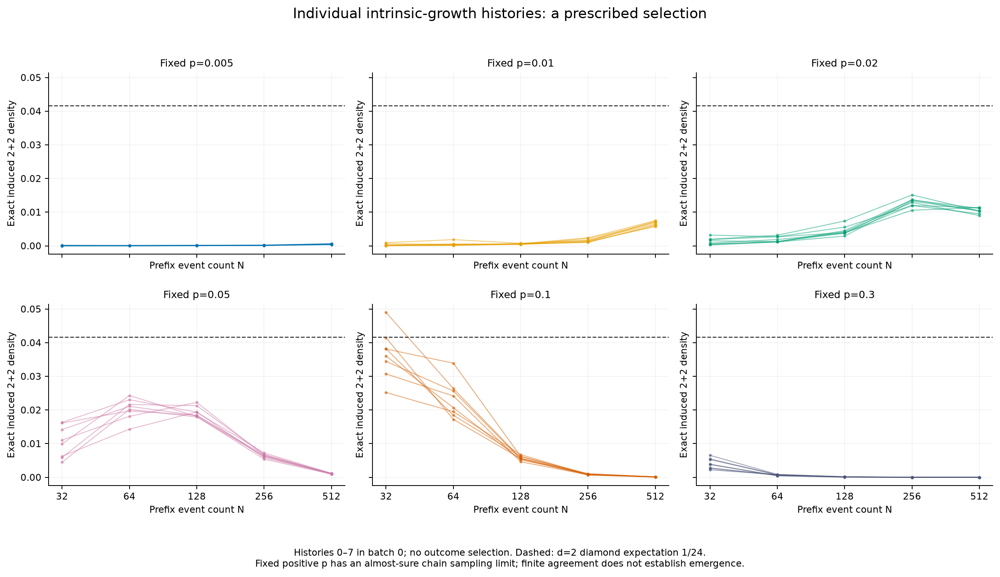
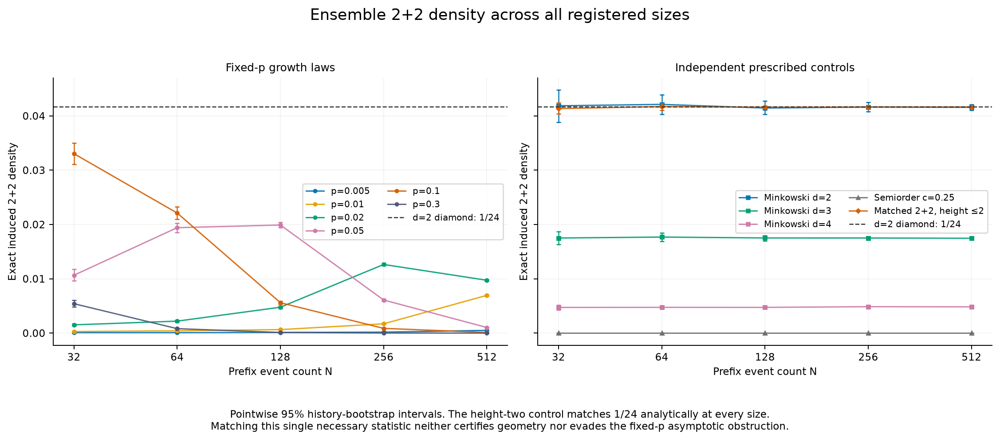
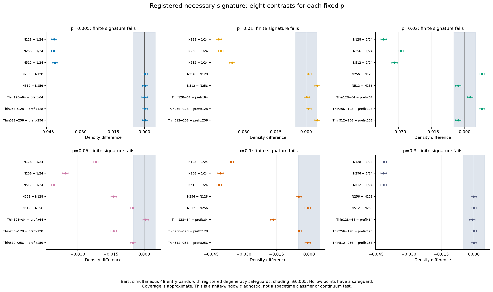
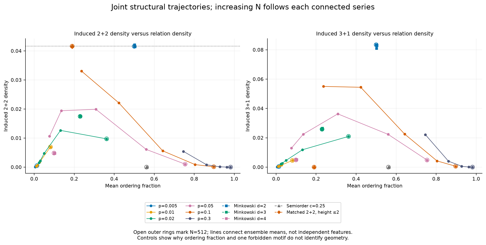
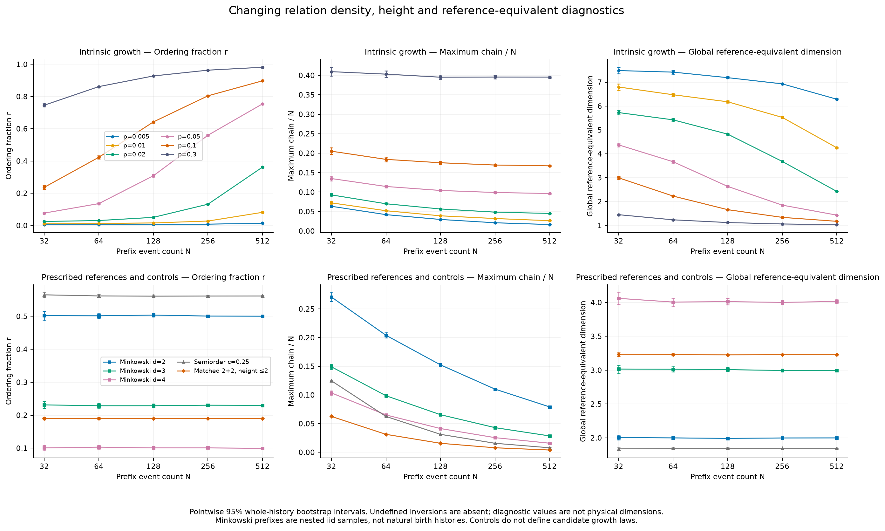
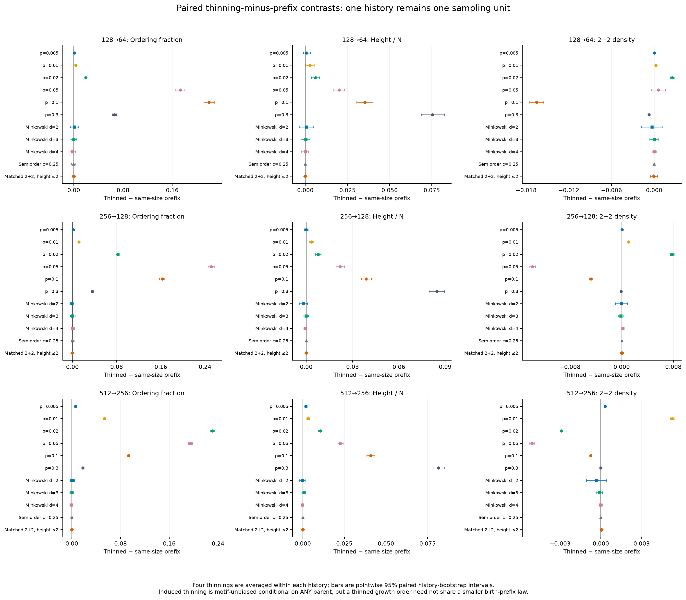
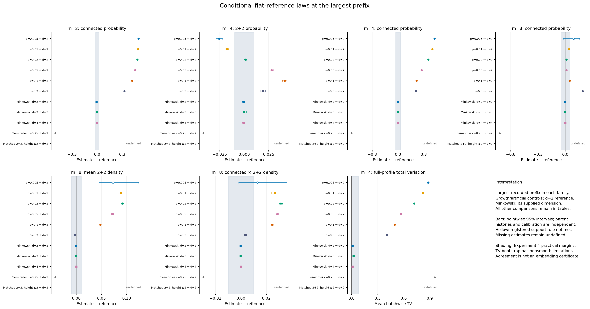
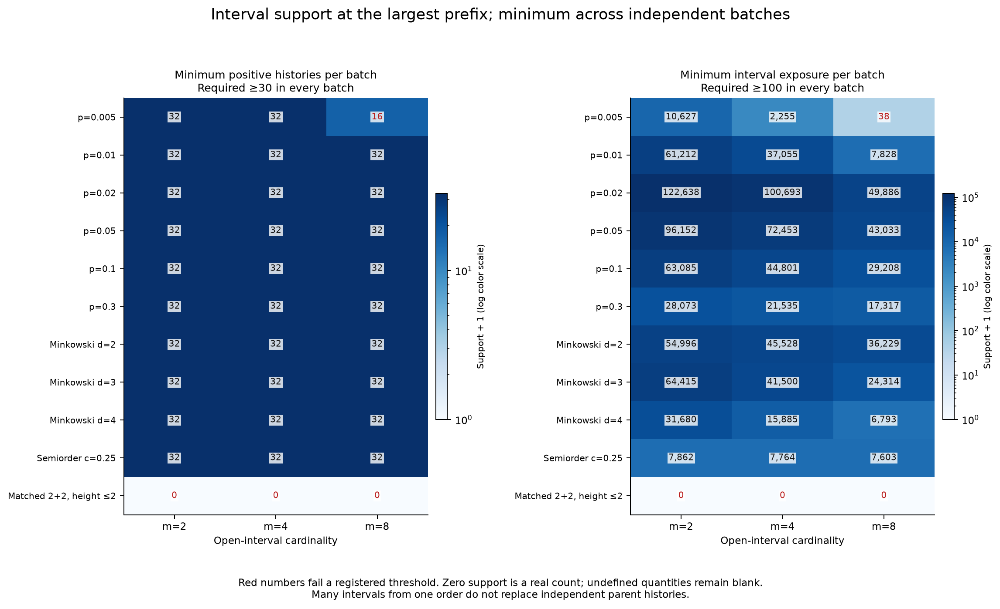
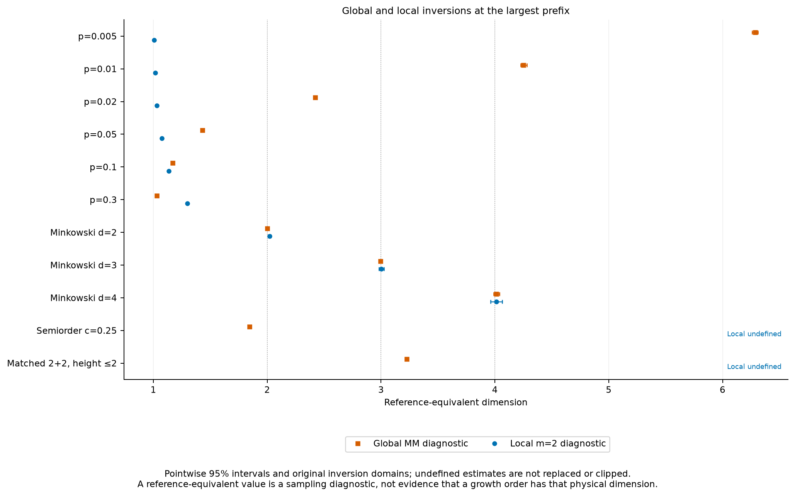

# Experiment 5: background-free causal growth

**Decision: no-go for transitive percolation, or ordinary classical sequential
growth (CSG), as a route to the Minkowski sampling limit studied here.** All six
registered fixed-p models fail the finite signature. This numerical result
agrees with an obstruction known before sampling; it is not a new continuum
theorem. The experiment is useful for showing what a consistent intrinsic law
does generate, why selected geometric-looking summaries are insufficient, and
which information a dense sampling limit can lose.

The independently sampled d=2 reference and the deliberately matched height-two
control both pass the eight-entry signature. The latter has height at most two,
no nonempty open intervals and no induced 3+1. Passing this signature therefore
does not establish geometry. No model was retuned after observing these results.

## Registration, baseline and workload

Experiment 4 PR [#4](https://github.com/raghammer1/causal-spacetime-lab/pull/4) was
merged at `f84153683dd4769f041dad9f2a7181240059ddb2`; its post-merge
[Python 3.10/3.14 CI](https://github.com/raghammer1/causal-spacetime-lab/actions/runs/40164911842)
passed before this branch was created. Prior independent mathematical, code,
archive and visual reviews were verified. GitHub itself had no submitted formal
review; the [protocol](BACKGROUND_FREE_GROWTH_PROTOCOL.md) records that distinction.
All earlier implementations and archives are preserved.

The protocol and [mathematical foundations](BACKGROUND_FREE_GROWTH_THEORY.md)
were committed at `4268ad3` before growth implementation. The timing-only pilot
selected 32 histories per batch, rather than 64, using the registered planning
rule. The [workload note](BACKGROUND_FREE_GROWTH_WORKLOAD.md) and verified source
were committed at `9fbf2d5f979693999b3aff50890b5d1dce1eb138` before primary data.
Its conservative projection was 1147.19 seconds, below the 1500-second planning
threshold. No pilot scientific values were retained or inspected.

The grid contains p=.005,.01,.02,.05,.1,.3, three independent batches, and
N=32,64,128,256,512 from each growing history. Four conditionally independent uniform
half-thinnings of each parent were taken at N=128,256,512. Each of the eleven stochastic
families contributes 96 independent histories and 1,632 dependent records.
There are **1,056 independent stochastic histories and 17,986 records**, including
34 records from two analytically deterministic endpoint histories. The five
comparison families are iid Minkowski diamonds in d=2,3,4, a uniform-utility
semiorder with threshold .25, and the matched height-two control. These comparison
families are explicitly supplied reference laws, not intrinsic CSG candidates.

**A pre-primary implementation failure is retained.** The first smoke run
accidentally reused the originally reserved primary streams. Review caught this
before primary sampling. The workload amendment mechanically reserved the next
unused pair: primary seed 20261027 and independent reference seed 20261028.
Future smoke uses seeds 20261021/20261022 and separate operation phases; pilot
uses 20261024/20261023. Parameters, margins and selection rules were unchanged.
The initial smoke is excluded from every scientific estimate. The independent
provenance audit confirms disjoint primary and smoke history identities.

## What was established before the numerical run

The generator has no coordinates, distance, hidden dimension or target geometry.
At birth j it independently selects each earlier event with probability p and
takes the ancestral closure. Primitive selections and the resulting closed
relation are both retained. For a specified precursor down-set S, with s events
and m maximal events in an n-event parent,

$$
T(C,S)=p^m(1-p)^{n-s}.
$$

All maxima must be selected, all events outside S must be absent, and selections
of redundant ancestors sum to one. Multiplying transitions along a natural
labeling gives `p^L(1-p)^I`, where L counts covers and I incomparable pairs. Thus
different natural birth descriptions of the same order have equal elementary
path weights. An unlabeled class additionally needs the number of inequivalent
natural labelings. This is stronger than merely relabeling a completed matrix.
For 0<p<1, spectator removal preserves competing-transition probability ratios. These
properties belong to this specified law, not to arbitrary custom growth rules.
[Rideout–Sorkin, §§3–5](https://arxiv.org/abs/gr-qc/9904062).

Fixed-p histories are consistent restrictions of one infinite Bernoulli-edge
construction. Separate constant-p_N ensembles change even the first two events'
edge probability and are not that single history. A birth-dependent p gives a
coherent process but generally breaks path covariance: for a three-event
one-edge order, two natural path weights are `a(1-b)^2` and `(1-a)b(1-b)`.
These distinctions were verified exactly, without adding a tuned primary model.

For fixed 0<p<1 and birth separation g, incomparability requires absence of the direct edge and
every two-step path. Writing q=1-p gives

$$
\Pr(i\parallel j)\le q(1-p^2)^{g-1},\quad
E(1-r_N)\le\frac{2 q}{(N-1)p^2},\quad
E[t_{22}(N)]\le\frac{3 q}{(N-1)p^2}.
$$

The last inequality uses `4 t22≤6(1-r)` for every order. Dyadic Markov bounds,
Borel–Cantelli and monotonicity of the incomparable-pair count establish
`r_N→1` almost surely along one fixed-p history. A union bound then gives
`1-t_chain,k≤binom(k,2)(1-r_N)→0` for every fixed k. This is a **chain sampling
limit**, not a proof that the infinite order is a total order. Disjoint adjacent
birth pairs remain incomparable independently with probability q; every chain
must omit one event from each failed pair. Consequently
`limsup H_N/N≤(1+p)/2<1` almost surely for 0<p<1. Dense sampling can forget sparse,
persistent order structure. The bounds can be very loose at N≤512 and do not
predict a monotone finite-size trajectory.

The wider [Brightwell–Georgiou theorem, definitions 1.2–1.3 and theorems 1.4–1.6](https://nicholasgeorgiou.webspace.durham.ac.uk/wp-content/uploads/sites/199/2021/04/contlim.pdf)
applies to their nonnegative-coupling CSG class with `t_0` or `t_1` positive, even
allowing different couplings at each N. Uniform approximation by semiorders in
expected pair-edit distance o(N²) forces the induced 2+2 and 3+1 densities to
vanish. Any limit represented by an atomless ordered probability space in their
definition is an almost-semiorder. The convergence is of expected probabilities
of every finite uniformly sampled labeled suborder, not Lorentzian metric
convergence. A nondegenerate flat diamond in
d≥2 has positive 2+2 probability, so cannot be this limit. This statement does
not cover every modified dynamics or every possible local scaling limit.

All derivations, exact small-order identities, coupling qualifications and primary
references are given in the [foundations](BACKGROUND_FREE_GROWTH_THEORY.md).
They are mathematical checks and established restrictions, not claims of novelty.

## Uncertainty and the registered primary result

For each p, the eight entries are t22 at N=128,256,512 minus 1/24, the two adjacent
prefix drifts, and three paired thinning-minus-smaller-prefix differences. Every
entry has margin±.005. Histories are resampled within each batch; the same weight
travels across all prefixes, local counts and thinnings. Batches are averaged
equally, without an outer resampling of three artificial seed strata. Four
thinnings are averaged before pooling or resampling; they are not four new
histories.

The 2000-draw bootstrap gives a common half-width **.00126466198**, using the
97.5th percentile of the largest absolute centered error over all 48 entries.
Registered zero-event safeguards use a separate .025 allocation; none activated
in these 48 primary cells. Coverage of the bootstrap portion is approximate,
not a proven exact simultaneous 95% statement. Unclipped centered bands may
extend below a density's physical range. Pointwise 95% intervals are separately
labeled and must not replace the registered simultaneous decision bands.

All 18 level bands lie below the target beyond the allowed margin. All six
families therefore fail independently of their drift/thinning outcomes. All 54
batch-specific late-level means also lie below the lower practical reference band.
Across the 48 entries there are 23 contradictions, 19 practical equivalences and
six inconclusive comparisons. The complete bands and batch means remain in
[`primary.json`](experiments/background-free-growth-v1/primary.json) and
[`primary.csv`](experiments/background-free-growth-v1/primary.csv).

| p | t22 N=128 | t22 N=256 | t22 N=512 | 48-entry screen |
|---|---:|---:|---:|---|
| 0.005 | 0.000115947 | 0.000177483 | 0.000505526 | failure |
| 0.01 | 0.000645713 | 0.0017124 | 0.00695585 | failure |
| 0.02 | 0.00476614 | 0.0126415 | 0.00973045 | failure |
| 0.05 | 0.019909 | 0.00609644 | 0.0010332 | failure |
| 0.1 | 0.00560156 | 0.000869939 | 0.000121488 | failure |
| 0.3 | 0.000111606 | 1.40033e-05 | 1.76775e-06 | failure |

Some small-p densities are still increasing at N=512, while others have turned
over. For p=.02, t22 rises from .004766 at 128 to .012642 at 256, then falls to .009730
at 512. For p=.005 it rises throughout the registered range. These are finite
crossovers, not evidence against the proved limit and not evidence that every
history has already reached an asymptotic regime. Histories numbered 0..7 in
batch 0 were plotted by advance specification, not selected for attractive paths.







## Other observables and deliberately misleading controls

The following table reports N=512 ensemble means. Motif intervals here are
**pointwise 95%**, rather than the primary 48-entry bands. Complete r, H, H/N,
H/sqrt(N), overlap, motif and uncertainty tables at all eight cells are in
[`global.csv`](experiments/background-free-growth-v1/global.csv). Every raw
interval-cardinality histogram and connected-interval profile is retained.

| Family | r N=512 | Mean H N=512 | t22 N=512, pointwise 95% CI | t31 N=512, pointwise 95% CI |
|---|---:|---:|---|---|
| percolation 0.005 | 0.0139659 | 8.47917 | 0.000505526 [0.000486422, 0.000525348] | 0.000384011 [0.000366616, 0.000403051] |
| percolation 0.01 | 0.0814063 | 13.5625 | 0.00695585 [0.00677944, 0.00712082] | 0.00454464 [0.00438098, 0.00470242] |
| percolation 0.02 | 0.362078 | 23.0833 | 0.00973045 [0.00958021, 0.00986986] | 0.0209428 [0.0207196, 0.0211814] |
| percolation 0.05 | 0.754479 | 49.3021 | 0.0010332 [0.0010082, 0.00105915] | 0.00482333 [0.00472537, 0.0049272] |
| percolation 0.1 | 0.89757 | 85.7604 | 0.000121488 [0.000118852, 0.00012415] | 0.000611294 [0.000598523, 0.000624098] |
| percolation 0.3 | 0.981585 | 202.552 | 1.76775e-06 [1.71496e-06, 1.81795e-06] | 9.91906e-06 [9.59391e-06, 1.02662e-05] |
| minkowski 2 | 0.500206 | 40.5 | 0.0415792 [0.0410465, 0.042115] | 0.0834362 [0.0830286, 0.0838333] |
| minkowski 3 | 0.229754 | 14.5833 | 0.0174646 [0.0172421, 0.0176903] | 0.0258381 [0.0254982, 0.0261865] |
| minkowski 4 | 0.0992771 | 8.07292 | 0.00483808 [0.00472173, 0.00495214] | 0.00490695 [0.00474067, 0.00507963] |
| semiorder 0.25 | 0.56156 | 4 | 0 [0, 0] | 0 [0, 0] |
| Matched 22 control | 0.190057 | 2 | 0.0416365 [0.0415809, 0.0416905] | 0 [0, 0] |

At p=.3,98.16% of pairs are comparable, yet the mean longest chain contains only
202.55 of 512 events, or 39.56% [39.24%,39.88%]. This illustrates the distinction
between nearly total dense sampling and a nearly spanning chain. No height
scaling exponent or Lorentzian metric is fitted from five sizes. Endpoint p=0
is an antichain with H=1 and undefined ordering-fraction inversion; p=1 is a
chain with H=N. They are exact controls, not repeated stochastic evidence.

The matched control uses independent fair lower/upper labels and cross-layer
edge probability

$$
q_b=\frac{1-\sqrt{1-4/(3\sqrt 2)}}2=.3804268441\ldots.
$$

A four-set has two events of each type with probability 6/16, and its 2+2
probability conditional on that split is `2 q_b²(1-q_b)²`. Thus
`E[t22]=(3/4)q_b²(1-q_b)²=1/24` at every N≥4. It has H≤2, t31=0 and every open
interval empty. Both its separately labeled eight-entry screen and the d=2
reference's screen pass, with their own eight-entry simultaneous bands.
The agreement is built into an explicit control law; it does not demonstrate
emergence or make the control an intrinsic growth model.

As a secondary exact analytical check made while reviewing the fixed study,
the d=2 ranking law also gives `E[t31]=2/24=1/12`: the only four-point rank
permutations forming 3+1 are `[3,0,1,2]` and `[1,2,3,0]`. This does not add a new
primary decision rule. The full law-equivalence between two random rankings
and d=2 diamond sampling remains exact; order-only analysis cannot identify
which of those equivalent constructions supplied an order.

The threshold .25 semiorder has both forbidden motifs exactly zero and
`E[r]=(1-.25)²=9/16`; sampled heights at 512 were all 4. Its nontrivial ordering
fraction does not establish a Minkowski interpretation; its forbidden-motif zeros
exclude the specified nondegenerate diamond sampling law. Zero motif values in
these two controls have mathematical explanations; a zero-width bootstrap
interval alone would not establish an exact stochastic identity.





## Prefixes and thinning test different consistency properties

For every fixed parent order C and uniform m-event subset S, a k-event motif
occurrence survives with probability `binom(m,k)/binom(N,k)`. Therefore
`E[t_F(C|S)|C]=t_F(C)` for **every** parent, geometric or otherwise. This identity
requires restriction of the closed relation. Deleting primitive edges and
reclosing would incorrectly erase relations mediated by removed events.

The relevant paired comparison is thinned N against the same history's N/2
birth prefix. They are not the same law for percolation. For example, the
p=.02,256→128 t22 contrast is+.0078083 with simultaneous band[.0065437,.0090730];
p=.05 gives−.0138030 [−.0150677,−.0125383] at the same sizes; p=.1,128→64 gives
−.0165214 [−.0177861,−.0152567]. These three thinning contrasts contradict the
±.005 margin. Other small contrasts do not rescue the failed level tests.

At 512→256 the ordering-fraction contrast is positive for every registered p;
its pointwise interval excludes zero in all six cases. For p=.02 it is+.230184
[.226936,.233641], while its t22 contrast−.002894 is within the practical margin.
Height fractions also change. Joint behavior matters: agreement of one motif's
mean does not establish exchangeability, projectivity under thinning, or a
controlled coarse-graining limit. All paired uncertainty and support is retained
in [`global_contrasts.csv`](experiments/background-free-growth-v1/global_contrasts.csv)
and [`conditional_contrasts.csv`](experiments/background-free-growth-v1/conditional_contrasts.csv).



## Conditional local laws, joint patterns and failed information

The conditional estimands are within-batch sum(B)/sum(A), then equal batch means.
Three fresh independent reference fits use 5000 four-event and 2000 eight-event
diamond samples for each of d=3,d=4. The d=2 reference uses exact 24/40320 permutation
tables. One calibration bootstrap per(batch,d) is shared across every comparison
using that law; it cancels from paired conditional-probability differences.
Support requires 30 positive histories and 100 mean interval exposures in **each**
batch. Missing intervals remain missing, not zeros or automatic compatibility.

At N=512 all 21 own-reference comparisons for the three Minkowski controls meet
the seven registered pointwise practical margins. Every growth family, however,
contradicts at least one well-supported conditional law against each of d=2,d=3,d=4.
The matched height-two control has no nonempty intervals; all its conditional
comparisons are insufficient-information outcomes. For p=.005 the size-eight
support is only 16,17,18 positive histories and 38,68,60 intervals per batch,
so all its m=8 comparisons remain insufficient despite numerically large residuals.

Selective agreement is retained. For p=.02 at 512, the size-four 2+2 probability
is .0427205, difference from d=2+.0010539 with CI[−.0001544,.0022007], and the
size-eight connectivity probability also meets its margin. Yet the full
size-four profile has TV=.719819, and the size-eight joint connected×2+2
density differs by+.0314691 [.0304103,.0325654], outside its±.01 margin.
Thus matching individual local summaries leaves strong joint disagreement;
these comparisons are structural diagnostics, not a newly trained classifier.

Global and local inversions can also disagree sharply. The table below calls
them **reference-equivalent dimensions**: neither is an inferred physical
dimension of the growth/control model. Global entries average defined per-history
inversions; six p=.005 prefix N=32 histories have out-of-domain global inversions
and are retained as missing. All other stochastic raw records have a defined
global inversion. Local entries invert the pooled size-two connectivity probability.
The different estimands and sampling assumptions must not be conflated.

| Family | Global reference-equivalent d, pointwise 95% CI | Local reference-equivalent d, pointwise 95% CI |
|---|---|---|
| percolation 0.005 | 6.28611 [6.26093, 6.30984] | 1.00681 [1.00572, 1.0079] |
| percolation 0.01 | 4.25235 [4.22546, 4.28094] | 1.0165 [1.0158, 1.01724] |
| percolation 0.02 | 2.42308 [2.40995, 2.4352] | 1.03133 [1.03058, 1.03206] |
| percolation 0.05 | 1.43046 [1.42657, 1.43443] | 1.07422 [1.07258, 1.0757] |
| percolation 0.1 | 1.1711 [1.16972, 1.17251] | 1.13667 [1.13389, 1.13933] |
| percolation 0.3 | 1.03012 [1.02978, 1.03046] | 1.29795 [1.29034, 1.30507] |
| minkowski 2 | 1.99981 [1.99334, 2.00586] | 2.01985 [2.0074, 2.03278] |
| minkowski 3 | 2.99544 [2.98198, 3.00922] | 3.00235 [2.98059, 3.02414] |
| minkowski 4 | 4.01449 [3.98952, 4.03921] | 4.01279 [3.96333, 4.06358] |
| semiorder 0.25 | 1.84391 [1.84003, 1.84755] | undefined [undefined, undefined] |
| Matched 22 control | 3.22684 [3.22551, 3.22821] | undefined [undefined] |

**Adverse genuine-control results are preserved.** The d=2 local estimate 2.01985
[2.00740,2.03278] excludes the generating value 2 pointwise, even though its
connected 2 residual−.0073973 [−.0121647,−.0027670] lies inside the practical±.02
margin. Across the full secondary grid, d=2 N=32 TV=.0870771 has a percentile
interval[.100563,.147499], and formally contradicts the .08 margin despite being
a known geometric control. Its support is adequate. This is a false rejection
by that secondary rule, not a failure of the exact conditional-law theorem.

The TV statistic is nonnegative and nonsmooth; its bootstrap is positively
biased near zero. All three N=512 reference TV intervals even have lower bounds
above their point estimates. These intervals do not supply a validated exact-law
test. Multiple pointwise checks, finite samples, nonlinear inversions and only
three calibration fits further limit interpretation. No correction, extra fit
or new sample was selected to remove these adverse outcomes. Across all 56
own-reference cells/metrics per dimension, the recorded counts are:

| Reference | Equivalent | Contradicts | Inconclusive | Insufficient information |
|---|---:|---:|---:|---:|
| d=2 |47|1|8|0|
| d=3 |45|0|5|6|
| d=4 |35|0|2|19|

The semiorder's sampled small intervals give zero connectivity and an
out-of-domain local inversion; this observed secondary[0,0] bootstrap range is
not a proof that every possible small interval is disconnected. Its globally
forbidden motifs, by contrast, are exactly absent by the semiorder theorem.
The matched control's local inversion is undefined because intervals are absent.
Full outcomes, all candidate reference dimensions, support and undefined
resamples are in [`summary.json`](experiments/background-free-growth-v1/summary.json)
and [`conditional.csv`](experiments/background-free-growth-v1/conditional.csv).







## Verification, reproducibility and retained artifacts

The implementation passed 813 tests, including every forward primitive DAG
through five events against independent Floyd–Warshall closure; all small-order
downsets and natural histories; transition normalization; spectator ratios;
relabeling; same-seed extension through 512; thinning of closed relations; and
independent exhaustive 2+2/3+1 counts. Test fixtures also verify shared resampling
weights, calibration reuse, missing support, constant-sample safeguards,
deterministic serialization and retention of partial failures.

An independent archive audit checked all 32 manifest artifacts and all 17,986 row
identities/grids. A fixed outcome-independent selection, batch 0/history 0 in all
eleven families plus endpoints, reconstructed 13 histories and 221 records. It
verified independent n22, n31, ordering and height, 156 thinning index replays,
221 motif replays and 7,072 four-subset classifications, with zero failures.
The provenance audit verified all 29 source/protocol/workload hashes, the frozen
configuration and all reference fit seeds/counts. The count audit does not
recompute bootstrap intervals. A separate statistical
reconstruction, without importing `growth_statistics`, independently rebuilt
raw history clusters and bootstrap streams, checking 4,877 points, intervals,
contrasts and the simultaneous width to 2e-12 tolerance with zero discrepancies.
Its [script](../scripts/review_growth_statistics.py) and
[detailed report](experiments/background-free-growth-v1/verification/statistics_review.md)
are retained.

A complete second run reproduced the scientific digest and all 31 nonmetadata
writer-owned artifacts **byte for byte**, including all nine figures. Both runs
record clean source commit `9fbf2d5f979693999b3aff50890b5d1dce1eb138`:

```
534c51d1745f4d370a87ced03b895b5ff935e3811a362f9349554b164f0a57da
```

| Run | Compute | Total including artifacts | Conservative aggregate peak RSS |
|---|---:|---:|---:|
| Primary |638.75 s|664.97 s|1,066,713,088 bytes|
| Full repeat |647.64 s|673.50 s|1,073,414,144 bytes|

Both satisfy the 2700-second / 4 GiB limits. Memory accounting includes root
serialization/rendering and a conservative worker-count multiple of the largest
completed-child/reported peak. These are resource measurements, not independent
scientific samples. Runtime checks between histories and final checks preserve
completed artifacts on failure; they are not operating-system hard quotas.
The recorded environment is Python 3.14.4, NumPy 2.5.4, Matplotlib 3.11.2 on macOS.
Frozen-source [Python 3.10/3.14 CI](https://github.com/raghammer1/causal-spacetime-lab/actions/runs/40167871933)
also passed. Full replay, numerical/provenance/statistical audit evidence and the
visual review are retained in the [verification directory](experiments/background-free-growth-v1/verification/README.md).

The [archive manifest](experiments/background-free-growth-v1/manifest.json)
covers raw family shards, primitive growth edges, reference/control reconstruction
data, saved thinning indices, exact observables, full sampled motif vectors with
conditional Monte Carlo variance, calibration outcomes, every failed/inconclusive
comparison, figures and machine metadata. Raw records are gzip JSON lines;
summary and reference data are JSON; flat tables are CSV with LF endings.
Primary n22 and n31 are exact. The other global four-event frequencies use 4096
draws per recorded order; their finite sampling noise is retained and does not
turn correlated motifs into independent evidence.

```bash
python -m pip install -e '.[dev]'
python -m pytest -q
python -m causal_lab.growth_study --smoke --workers 1 --output results/growth-smoke
python -m causal_lab.growth_study --histories 32 --workers 3 --output results/growth-primary
python -m causal_lab.growth_audit results/growth-primary --output results/growth-audit.json
python scripts/review_growth_statistics.py results/growth-primary --output-prefix results/growth-statistics-review
python -m causal_lab.growth_study --histories 32 --workers 3 --output results/growth-repeat
```

Use empty output directories: previous results are never overwritten. For exact
reproduction use the archived source commit and recorded Python/NumPy versions.
The digest excludes timings, process IDs, provenance and rendered images; the
manifest still checks those files. Bitwise equality across untested library
versions/platforms is not asserted. CI runs only the bounded smoke and unit suite.

## Scientific go/no-go and unresolved requirements

The model successfully generates coherent causal orders without supplied geometry.
It does not support a Minkowski continuum candidate. Independent parent selection
and transitive closure make sufficiently separated births comparable; the
remaining incomparabilities occupy a vanishing fraction of pairs for fixed p.
Changing separate finite-N parameters can preserve a nontrivial pair fraction
but does not escape the ordinary-CSG semiorder restriction. Recognizing a few
familiar statistics cannot repair this structural obstruction.

**Stop parameter or classifier optimization within this baseline.** A limited
go is justified for mathematical design of a different intrinsic dynamics or a
different precise limit, only after identifying which assumption changes and
why. A new kernel needs normalization, compatible prefixes and genuine birth
covariance; any change to Bell causality or other CSG assumptions must be explicit.
Local-feature dependence does not automatically satisfy those conditions.

A controlled geometric limit would additionally require a stated order-and-measure
convergence notion, concentration beyond a finite feature list, embedding or
intrinsic reconstruction with quantified existence and approximate uniqueness,
and separation of discreteness, mesoscopic and curvature/density scales. Boundary
effects, locality and universality need their own controls. Lorentz behavior,
gravitational equations and quantum dynamics remain separate questions. The
finite matched control and the chain-sampling/height distinction explain why
even strong-looking convergence statements leave these requirements unresolved.

No result here establishes physical discreteness, emergent spacetime, Einstein
dynamics, quantum gravity or singularity resolution.
