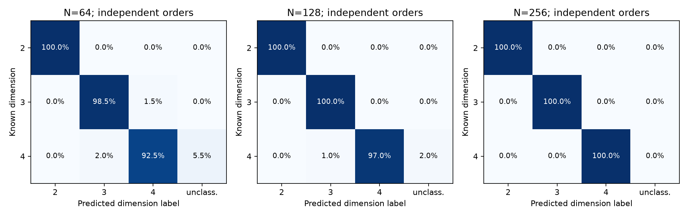
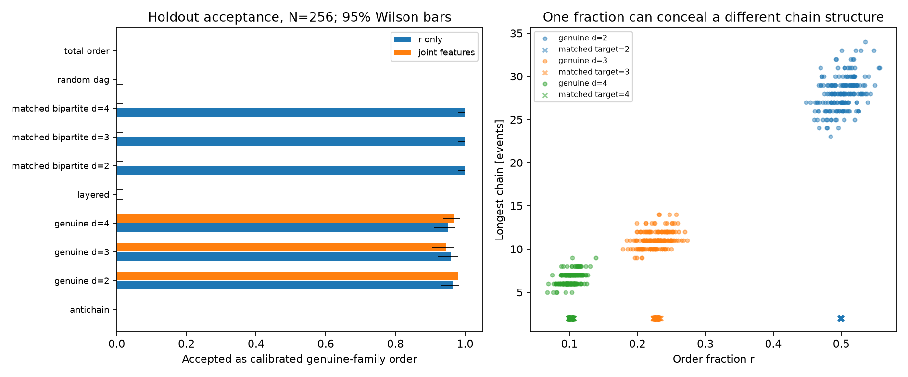

# Experiment 2: dimension reconstruction and its limits

2026-10-25. **Numerical conclusion:** causal order reconstructs the dimension of
the tested uniform flat-spacetime samples accurately, but an artificial order can
imitate the ordering fraction and fool the estimator. Additional order observables
improve rejection of the selected adversaries; they still do not identify geometry
uniquely or certify manifoldlikeness.

**Recovering dimensionality from causal order sampled inside a known geometry
does not prove that physical spacetime emerges from causal relationships.**

## Protocol, implementation and executed workload

PR #1 was verified merged at `7bfac9e`; its 81 tests and all archived Experiment 1
artifact checksums passed. Work began on `experiment/dimension-reconstruction-v1`
without modifying `main`. The [protocol](DIMENSION_RECONSTRUCTION_PROTOCOL.md) and
[mathematical derivation](DIMENSION_THEORY.md) were committed as `b9b5488` before
the resource pilot or primary/calibration study ran.

The implementation adds:

- Independent uniform Alexandrov-interval generators in spacetime dimensions
  d=2,3,4, with fixed-count and optional correctly normalized Poisson-count APIs.
- Strict Lorentzian ordering, validated partial orders and bounded Myrheim–Meyer
  inversion. The estimator takes only a matrix; neither coordinates nor the true
  dimension enter inference. Undefined/out-of-domain estimates retain explicit status.
- Order-only height, relation abundance and exact internal-interval cardinality
  histograms, including link fractions and normalized interval features.
- Total orders, antichains, layered orders, explicitly closed random DAGs and
  fraction-matched two-layer controls calibrated on separate data.
- Whole-order uncertainty, held-out dimension classification, an exploratory
  jointly scored detector, separate resource measurements and provenance.

The fixed primary grid used d=2,3,4, N=64,128,256, T=1, seed **20261025**, and
**200 independent orders per cell: 1,800 primary samples**. There were also
**900 separate calibration samples** and **3,006 controls**: 1,800 matched
two-layer orders, 600 random-DAG orders, 600 three-layer orders and six exact
total/antichain examples. The resulting **5,706 orders** have losslessly retained
interval histograms; calibration is not pooled with primary results.

The separate resource pilot used seed 20261024 and the registered small workload.
Its 1.18-second computation and 134.8 MiB peak process RSS supported proceeding
unchanged. No pilot scientific outcomes were used to choose favorable parameters.
No larger-N extension was added: the requested grid already resolved the stated
accuracy target, and increasing N alone would not resolve the adversarial failures.

## Data and figures

Reviewed artifacts, approximately 3.0 MB, are under
[experiments/dimension-reconstruction-v1/](experiments/dimension-reconstruction-v1/):

- [Primary/control raw CSV](experiments/dimension-reconstruction-v1/raw.csv),
  [calibration CSV](experiments/dimension-reconstruction-v1/calibration.csv), and
  [lossless full interval histograms](experiments/dimension-reconstruction-v1/interval_histograms.csv.gz).
- [Summary CSV](experiments/dimension-reconstruction-v1/summary.csv) and
  [JSON](experiments/dimension-reconstruction-v1/summary.json), including mean,
  variance, SD, SE, bootstrap intervals, bias, accuracy, Wilson intervals and failures.
- [Calibration model and adversary parameters](experiments/dimension-reconstruction-v1/calibration_model.json),
  [diagnostics](experiments/dimension-reconstruction-v1/diagnostics.json),
  [confusion data](experiments/dimension-reconstruction-v1/confusion.csv),
  [benchmarks](experiments/dimension-reconstruction-v1/benchmarks.csv),
  [metadata](experiments/dimension-reconstruction-v1/metadata.json), and
  [pilot resource assessment](experiments/dimension-reconstruction-v1/pilot_assessment.json).
- Six figures: [ordering fraction](experiments/dimension-reconstruction-v1/ordering_fraction.png),
  [dimension recovery](experiments/dimension-reconstruction-v1/dimension_recovery.png),
  [bias and spread](experiments/dimension-reconstruction-v1/bias_vs_count.png),
  [confusion matrices](experiments/dimension-reconstruction-v1/confusion.png),
  [adversaries](experiments/dimension-reconstruction-v1/adversaries.png), and
  [resources](experiments/dimension-reconstruction-v1/resources.png).

The first two figures slightly offset dimension positions to distinguish N; those
offsets are visual only. All error bars and axes state whether they represent
uncertainty in a mean, independent-order classification rates or observed spread.

## A. Can order recover dimension in an already-known flat spacetime?

**Yes, within these assumptions and tested sizes.** Uniform spacetime volume,
flat Alexandrov boundaries, and strict timelike relations give
`E[r]=Gamma(d+1)*Gamma(d/2)/(2*Gamma(3*d/2))` for `r=R/binom(N,2)`.
The derivation and independent numerical integration verify 1/2, 8/35 and 1/10.
The [primary-source convention](https://arxiv.org/pdf/1212.0631) uses half this
value when relations are normalized by the squared mean count instead.

Below, intervals for mean inferred dimension are pointwise 95% percentile
bootstrap intervals from 2,000 resamples of entire orders. Accuracy intervals are
95% Wilson intervals on 200 independent classifications. SD is per-order spread,
not uncertainty in the ensemble mean.

| True d | N | Mean r | Mean inferred d [95% interval] | SD | Accuracy [95% Wilson] |
|---:|---:|---:|---:|---:|---:|
| 2 | 64 | 0.49811 | 2.0093 [1.9932, 2.0254] | 0.1160 | 100.0% [98.1%, 100.0%] |
| 2 | 128 | 0.50001 | 2.0021 [1.9908, 2.0134] | 0.0822 | 100.0% [98.1%, 100.0%] |
| 2 | 256 | 0.50109 | 1.9980 [1.9906, 2.0057] | 0.0547 | 100.0% [98.1%, 100.0%] |
| 3 | 64 | 0.22969 | 3.0088 [2.9817, 3.0367] | 0.1987 | 98.5% [95.7%, 99.5%] |
| 3 | 128 | 0.22841 | 3.0084 [2.9878, 3.0286] | 0.1413 | 100.0% [98.1%, 100.0%] |
| 3 | 256 | 0.22630 | 3.0161 [3.0029, 3.0297] | 0.1001 | 100.0% [98.1%, 100.0%] |
| 4 | 64 | 0.09957 | 4.0383 [3.9989, 4.0787] | 0.2891 | 92.5% [88.0%, 95.4%] |
| 4 | 128 | 0.10172 | 4.0005 [3.9696, 4.0320] | 0.2286 | 97.0% [93.6%, 98.6%] |
| 4 | 256 | 0.10138 | 3.9914 [3.9715, 4.0107] | 0.1389 | 100.0% [98.1%, 100.0%] |



No primary estimate was undefined or outside the inversion domain [1,10]. The
ordering-fraction means were at most 1.77 empirical SEs from the analytic values;
none reached the predeclared five-SE investigation threshold. This diagnostic
does not establish an exact distributional goodness-of-fit or a simultaneous test.

The estimator is not exactly unbiased: for d=3,N=256 the pointwise interval for
mean bias is [0.0029,0.0297], entirely above zero. All nine mean-bias intervals
nonetheless lie inside the registered ±0.10 tolerance. The inverse of mean r and
the mean of individual inverses are distinct quantities, both retained in summaries.

## B. How many events were enough by the stated accuracy criterion?

At N=256 every dimension had 200/200 correct labels, with per-class Wilson lower
bound 98.1%, exceeding the registered 90% target. **N=128 was the smallest tested
count that supported this target for all three dimensions.** At N=64, d=2 and
d=3 supported it, while d=4 was inconclusive: observed 92.5% accuracy but a lower
bound of 88.0%. This does not locate a universal minimum or say that exactly 128
events are necessary; intermediate counts and other model assumptions were not tested.

Classification uses nearest label 2,3,4 only inside [1.5,4.5], otherwise
unclassified. At N=64, three d=3 samples were labeled 4, four d=4 samples were
labeled 3 and eleven d=4 samples were unclassified. At N=128, two d=4 samples
were labeled 3 and four were unclassified. These failures remain in the accuracy
denominator. They are valid finite-domain estimates, not hidden numerical failures.

Spread decreased with N for every dimension. Mean bias was not strictly monotonic:
the d=3 sample bias rose between N=128 and N=256, with overlapping uncertainty
intervals. There is no resolved adverse size drift from these comparisons, and
neither monotonic bias nor an asymptotic convergence rate is established.

## C. Can artificial orders fool the dimension estimator?

**Yes.** The balanced two-layer adversary fits only q using the mean r of separate
calibration sprinklings. Its relations connect lower to upper events, so height
is at most two and every existing relation is a link. No holdout outcome influences q.
All nine fitted q values were inside their allowed range; no saturation was needed.

All **1,800 matched holdouts** received their target dimension label and passed
the calibrated r-only detector. All nine mean-r differences met the predeclared
absolute 0.02 matching tolerance; the largest difference was 0.00445. This is
approximate mean matching, not equality of full distributions. In particular,
d=4,N=64 had adversary-minus-genuine r difference 0.00445 with interval
[0.00094,0.00782], excluding zero despite satisfying the operational tolerance.

For illustration at N=256:

| Generator/family | Dimension or target | Mean height | Mean link fraction | Mean internal interval cardinality |
|---|---:|---:|---:|---:|
| Genuine flat interval | 2 | 28.065 | 0.06493 | 28.177 |
| Genuine flat interval | 3 | 11.125 | 0.26712 | 8.245 |
| Genuine flat interval | 4 | 6.560 | 0.54232 | 2.410 |
| Matched two-layer | 2, 3 or 4 | 2 | 1 | 0 |

A separate exact unit-test counterexample is a 20-event outward star: 19 of its
190 pairs are comparable, so r=0.1 and the estimator returns d=4, while height
is two and all internal intervals are empty. These examples establish a limitation
of the statistic, not the geometric dimension of those artificial orders.

Other controls behave distinctly. Total orders return the domain boundary d=1;
antichains produce explicit out-of-domain status, not a fabricated large dimension.
Three-layer controls yield mean estimates about 1.61. Random-DAG means rise from
4.63 to 5.34 to 6.08 as N grows under the chosen edge rule. Such values do not
assign a physical dimension to those orders. The nearest-label classifier and
the genuine-family detector are separate procedures and must not be conflated.

## D. Do joint observables help, and where do they fail?

The exploratory detector combines r, height/N, link fraction, normalized mean
internal cardinality and the fraction of intervals with at least four internal
elements. It uses fixed, separately fitted dimension templates and a held-out
calibration threshold. R itself is redundant with r at fixed N, and is not counted
as a second independent feature; the interval features are also correlated.

It rejected all 1,800 matched controls while accepting 90–98% of genuine samples
across the nine cells. Per 200-trial matched cell, r-only acceptance was 100%
(Wilson [98.1%,100%]) and joint acceptance 0% (Wilson [0%,1.9%]). The observed
100-percentage-point rejection gain supports the registered exploratory criterion
for these families, with the genuine-acceptance requirement also met.

The matched adversaries deliberately have an obvious height/interval mismatch.
No feature ablation was performed, so this does not show that all five features
are individually necessary, or that the same improvement holds for harder controls.

**The joint detector is not uniformly stronger.** At N=64 it accepted **49/200
random-DAG controls**, 24.5% (Wilson [19.1%,30.9%]), compared with 135/200,
67.5% ([60.7%,73.6%]), for r alone. The paired rejection gain was 43 percentage
points with bootstrap interval [32,53]. Yet the paired outcomes expose a tradeoff:

| r-only decision | Joint accepted | Joint rejected |
|---|---:|---:|
| Accepted | 13 | 122 |
| Rejected | 36 | 29 |

Thus 36 previously rejected controls became accepted. All 49 joint survivors
had unclassified Myrheim–Meyer labels under the fixed [1.5,4.5] classification
rule; do not describe detector acceptance as a successful d=4 label. The score
permits tradeoffs among standardized features and is not an intersection of tests.
This adverse outcome is preserved without retuning features or thresholds.

At N=128 and 256 both detectors rejected every sampled random DAG; both also
rejected all layered controls. Their observed rejection improvements were zero,
so those comparisons are inconclusive about added benefit. Genuine acceptance
is not guaranteed to equal the nominal 95% calibration quantile: the r-only
detector fell to 86% in one genuine cell and the joint detector to 90%.

Finally, the nonisomorphic three-event V order and its dual have identical r,
height and complete interval-cardinality histograms, hence identical selected
features. Their numbers of minimal elements differ, so they are distinct directed
orders. This exact example proves that the chosen summaries are not a complete
invariant; it does not say that all possible order statistics are indistinguishable.



Detector intervals condition on the frozen calibration fit. They **do not** include
refitting uncertainty, new calibration seeds or unrestricted adversary families.
Pointwise bootstrap intervals for a constant observed success vector can be
degenerate; nondegenerate Wilson intervals remain necessary. Passing these finite
checks is not proof that an order is manifold-like.

## E. What is still missing for background-free emergence?

Here the generator presupposes the metric, dimension, region and uniform measure.
Reconstruction shows information in samples from that construction. A next model
would need a rule acting only on orders, explicit transition probabilities,
label-invariant observables and a justified limiting procedure. Its joint signatures
must persist across sizes and seeds and survive controls that match more than r.
The surviving DAGs and V/dual ambiguity show why a single successful score cannot
be taken as emergent geometry. Dynamics and observational relevance remain separate
requirements even if several continuum-like statistics eventually emerge.

## F. What is needed for curvature and eventual black-hole geometry?

A curved-background benchmark first needs the correct invariant volume element,
well-defined intervals, independent continuum causal/geodesic calculations and
recovery of the flat limit. Finite size, density variation, boundaries and curvature
must be separated. The flat Myrheim–Meyer formula cannot simply be assumed valid
in general curvature; [Roy, Sinha and Surya](https://arxiv.org/abs/1212.0631)
explicitly investigate curvature-dependent chain relations.

A black-hole model would further need consistent gravitational dynamics, controlled
continuum and exterior limits, gravitational time dilation and observational
constraints. A causal horizon is not a black-hole solution. No curved or black-hole
model, Einstein dynamics, or singularity-resolution claim is introduced in this PR.

## Runtime, verification and provenance

The archived full run took **27.36 s** for calibration, simulation, bootstrap,
diagnostics and benchmarks, plus **1.95 s** to write outputs. These timers exclude
interpreter/import startup. Peak process RSS through output generation was
**159,219,712 bytes (151.8 MiB)** on Darwin arm64, Python 3.14.4, NumPy 2.5.4,
Matplotlib 3.11.2. The separate pilot projected roughly 60 s by order-count scaling;
no resource-driven protocol change was required.

Representative phase measurements, averaging nine calls per N across three
dimensions and three independent benchmark samples each:

| N | Phase | Mean untraced time | Observed min–max | Mean peak newly traced allocations |
|---:|---|---:|---:|---:|
| 64 | Order-only validation, inference and features | 0.956 ms | 0.689–1.282 ms | 41.65 KiB |
| 128 | Order-only validation, inference and features | 2.566 ms | 1.539–3.966 ms | 97.61 KiB |
| 256 | Coordinate generation | 0.094 ms | 0.058–0.132 ms | 20.71 KiB |
| 256 | Construct causal-order matrix | 0.651 ms | 0.367–0.894 ms | 2048.74 KiB |
| 256 | Order-only validation, inference and features | 8.307 ms | 4.195–13.401 ms | 193.55 KiB |

Memory passes use tracemalloc separately from timing on identical deterministic
samples. Traced allocations exclude retained inputs and can miss native allocation;
they are not process RSS or additive phase peaks. Matrix storage is quadratic,
the study enforces N≤512, and no large-N complexity exponent is inferred here.

**253 tests pass**, preserving all prior tests. Validation includes independent
geometric quadrature, exact volume/probability values, distribution moments,
Lorentz/rotation/translation/rescaling and relabeling invariance, old/new d=2
agreement, malformed/cyclic structures, inversion failures, exhaustive tiny-DAG
closure/interval checks, statistical calculations, calibration/holdout separation,
injected consistency failures, deterministic streams and CLI artifact integrity.
CI runs the suite, Experiment 1 CLIs and a small Experiment 2 smoke workload on
Python 3.10 and 3.14; it does not repeat the full research study per commit.

Independent review reconciled every histogram, all 30 summary groups, fitted
parameters, template scales, held-out thresholds and 4,806 holdout decisions.
Calibration and holdout sample IDs are disjoint. Only the three deterministic
antichains have out-of-domain estimates; no stochastic sample was silently dropped.
All six plots were visually inspected. Complete repeats, including the final run after trailing-whitespace cleanup, produced byte-identical
scientific tables, models, diagnostics, compressed histograms and five scientific
figures. Timing, resource plots and metadata are intentionally variable.

Scientific digest:

`296324854c7d36a103994c64e3a50b2870b3d1cbe269cd58ca3eac18ce161036`

Metadata records exact parameters, seed-purpose mapping, versions, protocol hash,
source hashes and parent commit. The run records protocol commit `b9b5488` and a
dirty worktree because implementation/results were not yet committed. The recorded
source SHA256 values identify the actual code and match the published files; the
protocol-only commit is not misrepresented as containing the implementation.
The pilot assessment retains its original pre-primary observations and source
hashes, with the later formatting-only change identified explicitly.
Version changes can affect bitwise numerical or PNG reproduction.

## Reproduce

From the repository on `experiment/dimension-reconstruction-v1`:

```bash
python3 -m venv .venv
source .venv/bin/activate
python -m pip install -e '.[dev]'
python -m pytest -q
python -m causal_lab.dimension_study --seed 20261025 --counts 64 128 256 --repeats 200 --calibration-repeats 100 --bootstrap 2000 --out results/dimension-reconstruction-v1
```

For CI-sized reproduction:

```bash
python -m causal_lab.dimension_study --dimensions 2 3 --counts 16 --repeats 3 --calibration-repeats 10 --bootstrap 100 --benchmark-repeats 1 --out results/dimension-smoke
```

The metadata supplies the fully expanded invocation. Coordinates and full matrices
are regenerated from the recorded streams; raw statistics and interval histograms
are retained without unnecessary large matrix dumps.

## Three justified next directions

1. **Harder discrimination with calibration uncertainty:** repeat independent
   calibration fits, compare feature ablations at matched genuine-acceptance rates,
   and tune adversaries to multiple statistics using separate holdouts. The 36
   newly accepted DAG controls and exact V/dual ambiguity motivate this directly.
2. **A preregistered background-free growth study:** specify an order-growth law,
   closure and label invariance, then test joint signatures across sizes against
   the validated flat references and stronger controls. Do not bake in coordinates
   or interpret one apparent dimension as emergence.
3. **Controlled curvature benchmarks before black-hole claims:** construct and
   independently verify curved-volume sampling and causal/proper-time observables,
   test flat-limit recovery, and quantify curvature versus finite-size effects.
   Gravitational dynamics and black-hole phenomenology remain later prerequisites.
