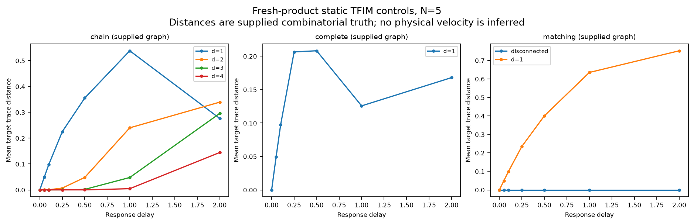
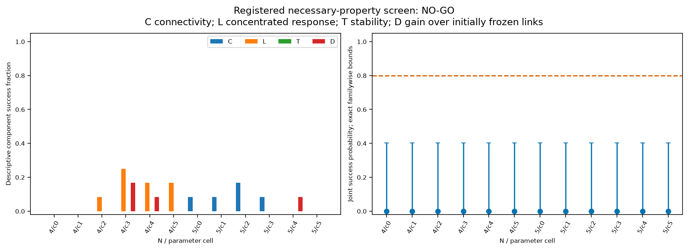
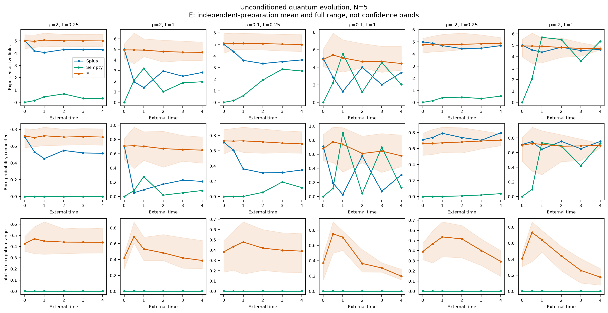
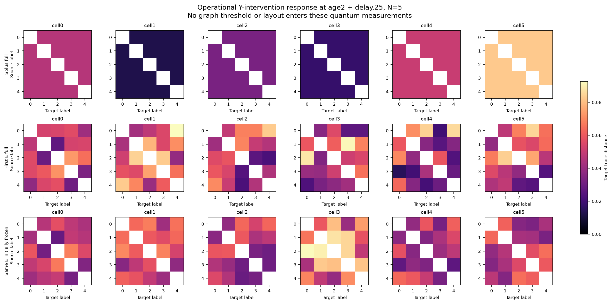
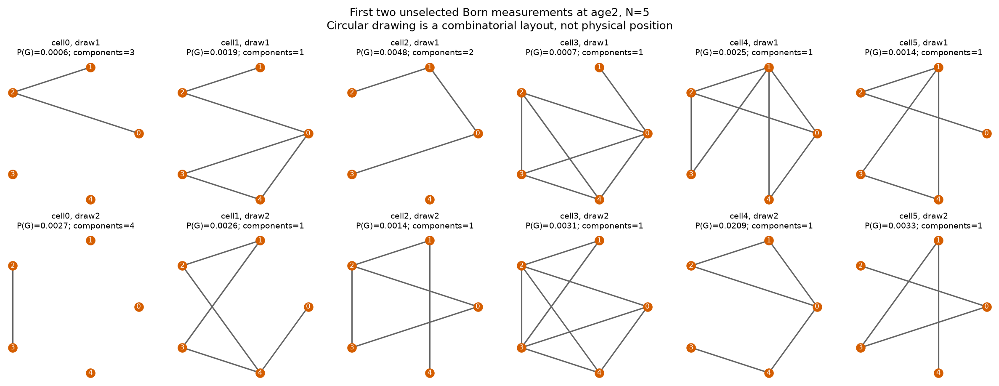
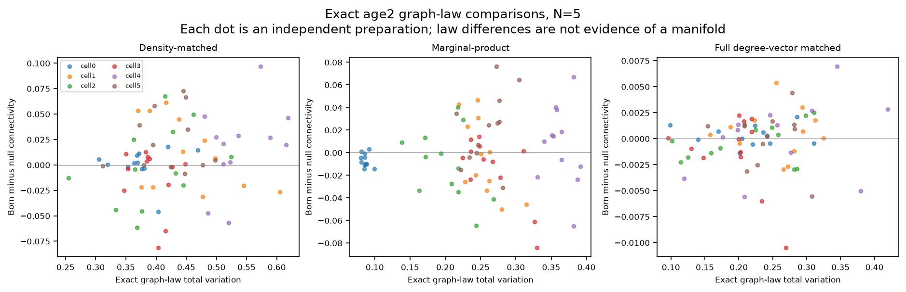
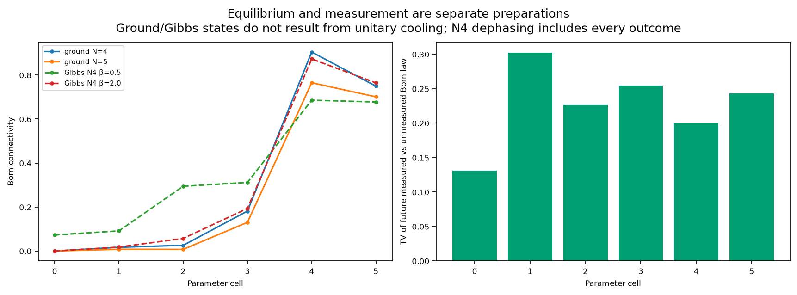

# Experiment 7: dynamical quantum locality — results and final decision

**NO-GO for the registered finite-system, unconditioned locality benchmark.**
All six parameter settings fail at both tested sizes. Each of the twelve cells has
**0 joint successes out of 12 independent preparations**; its simultaneous exact
binomial upper bound is **0.402190**, below the required success probability of 0.8.
The assay and independent numerical checks pass. This rejects the registered
advancement claim for these parameters, preparations and time windows. It is not
a theorem excluding every state, larger size, relational instrument or continuum
limit of this Hamiltonian, and it does not exclude quantum gravity in general.

**Geometric scaling remains unresolved.** Four and five vertices cannot establish
a continuum dimension, Lorentzian geometry or a thermodynamic phase. The programme
conclusion is **B: useful mathematical/computational research, but insufficient
evidence to pursue the physical hypothesis through further simulations**. See the
[seven-experiment synthesis](FINAL_RESEARCH_SYNTHESIS.md).

## 1. Registration, chronology and complete workload

Experiment 6 PR #7 was merged into main at
`73baea299fb07d608bade8364d6cf66443e23166`; its post-merge
[CI passed](https://github.com/raghammer1/causal-spacetime-lab/actions/runs/40173493770).
The inherited 1,001 tests passed before implementation. An isolated worktree kept
the original workspace, earlier archives and interactive atlas intact.

| Stage | Commit or record | Status before primary data |
|---|---|---|
| Mathematical protocol and theory |`5b71924`|Committed before implementation|
| Initial validated implementation |`24b7525`|1,119 tests and CLI pass|
| Exact frozen-link sector optimization |`74103c3`|First resource failure retained; numerical law unchanged|
| Resource amendment A1 |`e2600e6`|Planning allowance 20→30 minutes; second pilot retained|
| Final resource amendment A2 |`9afe2cf`|Planning allowance 30→40 minutes; third pilot retained; worst timings reused|
| Final workload/source freeze |`ff8d088`|Committed before any primary data|

The [protocol](DYNAMICAL_LOCALITY_PROTOCOL.md),
[theory and derivations](DYNAMICAL_LOCALITY_THEORY.md),
[computational clarifications](DYNAMICAL_LOCALITY_COMPUTATIONAL_PLAN.md), and
[frozen workload](DYNAMICAL_LOCALITY_WORKLOAD.md) disclose the chronology.
Resource amendments changed computation allowance only: no Hamiltonian, parameter,
state distribution, observable, precision, scientific margin or decision threshold
was relaxed. Three rejected timing pilots are retained. The final worst-case
projection was 2153.542 seconds, with the original 45-minute hard cap, 2 GiB RSS cap
and one worker/BLAS thread unchanged. A fresh censored N=6 timing test rejected its
complete cohort under that planning rule. This is not proof of intrinsic
infeasibility on other hardware. No partial N=6 quantum result is presented.

Executed: **168 primary preparation bundles**, comprising 144 independent E
preparations and 24 deterministic symmetric preparations; 12 ground states; 12 exact
N=4 Gibbs laws; 36 independent-link controls; six exact N=4 nonselective link-measurement
comparisons; and all 1,088 labeled N=4/N=5 classical graphs for static/null controls.
No primary numerical failure, missing preparation or duplicate statistical unit
was found. The primary took 604.133 seconds with peak RSS 349,536,256 bytes.

## 2. The specified model and what it supplies

For N matter qubits and M=N(N−1)/2 link qubits,

\[
H=-h\sum_iX_i-g\sum_{i<j}n_{ij}Z_iZ_j-\Gamma\sum_eX_e
  +\mu\sum_en_e+U\sum_i {D_i\choose 2},\qquad
n_e=(I-Z_e)/2,\quad D_i=\sum_{j\ne i}n_{ij}.
\]

The only primary model has h=g=U=1 and the following six cells. Simulation time is
external, with ℏ=1 and no assigned physical length or speed of light.

| Cell | μ | Γ | Analytical reference, not a finite-field prediction |
|---|---:|---:|---|
|0|2|0.25|Empty graph favored at Γ=0|
|1|2|1|Same cost, stronger link flips|
|2|0.1|0.25|Exact maximum-matching ground sectors at Γ=0|
|3|0.1|1|Same matching reference, stronger mixing|
|4|−2|0.25|Degree two favored at h=Γ=0|
|5|−2|1|Same classical degree preference, stronger mixing|

The tensor factorization, matter/link distinction, complete possible-pair incidence,
and degree cost are supplied microscopic structure. In particular,
`Σ_i choose(D_i,2)=Σ_(e<f sharing a vertex) n_e n_f`: the congestion term is a
fixed incidence interaction. Coordinate-free does not mean structure-free.
No target dimension, loop reward, connectivity reward or alternative Hamiltonian
was added after results.

Matter starts in the identical tilted product with Bloch vector
(1/√2,0,1/√2). Splus has all links in |+〉; Sempty has all links in |0〉. For each
E preparation, every link independently draws occupation p uniform[0.25,0.75]
and phase uniform[0,2π). A particular E realization supplies asymmetry; exchangeability
holds for its distribution. Structure ages are 0,0.5,1,2,3,4. A local Pauli-Y source
intervention occurs at age 2, with response delays 0,0.05,0.1,0.25,0.5,1,2. A paired
5% Γ increase uses exactly the same initial factors.

Closed evolution, independently prepared ground/Gibbs states, projective graph
measurements and frozen-graph controls are separate procedures. No closed unitary
trajectory is described as cooling. N=4 thermal laws use the full spectrum at
β=0.5 and 2; no uncontrolled N=5 thermal approximation is substituted.

## 3. Operational observable, exact restrictions and independent controls

For distinct source i and target j,

\[
R_{i\to j}(\tau)=\tfrac 12\|\rho_j[U(\tau)Y_i\psi(2)]
                              -\rho_j[U(\tau)\psi(2)]\|_1.
\]

For a qubit this is half the distance between its two Bloch vectors. Archived
first-crossing times at 0.01/0.05 are grid-censored descriptive diagnostics, not a
fitted light cone or velocity; between-grid crossings need not be monotone. At delay 0,
a local unitary leaves every other site's reduction unchanged, even when the
initial state is entangled. At g=0 all cross-site responses vanish. This measures
operational distinguishability, not ordinary correlation.

The decisive structural arguments are derived in full in the theory document:

* **Symmetry:** simultaneous vertex/link permutations commute with H. A symmetric
  initial density therefore stays symmetric; the stabilizer of a chosen source
  permutes all other targets, forcing equal off-diagonal responses. For h,Γ>0,
  irreducible nonpositive off-diagonal flips also give a unique positive symmetric
  ground state by Perron–Frobenius. Uniform labeled marginals do not forbid a
  structured relational Born law, such as a symmetric superposition of cycles.
* **Direct influence:** `[X_i(τ),X_j]=4igτ n_ij Y_iY_j+O(τ²)`. Its operator-norm
  slope is 4|g| for every potential pair; its state-RMS slope is 4|g|√〈n_ij〉.
  A sparse state-dependent effective sector would need a separate leakage bound.
* **Aged-state response:** after the Y intervention,
  `R_ij(τ)=2|g| sqrt(〈n_ij Zi Xj〉²+〈n_ij Zi Yj〉²)|τ|+O(τ²)`.
  Thus the exact joint moments, not just an aged edge occupation, explain its
  first derivative. For the unaged tilted product it reduces to |g|p_ij|τ|.
* **Absent-link shortcut:** for fresh tilted product matter on a basis graph whose
  i–j distance is at least three or disconnected, the absent direct link gives
  `R_ij=|g|Γ²|τ|³/3+O(τ⁴)`. At distance two, a static-path contribution can enter
  at the same order; density-matrix contributions cannot generally be replaced
  by adding trace-distance coefficients.
  A static Ising path of distance d first permits support at order 2d−1.
  The cubic formula is not asserted for arbitrary aged conditional matter.
* **Energetic fragmentation:** at Γ=0, removing an edge touching degree≥2 lowers
  sector ground energy if μ+U>g. A matching with m edges has
  `E_m=−hN+m[μ+2h−sqrt(g²+4h²)]`. With h=g=U=1 and μ=0.1, maximum matchings
  minimize energy and are disconnected for N≥3. This theorem does not extend
  unchanged to the finite-Γ primary states.
* **Forced tiny rings:** at h=Γ=0, minimizing matter signs gives
  `(μ−g)|E|+U Σ_i choose(d_i,2)`. Degree two forces C4/C5, whereas N=6 allows
  C6 and two triangles at the same classical energy. There are 60 versus 10 labeled
  graphs; aligned-matter multiplicities 2 versus 4 give zero-temperature canonical
  connectivity 3/4. Quantum corrections may split these classical sectors.

The controls worked. In the N=5 static chain, mean response at delay 0.1 for graph
distances 1,2,3,4 was respectively 0.0982789,0.000467256,6.65e−7,4.54e−10. This is
supplied locality and validates the probe; no physical propagation speed is fitted.
Complete fixed interactions have equal target responses within 2.00e−14. Disconnected
static components have cross-component/zero-delay errors below 7.41e−15. Independent
links require **both g=0 and U=0**; across all 36 controls, maximum cross-matter
response was 7.93e−14 and maximum departure from the exact marginal-product graph
law was 2.06e−13. Zero signalling alone does not qualify disconnected/uncoupled
systems as geometric.



## 4. Registered decision and uncertainty

The entire E preparation, including all paired perturbations, targets and times,
is one independent statistical unit. Exact Born enumeration removes graph-shot
Monte Carlo error, not preparation uncertainty. Splus/Sempty and equilibrium
states do not acquire artificial ensemble confidence intervals.

The four simultaneous within-preparation conditions are: **C**, connected Born
mass≥0.8 at ages 2,3,4; **L**, fractional top-two response capture F≥0.8 and mean
off-diagonal response≥0.01 at both delays 0.25 and 0.5; **T**, both late Born-law
TV changes≤0.1 plus robust perturbed neighborhoods and perturbed L; and **D**,
F improvement≥0.1 over initially frozen links at both delays. Fractional ties
prevent label-dependent neighbor choices. F is response concentration, not recovery
of an independently known spatial neighborhood. Its uniform baseline is 2/(N−1).
The complete numerical definitions and failure quantifiers are in the protocol.

| N | Cell | C successes | L successes | T successes | D successes | Joint successes |
|---:|---:|---:|---:|---:|---:|---:|
|4|0|0|0|0|0|0/12|
|4|1|0|0|0|0|0/12|
|4|2|0|1|0|0|0/12|
|4|3|0|3|0|2|0/12|
|4|4|0|2|0|1|0/12|
|4|5|0|2|0|0|0/12|
|5|0|1|0|0|0|0/12|
|5|1|1|0|0|0|0/12|
|5|2|2|0|0|0|0/12|
|5|3|1|0|0|0|0/12|
|5|4|0|0|0|1|0/12|
|5|5|0|0|0|0|0/12|

Component counts are descriptive. The confirmatory joint intervals use exact
two-sided Clopper–Pearson bounds with family size 12 and total α=0.05. For zero
successes out of 12, the upper bound is
`1−(0.05/24)^(1/12)=0.402189925`. Every cell fails the 0.8 advancement probability.
The stricter 24-family GO bounds are also archived; their upper endpoint is 0.435742426.
No cell passes the extra degree-null GO event. Numerical/control/cohort validation
passed, so the registered decision is NO-GO, not a missing-power inference.

Power remains limited in the other direction: even 12/12 successes would not
certify the positive benchmark. This was disclosed before primary execution.
The dataset can reject the observed large failure without resolving small
advantages, exact equality of graph laws, or continuum behavior. Calibration uses
binomial enumeration over a stated probability grid including interval endpoints,
with independently seeded checks; the finite-sample interval guarantee comes from
its binomial construction. No failed bootstrap method from earlier experiments
was silently reused.



## 5. What the quantum links did produce

The model produced nontrivial graph laws and responses. It did **not** merely
reproduce an independent-edge graph distribution. The table gives descriptive
E-preparation means at age 2; F and ΔF refer to delay 0.25, and all twelve
realizations contribute to each mean. These means are not simultaneous confidence
claims or independent graph samples.

| N | Cell | Connected mass | Expected links | F | ΔF vs initially frozen | TV vs marginal-product law | TV vs degree null |
|---:|---:|---:|---:|---:|---:|---:|---:|
|4|0|0.5782|2.9812|0.7392|0.0129|0.0772|0.0635|
|4|1|0.5486|2.8126|0.7962|0.0877|0.1853|0.0789|
|4|2|0.6160|3.1002|0.7543|0.0313|0.2073|0.0725|
|4|3|0.4976|2.7338|0.7856|0.0716|0.1880|0.0667|
|4|4|0.6336|3.1242|0.7869|0.0741|0.2595|0.0741|
|4|5|0.5545|2.8513|0.7789|0.0646|0.1908|0.0769|
|5|0|0.7080|4.9986|0.5939|0.0052|0.0866|0.2149|
|5|1|0.6710|4.8013|0.6206|0.0322|0.2535|0.2558|
|5|2|0.7161|5.0686|0.5871|0.0037|0.2032|0.2150|
|5|3|0.6099|4.6488|0.6093|0.0321|0.2661|0.1940|
|5|4|0.6822|4.7955|0.6402|0.0576|0.3635|0.2610|
|5|5|0.6871|4.8034|0.6290|0.0430|0.2591|0.2406|

The paired Γ perturbation often preserved rankings: mean delay 0.25 neighborhood
overlaps range 0.9333–1 across cells. That favorable robustness result is retained.
It is insufficient: no E realization satisfies both late-time TV≤0.1 requirements,
and no N=5 realization passes L. The T failures must not be described as universal
perturbation fragility; temporal graph-law variation and insufficient concentration
are distinct issues. Individual favorable L/D results at N=4 are also retained.

For Splus/Sempty, maximum labeled occupation spread was 2.66e−15 and maximum
response spread 4.79e−15, as the exact symmetry argument requires. Born measurements
can nevertheless produce irregular connected or disconnected graphs. These are
possible measured configurations, not a unique classical geometry selected by
the unmeasured finite quantum state.





The archive includes count variances/covariances, all degree/component/size
histograms, isolation and hub diagnostics, triangles/clustering, graph distances,
ball sizes and Laplacian spectra. Connected-diameter histogram entries are joint
masses `P(diameter=k AND connected)`; the separately reported mean is conditional
on connectivity. Expected sorted graph spectra are not the spectrum of a unique
quantum geometry. No power law or dimension is fitted across these few radii.

## 6. Nulls, equilibrium and measurement dependence

Four exact nulls distinguish density, one-link heterogeneity, count fluctuations
and structure beyond the full labeled degree vector. The degree null uniformly
redistributes each observed degree-vector mass over its entire graph class; there
is no unverified edge-swap mixing. N=5 E means differ from that null in total variation,
but their mean connectivity advantages range only −0.001321 to 0.000579. Distributional
difference is useful information about this law, not a manifold certificate.

A pre-primary exact audit exposed a particularly restrictive extra GO condition.
At N=4 each degree class fixes connectivity. At N=5, each mixed-connectivity degree
class has six P5 paths and one triangle disjoint from an edge. Thus

    P(connected)−Q_degree(connected) = [P(P5)−6P(C3 disjoint union K2)]/7.

The registered 0.1 advantage requires P(P5)≥0.7. This path-selective finite-size
restriction is disclosed, not interpreted as a universal geometry criterion.
The primary C/L/T/D rejection does not depend on this extra gate.



Equilibrium is preparation-dependent. Ground connected mass for μ=−2,Γ=0.25 is
0.904578 at N=4 but 0.765087 at N=5; for μ=2,Γ=0.25 it is approximately 3.07e−5 and
2.23e−6. The near-matching μ=0.1,Γ=0.25 grounds have connected masses 0.025968 and
0.007505. These results are consistent with energetic fragmentation/sparsity
mechanisms, but the finite-Γ numbers are measured results, not applications of
a Γ=0 theorem. Ground states remain symmetric and stationary; they do not show
that the chosen quench dynamically cooled into a geometry. Exact N=4 finite-temperature
results, full spectra, energies and entropies are archived separately.

Nonselective link measurement at age 2 changed the age 3 Born law in all six
prespecified N=4 comparisons. TV changes by cell were 0.131349,0.302554,0.226681,
0.254886,0.199973,0.243409. Every graph outcome was included with its Born weight.
This is real measurement backaction in the model; no preferred outcome was selected.
Independent draws at different ages are not one persistent graph trajectory.



Frozen controls distinguish initially frozen links, freezing only at the probe,
and fresh matter placed on a measured classical graph. For the latter, averaging
conditional trace distances differs from taking the distance of averaged target
states. Likewise, F of an averaged response differs from the average graph-adapted
F. The unconditioned labeled NO-GO does not rule out every relationally addressed
instrument with access to a graph record. Such an instrument needs its own declared
measurement/state-selection procedure; the static fresh-matter controls supply a
graph and change the dynamics. A [secondary descriptive table](experiments/dynamical-locality-conditioned-response.json)
computes graph-adapted F without silently deleting undefined mass. For N=5 Sempty
cell 0 at delay 0.25, mean conditioned F is 0.998589, but valid graph mass is only
0.00394451 and connected mass 0.000149462; both averaged-response F values are 0.5.
For N=5 Splus cell 4, conditioned F is 0.949894 versus 0.950129 under its degree null.
Across N=5 E cell means, Born-minus-degree conditioned F differs by at most 0.000138
at delay 0.25 and 0.000556 at 0.5. These are descriptive comparisons without a new
confidence or equivalence claim. They illustrate conditional selection and supplied
static coupling; they do not alter the registered decision.

Two additional exact observations clarify preparation: averaging the registered E
link factors gives `I_links/2^M`, because uniform phases cancel coherences and
E[p]=1/2. The unobserved preparation mixture is therefore permutation symmetric;
averaging per-preparation distinguishabilities is a different operation. Before
aging, the largest-two direct-slope fraction is bounded by 6/(N+3), using
p∈[0.25,0.75]. At N=5 this is 0.75; it does not bound the aged probe's joint moments.
Neither fact changes a registered threshold.

## 7. Answers to the research questions A–L

**A — Distinguishable neighborhoods?** Symmetric preparations and finite grounds
have none in labeled expectations/target-only response. E preparations have
asymmetric patterns, but supply initial asymmetry; no complete dynamical-organization
screen passes. Relational graph correlations are a separate question.

**B — Stable connected structures?** Some measured graphs are connected and some
preparations have high connected mass. Only 5/144 E preparations satisfy C across
all three late ages; none meets the two late-law TV limits together. Ground
stationarity is an equilibrium assumption, not dynamic formation.

**C — Different from random controls?** Yes, exact finite Born laws generally
differ from independent/density/degree nulls. No defensible implication from those
differences to geometry is established; degree-matched connectivity gains are tiny.

**D — Meaningful operational locality?** The supplied static chain validates
local propagation. The primary law fails its registered unconditioned locality
screen at every setting/size. Persistent graph-adapted relational protocols and
controlled scale dependence remain unresolved, not mathematically excluded.

**E — Dynamically generated or encoded?** The model dynamically changes links and
responses, but supplies their incidence, direct matter coupling and degree costs.
Measured gains over frozen initial links are insufficient for advancement; direct
commutator/joint-moment identities explain microscopic influence without inventing
an emergent length or light speed.

**F — Measurement-created appearances?** Individual Born graphs can look sparse
and geometric despite uniform symmetric marginals. Dephasing measurably changes
future graph laws. Layout/threshold changes leave the computed quantum response
unchanged by construction; that pipeline check is not independent physical evidence.

**G — Obstructions?** Exact finite symmetry, disconnected energetic limits,
state/preparation dependence, nonstationary Born laws, weak response concentration,
and severe size limits obstruct this tested route. None proves a universal no-go
for every quantum-link theory or continuum limit.

**H — Low-dimensional geometry?** No defensible dimension or continuum evidence.
Graph distance exists combinatorially; tiny forced rings, finite Laplacian spectra
and two-dimensional drawings do not establish a geometric scaling regime.

**I — Previously known mechanisms?** The requested original graphity papers already
exhibit degree/loop preferences, locality-restricted graph moves, approximation-dependent
equilibrium reasoning and fragmentation during epitaxial optimization. Their models
are different. The [theory review](DYNAMICAL_LOCALITY_THEORY.md#1-what-the-original-literature-establishes)
identifies exactly which assumptions are supplied in each, without importing their
claims as theorems for this Hamiltonian.

**J — New mathematics or prediction?** Independently checkable project deductions
include the finite-h matching criterion, tiny-size degree-null path restriction,
aged response identity, and qualified cubic shortcut. They are useful explicit
results/counterexamples for this model. No publication-priority claim or new
empirically discriminating physical prediction is established.

**K — Lorentzian continuum or Einstein equations?** Needed are a justified
size-dependent state/law sequence and energy normalization, relational observables,
controlled coarse-graining/concentration, nondegenerate approximately unique geometry,
scale separation and effective propagation bounds including sector leakage. A
Lorentzian causal structure, matter sector, Lorentz symmetry and gravitational
constraints/backreaction/equations remain separate obligations. Fixed coefficients
include O(N²) flips and a potentially O(N³) congestion cost; no controlled scaling
normalization was derived. The sizes here cannot discharge these requirements.

**L — Black holes?** Nothing substantive about physical black holes follows. This
model derives no gravitational dynamics, physical horizon or black-hole interior.
Finite-dimensional bounded numerical evolution does not resolve a GR singularity.

## 8. Reproducibility, verification and retained limitations

The primary archive is [dynamical-quantum-locality-v1](experiments/dynamical-quantum-locality-v1):
240 hashed files, including 238 deterministic scientific artifacts, seven figures,
raw factor/Born/Bloch/state checkpoints, all graph controls, CSV tables and every
registered failure count. Total archive size is 38,349,538 bytes. Initial factors,
semantic seeds, environment and source hashes are explicit; NPZ files require no
pickle. The scientific digest is

`0328f5beb3501f9ca9701594920c208beea37e6d6c274f1f0c5134634f162bec`.

The frozen implementation passed 1,129 tests and an end-to-end CLI. The final
publication branch, including independent-audit regression tests, passed **1,142 tests** and a fresh end-to-end smoke CLI. Full primary norm/probability error was at most 4.58e−14; maximum relative energy drift 1.03e−13;
maximum scaled two-eigenpair solver residual relative to max(1,|E0|) was 6.92e−13.
These are numerical checks, not uncertainty on a physical theory. Scientific figures were visually
reviewed; all previous archives and atlas files are preserved.

The [independent audit](experiments/dynamical-locality-independent-audit.json)
imports no production analysis helpers. It verifies 168 units, 2,352 response
estimands, 60 checkpoints, all 1,088 graph entries, all 12 grounds, N=4 Gibbs laws,
six dephasing comparisons and 12 directly regenerated preparations under all four
Hamiltonian branches. It independently reproduces NO-GO with zero failures;
maximum regenerated response error is 2.33e−15, frozen-response error 2.22e−15,
thermal-density error 2.05e−15 and elementary-binomial discrepancy 2.44e−15.
A separate [graph/static audit](experiments/dynamical-locality-graph-audit.json)
made 2,052,828 scalar comparisons across 74,196 checks with zero failures, rebuilding
all 1,088 graphs and dense static probes. It checked 1,008 full Born laws, 840 weighted
controls and 2,040 eight-shot draw laws, including equilibrium and measurement
summaries. Maximum dense-static discrepancy was 3.07e−12; weighted-control error
2.95e−14. The illustrations are not independent statistical units, and some
illustrative preparations share random variates through the declared seed scheme.
The [complete frozen-source replay](experiments/dynamical-locality-replay-audit.json)
reproduced all 238 scientific artifacts byte for byte, including all seven figures,
with the same digest. It took 618.222 seconds and peak RSS 330,399,744 bytes. Only
`timing.json` differs among all 240 hashed files; metadata also matches. Replay is
not an additional independent preparation cohort or new physical evidence. The
same audit records unchanged tree hashes for every previous archive and the atlas.

Reproduce the exact workload from its frozen commit in a clean worktree:

```bash
git worktree add --detach ../causal-locality-reproduce ff8d088
cd ../causal-locality-reproduce
python3 -m venv .venv
.venv/bin/python -m pip install -e . pytest
export OPENBLAS_NUM_THREADS=1 OMP_NUM_THREADS=1 VECLIB_MAXIMUM_THREADS=1
.venv/bin/python -m pytest -q
.venv/bin/python -m causal_lab.dynamical_study --mode primary \
  --freeze docs/experiments/dynamical-locality-workload.json \
  --output results/dynamical-primary
```

The recorded environment is Python 3.14.4, NumPy 2.5.4, SciPy 1.18.1 and Matplotlib 3.11.2.
Install those versions for same-environment byte comparisons; other supported
versions require numerical-tolerance validation. Matrix-free exponential action
uses a guarded private SciPy kernel to avoid hidden global-random norm estimates;
that implementation dependency is explicit. Frozen Γ=0 propagation retains all
coherent graph-sector phases. No classical surrogate is mixed with quantum data.

On the publication branch, run the new smoke CLI and the independent auditors:

```bash
python -m causal_lab.dynamical_study --mode smoke --output results/dynamical-smoke
python scripts/audit_dynamical_primary.py docs/experiments/dynamical-quantum-locality-v1 \
  --thermal-replay --output results/dynamical-independent-audit.json
python scripts/audit_dynamical_graphs.py docs/experiments/dynamical-quantum-locality-v1 \
  --output results/dynamical-graph-audit.json
python scripts/dynamical_conditioned_response.py docs/experiments/dynamical-quantum-locality-v1 \
  --output results/dynamical-conditioned-response.json
```

The finite screen uses practical thresholds and one intervention family; it is not
a universal definition of locality. All source/target pairs and delays are dependent
within a preparation. Three batches and 12 preparations per cell cannot establish
small effects or continuum universality. The extra GO condition has an exact
path-selection bias at N=5. No primary result is erased by those limitations, and
no limited GO or new Hamiltonian is proposed to keep the programme running.
