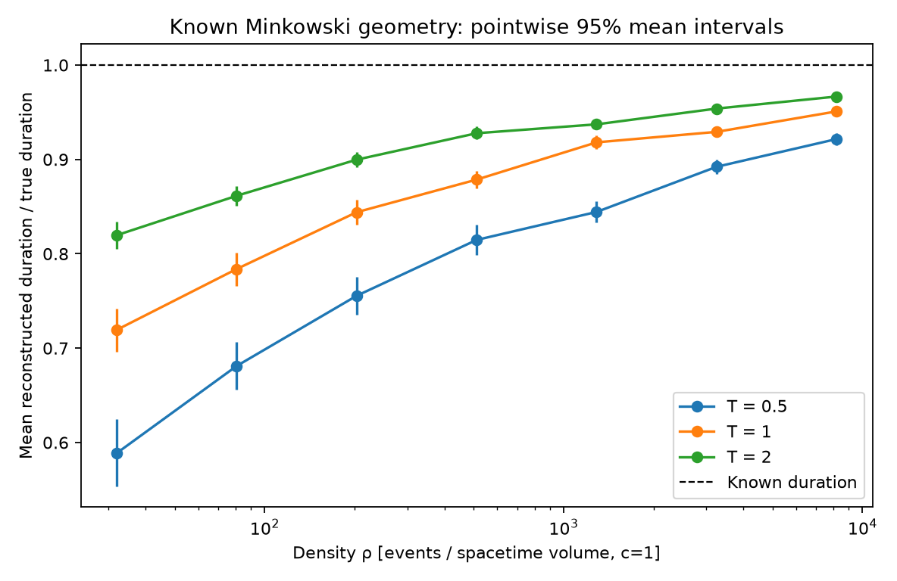

# Finite-density scaling v1 — numerical results, 2026-10-25

**Result:** In this prescribed 1+1D Minkowski model, the mean chain-based time
estimate approaches the known duration over the tested density range, while
remaining biased low. This supports the protocol's finite-range prediction.
It is not evidence that our universe is discrete, that gravity is emergent,
or that a black-hole singularity is resolved.

## What ran

The [primary protocol](FINITE_DENSITY_PROTOCOL.md) was included in the verified
baseline before implementing or running this extension. Seven logarithmically
spaced densities from 32 to 8192 and durations 0.5, 1 and 2 were sampled with
200 independent repetitions per cell: **4,200 primary sprinklings**, containing
7,119,191 events in total. Two empty draws were retained. The seed was 20261025,
with 2,000 bootstrap resamples per cell. Expected counts ranged from 4 to 16,384.

The preserved study has 4,200 raw rows, 63 summary rows (21 cells times three
order models), 208 explicit primary algorithm/control comparisons, and 63
separate benchmark samples. Of 420 candidate primary comparisons, 212 were
above the N=256 matrix cap; none were silently discarded from the physical
sample. An additional 32 benchmark samples compared both algorithms.

## Tables and plots

All reviewed artifacts are in [experiments/finite-density-scaling-v1/](experiments/finite-density-scaling-v1/):

- [Raw trials CSV](experiments/finite-density-scaling-v1/raw.csv)
- [Summary CSV](experiments/finite-density-scaling-v1/summary.csv) and [JSON](experiments/finite-density-scaling-v1/summary.json): means, sample SD, SE, pointwise 95% bootstrap intervals, absolute and normalized bias, event/chain statistics, and analytic control expectations
- [Algorithm comparisons](experiments/finite-density-scaling-v1/agreement.csv), [diagnostics](experiments/finite-density-scaling-v1/diagnostics.json), [benchmarks](experiments/finite-density-scaling-v1/benchmarks.csv), and [provenance](experiments/finite-density-scaling-v1/metadata.json)
- [Reconstruction](experiments/finite-density-scaling-v1/reconstruction.png), [bias scaling](experiments/finite-density-scaling-v1/bias_scaling.png), [negative controls](experiments/finite-density-scaling-v1/chain_controls.png), and [performance](experiments/finite-density-scaling-v1/benchmarks.png)

| True duration | Bias at density 32 | Bias at density 8192 | 95% interval for high-density bias |
|---:|---:|---:|---:|
| 0.5 | −41.125% | −7.844% | [−8.477%, −7.234%] |
| 1.0 | −28.063% | −4.914% | [−5.313%, −4.523%] |
| 2.0 | −18.031% | −3.338% | [−3.607%, −3.088%] |

Bias here means `(mean estimate − true duration)/true duration`. At the highest
density, the means were respectively 0.460781, 0.950859 and 1.933242; the sample
SDs were 0.021915, 0.028655 and 0.037339, and SEs 0.001550, 0.002026 and 0.002640.
The high-minus-low normalized-bias contrasts were positive at each duration:
0.33281 [0.29414, 0.36860], 0.23148 [0.20733, 0.25477], and
0.14693 [0.13182, 0.16149]. These additional contrasts bootstrap the independent
endpoint cells independently. All 21 pointwise mean-bias intervals lie below zero.



The bias-versus-expected-count plot includes the literature leading-order guide
`−1.7711/(2*lambda^(1/3))`, derived in [THEORY.md](THEORY.md). It is visibly an
imperfect approximation at small counts. No exponent was fitted and no finite-size
correction was calibrated. A finite density sweep cannot establish an asymptotic
limit, even though the plotted trend agrees with the known mathematical result.

## Falsification attempts and an investigated discrepancy

**Algorithms and causal validity:** All 208 primary small-case comparisons and
32 independent benchmark comparisons agreed in chain length. Returned chains
were checked for valid indices and causal steps; every fast primary chain was
checked. Explicit total-order and antichain matrices matched `L=N` and `L=1[N>0]`.
Regression tests deliberately inject wrong lengths and noncausal paths and require
the study to abort. Cycles and missing transitive relations are rejected.

**Sampling normalization:** The largest absolute count-mean deviation was 2.18
theoretical SEs; the largest count-variance deviation was 3.37 theoretical SEs.
None reached the predeclared five-SE investigation threshold. This is a diagnostic,
not an exact distributional goodness-of-fit test or proof of the generator.

**Negative controls:** Across the grid, matched-count total orders follow their
exact mean-chain reference lambda, and antichains their reference `1−exp(−lambda)`;
their trends differ from the sprinkled square-root chain trend. Large control
lengths use the exact formulas, with small matrices providing independent checks.
The control rows share event counts with the sprinkled samples and are not
additional independent physical draws. These two controls do not establish that
the statistic distinguishes every arbitrary DAG from continuum-like order.

**Equal-count scale check:** Three of four primary equal-count contrast intervals
included zero. The pair at expected count approximately 161.27 differed by
0.017127 in mean relative estimate (T=2 minus T=0.5), interval
[0.001378, 0.032089], or 2.19 estimated SEs. This is preserved as an adverse
pointwise result; it was not erased or described as universal agreement.
The original protocol required investigation, while the implementation's five-SE
flag is only a diagnostic alarm, not a reason to ignore a narrower-interval discrepancy.

We then recorded an [independent follow-up plan](EQUAL_COUNT_FOLLOWUP_PROTOCOL.md)
before running it. Seed 20261026, two densities, two durations, 2,000 draws per
cell and 5,000 bootstrap resamples produced **8,000 additional draws**. The
other two cells provided controls. The target contrast became **0.000138**,
interval **[−0.004824, 0.005197]**, or 0.054 SEs. All 60 follow-up small-case
checks agreed and count diagnostics remained below five SEs. Exact same-sample
coordinate rescaling also passes its independent unit test.

This follow-up did not reproduce a persistent difference at this resolution.
It is compatible with the original discrepancy being sampling variation across
multiple pointwise comparisons; it does not prove equality of distributions.
The follow-up is post hoc, separately seeded, fully retained, and not pooled into
a supposedly preregistered confirmation. Its [raw data](experiments/equal-count-followup/raw.csv),
[summaries](experiments/equal-count-followup/summary.csv), [diagnostics](experiments/equal-count-followup/diagnostics.json),
and [plan provenance](experiments/equal-count-followup/followup_context.json) remain separate.

## Runtime and memory

The final archived primary run took **5.73 s** for simulation, checks, bootstrap,
diagnostics and benchmarks, plus **1.38 s** to write tables and plots. These
timers exclude interpreter/import startup. Process peak RSS including imports
and output generation was **121,110,528 bytes (115.5 MiB)** on Darwin arm64,
Python 3.14.4, NumPy 2.5.4 and Matplotlib 3.11.2. Timing is machine-specific.
The follow-up took 4.93 s plus 1.03 s of output generation, peak RSS 123.6 MiB.

Representative primary measurements (three independent benchmark samples each):

| Mean N | Phase | Mean untraced time | Min–max time | Mean peak newly traced allocations |
|---:|---|---:|---:|---:|
| 99.7 | Embedding LIS | 0.0558 ms | 0.0535–0.0577 ms | 9.87 KiB |
| 99.7 | Construct order matrix | 0.0268 ms | 0.0239–0.0283 ms | 148.79 KiB |
| 99.7 | Validate strict order + order-only DP | 0.9018 ms | 0.8523–0.9424 ms | 65.89 KiB |
| 16,547.3 | Embedding LIS | 10.5236 ms | 10.4388–10.6243 ms | 331.02 KiB |

Timing calls are untraced; memory uses a separate `tracemalloc` pass on the same
deterministic sample. Newly traced allocations exclude retained inputs and can
miss unsupported native allocations. They are not RSS, and the separate phases'
peaks must not be added as a claimed total peak. Order-only analysis here includes
O(N³) worst-case defensive transitivity validation; matrix storage is O(N²).
Only fast embedding-based processing is benchmarked at the largest sizes.
Matrix benchmarks are selected by realized N and are not an unbiased comparison
across a cell near the cap. Performance bars show observed min–max, not confidence
intervals or evidence about an asymptotic complexity exponent.

## Reproduction and provenance

```bash
git switch experiment/finite-density-scaling-v1
python3 -m venv .venv
source .venv/bin/activate
python -m pip install -e '.[dev]'
python -m pytest -q
python -m causal_lab.cli --seed 20261025 --repeats 100 --out results
python -m causal_lab.scaling --seed 20261025 --repeats 200 --bootstrap 2000 --out results/finite-density-scaling-v1
python -m causal_lab.scaling --seed 20261026 --densities 80.63494719327188 1290.1591550923501 --durations 0.5 2 --repeats 2000 --bootstrap 5000 --out results/equal-count-followup
```

**81 tests pass.** The original notebook also executes through Jupyter nbconvert.
The primary run was repeated; raw CSV, summary CSV/JSON, agreement CSV and
diagnostics JSON were byte-identical. The final plotting-only axis correction
was followed by another full run with the same scientific digest:

`bcdc5b6c785faf3927298eef212ea06ef81caf478e1707c848823af3487ece81`

The follow-up scientific digest is:

`c5d6e31b59ba4fe51379bae38c704be3666aa222c6b4461f3ce7a6e98b3b3bdb`

Metadata records the exact floating-point density values, parameter-keyed PCG64
stream recipe, versions, source hashes, protocol hash and artifact checksums.
The recorded Git commit is the baseline parent `135dd3c` with a dirty worktree:
the study ran before committing its implementation and outputs. The source
SHA256 hashes identify the actual experiment code and match the published files;
the metadata does **not** claim baseline code generated the study. The follow-up
also records its distinct plan hash. Timings, memory and metadata are excluded
from the scientific digest. Across other numerical/plotting versions, bitwise
identity is not guaranteed; use the recorded versions and exact parameter list
for strict reproduction, rather than rounding densities shown in prose.

## Limits and next questions

The calculation presupposes a flat metric, known density in physical volume
units, uniform Poisson sprinkling, strict timelike relations and interior-only
chain counts. Absolute time needs the density calibration. The fast method uses
coordinates, while the small order algorithm consumes only the precedence
matrix. Neither produces geometry from a background-free dynamics.

Bootstrap intervals are pointwise, with no multiple-comparison adjustment; they
describe Monte Carlo uncertainty of a mean, not systematic finite-density error,
model error or uncertainty in the known input duration. Antichain draws can all
equal one, giving zero-width empirical bootstrap intervals despite a nonzero
rare-empty probability. Only 200 primary repeats per cell and one fixed suite of
seeded streams were used. The investigated discrepancy illustrates why favorable
plots alone are insufficient.

The next three research questions, with prerequisites and refutation conditions
in the [roadmap](EXPERIMENTS.md), are:

1. Can multiple order statistics recover known dimensions and reject orders
   deliberately constructed to match a single pair fraction?
2. Can a specified background-free sequential growth rule sustain those joint
   signatures as event count grows, without hidden coordinates or label effects?
3. In a specified curved background, does reconstruction agree with independent
   continuum proper times and recover the flat limit? A causal horizon remains
   distinct from a black-hole solution.

Einstein dynamics, gravitational time dilation, black-hole limits and observational
constraints remain much later requirements, not outputs of this experiment.
