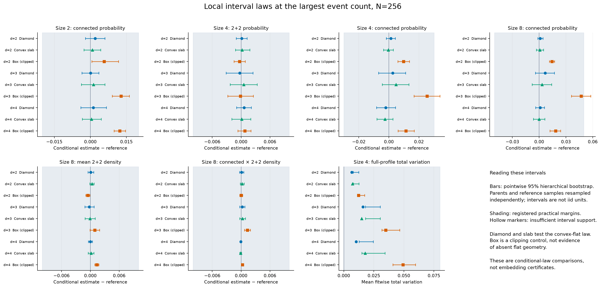
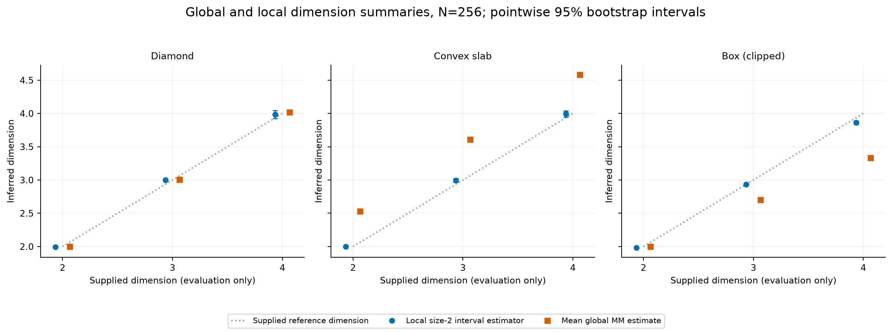
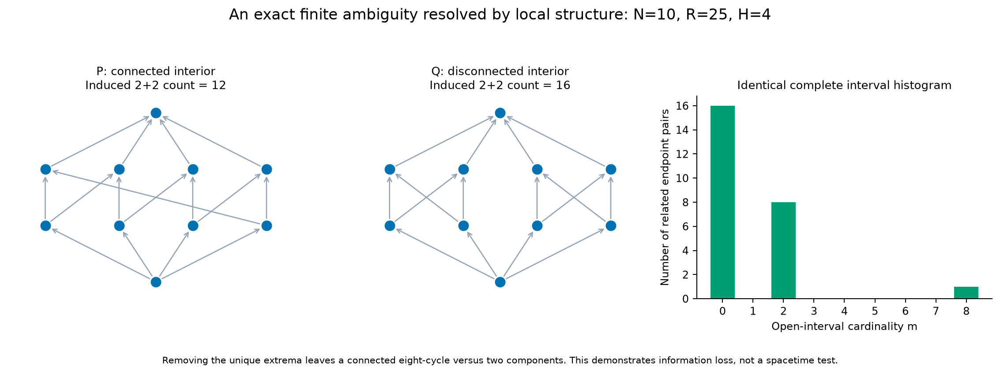
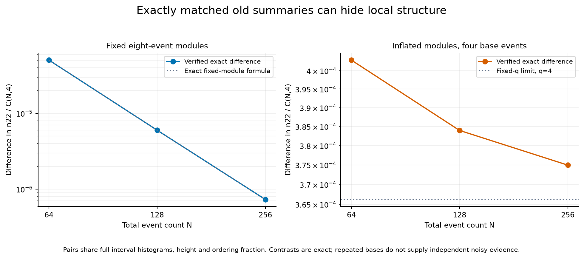
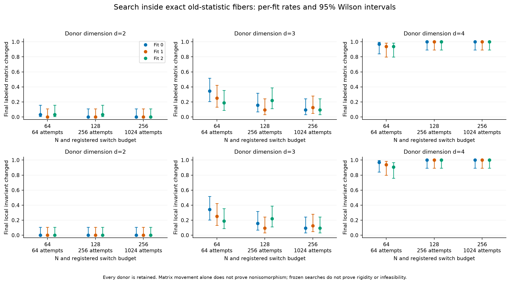
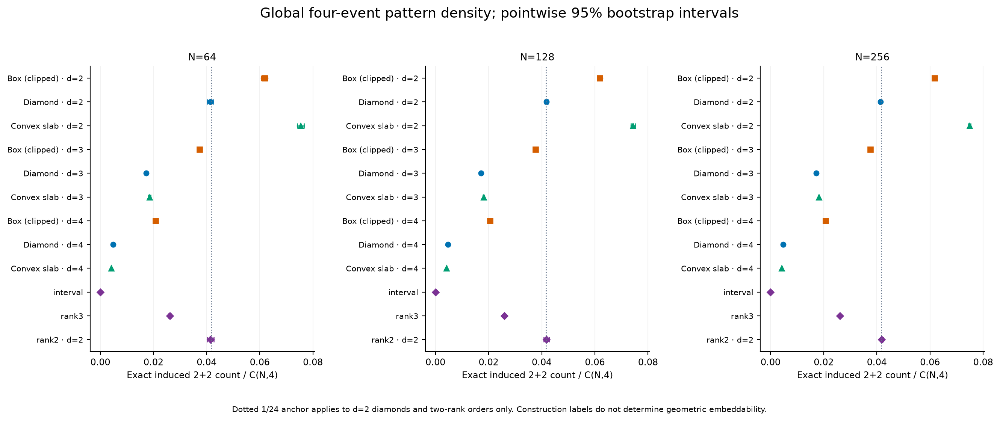
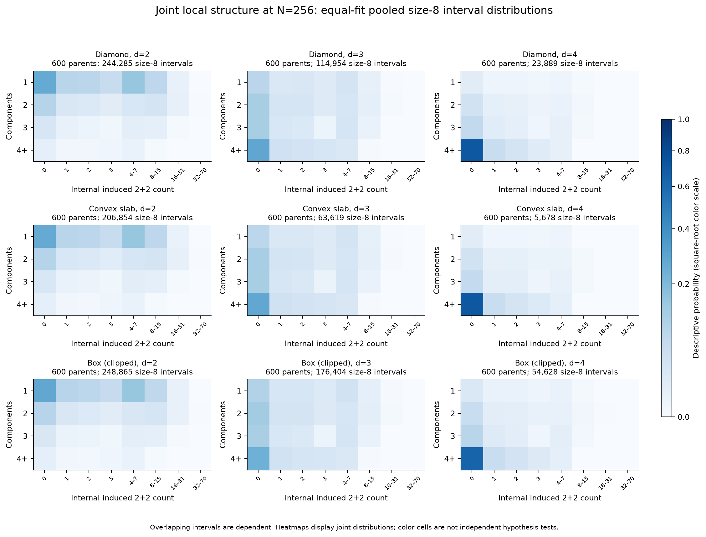
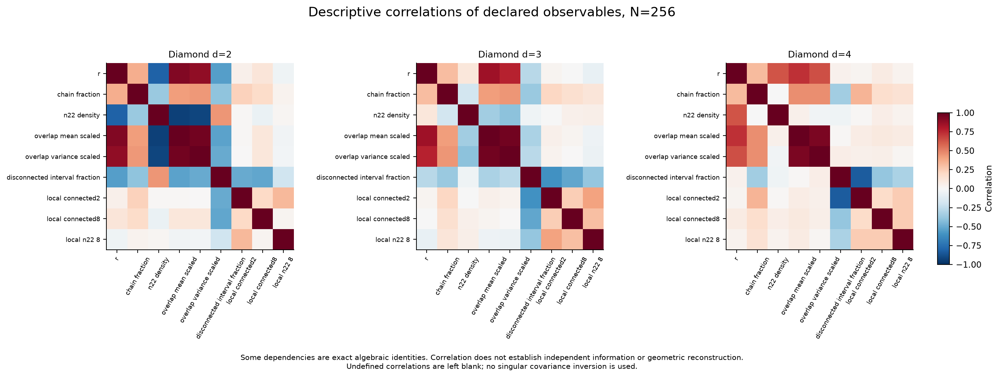

# Experiment 4: local causal structure and geometric identifiability

**Local structure contains information absent from the previous global summaries, and conditioning on interval size provides a useful boundary-controlled geometric law. Neither finding establishes geometric embeddability of an arbitrary order.** All 42 registered primary conditional-law checks at N=256 support their practical equivalence margins, including all 126 corresponding per-fit checks. Exact counterexamples and searches nevertheless show that the old summaries and the measured local laws leave substantial ambiguity.

The useful advance is mathematical: specify the assumptions under which causal relationships encode local geometry, derive the resulting laws, and retain examples showing what those laws fail to identify. This experiment introduces no seventh recognition classifier.

## Provenance, design and scientific status

Experiment 3 PR [#3](https://github.com/raghammer1/causal-spacetime-lab/pull/3) was merged into main at `8dccf04`; its post-merge [CI run 40160786346](https://github.com/raghammer1/causal-spacetime-lab/actions/runs/40160786346) passed before implementation. The mathematical protocol and theory were committed at `e92c6e4`. The resource-only workload decision and frozen implementation were committed before primary execution; the primary run used clean commit `96234c586ab983c7a8b4ffc11ddd12b278d4ea70`. The frozen baseline passed 658 tests and [CI run 40163055460](https://github.com/raghammer1/causal-spacetime-lab/actions/runs/40163055460).

See the [preregistered protocol](LOCAL_CAUSAL_STRUCTURE_PROTOCOL.md), [timing-only workload selection](LOCAL_CAUSAL_STRUCTURE_WORKLOAD.md), [full theory](LOCAL_CAUSAL_STRUCTURE_THEORY.md), and [continuum interpretation](LOCAL_CAUSAL_STRUCTURE_CONTINUUM.md). Exact identities and explicit finite counterexamples are mathematical results; ensemble estimates below are numerical evidence conditional on their generators and uncertainty method. Physical emergence remains a separate hypothesis.

The full registered grid used d=2,3,4, N=64,128,256 and three independent fits. Each ordinary ensemble cell contains 200 independent parent orders per fit. Reference fits use 5,000 four-event and 2,000 eight-event diamonds per d=3,4 fit; d=2 uses all 4! and 8! rank permutations exactly. This gives 42,000 stochastic reference orders, 31,392 parent/checkpoint records, 3,600 exact matched pairs, and 864 searches with 32 independent donors per fit/d/N. The timing-only pilot selected the largest proposed workload; no scientific outcomes selected seeds or workloads.

Within a fit, conditional observables are ratios of pooled counts, sum(B)/sum(A), retaining parents with zero relevant intervals. Across fits, estimates and deviations are equally weighted means of fitwise ratios. They are not per-parent mean ratios or globally interval-weighted fit averages. The 2,000-draw bootstrap resamples whole parent orders and independent reference records, and resamples fits for pooled uncertainty. TV is averaged within fits before pooling. At least 30 positive parents and 100 intervals are required in every fit. All intervals are pointwise 95% percentile intervals, not simultaneous coverage across the tables.

## Why conditioning changes the geometric question

For uniform independent points in a causally convex flat region, condition on a fixed related endpoint pair and m internal points. Those internal coordinates are independent uniform points in the full Alexandrov interval. Translation, Lorentz transformation and scale invariance give the standard m-event diamond law, irrespective of the outer region. Thus, for an internal statistic g,

$$E[B_{g,m}-\mu_g(d,m)A_m]=0.$$

This is a derived count identity; it does not assert E[B/A]=mu for a random per-parent denominator. The central-time slab of a diamond is causally convex, so the same law applies despite its different shape. Spatial boxes can clip intervals and do not satisfy that assumption. A random four-subset is also not necessarily geometrically nearby: order intervals, global subset motifs, and continuum locality must be distinguished.

At m=2, connectivity means the two internal events are related. Its probability is the established flat-diamond ordering law p(d), giving a local dimension estimate by inversion without exposing the test dimension. This is an ensemble estimator under stated sampling assumptions, not proof of reconstruction from one increasingly dense causal order.

## All 42 primary conditional-law checks

All six primary region/dimension cells and all seven declared observables support their margins. All 126 corresponding per-fit checks also support them. Support is ample: the smallest primary per-fit m=8 support is 197 positive parents and 1,967 intervals (d=4 slab); all other primary interval sizes/cells have at least 200 positive parents except the remaining sparse d=4 slab m=8 fits. The primary 16-motif TV upper bounds range from 0.01239 to 0.03428, below the registered 0.08 margin.

The table gives differences from independent reference means; TV is a nonnegative distance from the full reference profile. Probabilities, densities and margins are in units of one, not percentages.

| Region | d | Conditional observable | Difference / TV | 95% interval | Margin | Decision |
| --- | ---: | --- | ---: | --- | ---: | --- |
| diamond | 2 | connected, m=2 | 0.001981 | [-0.002010, 0.006018] | 0.02 | equivalent |
| diamond | 2 | 2+2, m=4 | 0.000129 | [-0.000999, 0.001260] | 0.01 | equivalent |
| diamond | 2 | connected, m=4 | 0.001382 | [-0.001687, 0.004243] | 0.03 | equivalent |
| diamond | 2 | connected, m=8 | 0.001243 | [-0.001563, 0.004205] | 0.05 | equivalent |
| diamond | 2 | 2+2 density, m=8 | 0.000074 | [-0.000493, 0.000688] | 0.01 | equivalent |
| diamond | 2 | connected × 2+2 density, m=8 | 0.000100 | [-0.000307, 0.000535] | 0.01 | equivalent |
| diamond | 2 | 16-motif TV, m=4 | 0.006678 | [0.007852, 0.012392] | 0.08 | equivalent |
| diamond | 3 | connected, m=2 | 0.000095 | [-0.003495, 0.003500] | 0.02 | equivalent |
| diamond | 3 | 2+2, m=4 | -0.000284 | [-0.003132, 0.002464] | 0.01 | equivalent |
| diamond | 3 | connected, m=4 | 0.002604 | [-0.006814, 0.011065] | 0.03 | equivalent |
| diamond | 3 | connected, m=8 | 0.006823 | [-0.004163, 0.017069] | 0.05 | equivalent |
| diamond | 3 | 2+2 density, m=8 | -0.000204 | [-0.001120, 0.000767] | 0.01 | equivalent |
| diamond | 3 | connected × 2+2 density, m=8 | 0.000248 | [-0.000270, 0.000787] | 0.01 | equivalent |
| diamond | 3 | 16-motif TV, m=4 | 0.016014 | [0.018027, 0.030346] | 0.08 | equivalent |
| diamond | 4 | connected, m=2 | 0.001268 | [-0.003988, 0.006655] | 0.02 | equivalent |
| diamond | 4 | 2+2, m=4 | 0.000634 | [-0.000930, 0.002128] | 0.01 | equivalent |
| diamond | 4 | connected, m=4 | -0.002081 | [-0.008203, 0.004411] | 0.03 | equivalent |
| diamond | 4 | connected, m=8 | 0.001248 | [-0.004060, 0.005827] | 0.05 | equivalent |
| diamond | 4 | 2+2 density, m=8 | 0.000002 | [-0.000408, 0.000413] | 0.01 | equivalent |
| diamond | 4 | connected × 2+2 density, m=8 | -0.000040 | [-0.000201, 0.000109] | 0.01 | equivalent |
| diamond | 4 | 16-motif TV, m=4 | 0.010376 | [0.012706, 0.024558] | 0.08 | equivalent |
| slab | 2 | connected, m=2 | 0.000890 | [-0.002668, 0.004274] | 0.02 | equivalent |
| slab | 2 | 2+2, m=4 | 0.000227 | [-0.001156, 0.001798] | 0.01 | equivalent |
| slab | 2 | connected, m=4 | -0.000322 | [-0.003560, 0.002893] | 0.03 | equivalent |
| slab | 2 | connected, m=8 | 0.000734 | [-0.003239, 0.004913] | 0.05 | equivalent |
| slab | 2 | 2+2 density, m=8 | 0.000337 | [-0.000125, 0.000786] | 0.01 | equivalent |
| slab | 2 | connected × 2+2 density, m=8 | 0.000226 | [-0.000172, 0.000614] | 0.01 | equivalent |
| slab | 2 | 16-motif TV, m=4 | 0.007223 | [0.008031, 0.012612] | 0.08 | equivalent |
| slab | 3 | connected, m=2 | 0.001321 | [-0.003733, 0.006083] | 0.02 | equivalent |
| slab | 3 | 2+2, m=4 | 0.000542 | [-0.002277, 0.003351] | 0.01 | equivalent |
| slab | 3 | connected, m=4 | 0.004802 | [-0.004344, 0.013266] | 0.03 | equivalent |
| slab | 3 | connected, m=8 | 0.003244 | [-0.007851, 0.013841] | 0.05 | equivalent |
| slab | 3 | 2+2 density, m=8 | -0.000073 | [-0.001095, 0.000987] | 0.01 | equivalent |
| slab | 3 | connected × 2+2 density, m=8 | 0.000268 | [-0.000305, 0.000892] | 0.01 | equivalent |
| slab | 3 | 16-motif TV, m=4 | 0.014825 | [0.018076, 0.030310] | 0.08 | equivalent |
| slab | 4 | connected, m=2 | 0.000440 | [-0.003318, 0.004490] | 0.02 | equivalent |
| slab | 4 | 2+2, m=4 | 0.000115 | [-0.001926, 0.002010] | 0.01 | equivalent |
| slab | 4 | connected, m=4 | -0.002622 | [-0.007914, 0.002742] | 0.03 | equivalent |
| slab | 4 | connected, m=8 | 0.000036 | [-0.006534, 0.006219] | 0.05 | equivalent |
| slab | 4 | 2+2 density, m=8 | 0.000147 | [-0.000438, 0.000734] | 0.01 | equivalent |
| slab | 4 | connected × 2+2 density, m=8 | -0.000104 | [-0.000292, 0.000108] | 0.01 | equivalent |
| slab | 4 | 16-motif TV, m=4 | 0.017844 | [0.014995, 0.034277] | 0.08 | equivalent |



A confidence interval containing zero alone would not establish equivalence. Conversely, practical equivalence can coexist with a small nonzero difference. This distinction matters for boxes and the artificial orders below.

## Dimension reconstruction and boundary dependence

At N=256, local inversion recovers the generating dimensions for both diamonds and slabs within the reported intervals, while global MM estimates on slabs are approximately 2.528, 3.609 and 4.581. The regions remain flat: the global change reflects a different sampling region. The local estimator uses the analytic conditional law, not a learned classifier.

| Region | Generating d | Global MM mean | 95% interval | Local estimate | 95% interval |
| --- | ---: | ---: | --- | ---: | --- |
| diamond | 2 | 1.9980 | [1.9921, 2.0032] | 1.9947 | [1.9840, 2.0054] |
| diamond | 3 | 3.0040 | [2.9938, 3.0153] | 2.9995 | [2.9812, 3.0190] |
| diamond | 4 | 4.0156 | [3.9966, 4.0357] | 3.9850 | [3.9234, 4.0483] |
| slab | 2 | 2.5282 | [2.5237, 2.5329] | 1.9976 | [1.9886, 2.0071] |
| slab | 3 | 3.6085 | [3.5996, 3.6178] | 2.9929 | [2.9675, 3.0203] |
| slab | 4 | 4.5813 | [4.5678, 4.5945] | 3.9948 | [3.9478, 4.0401] |
| box | 2 | 2.0008 | [1.9976, 2.0038] | 1.9847 | [1.9690, 1.9983] |
| box | 3 | 2.7044 | [2.6966, 2.7120] | 2.9327 | [2.9150, 2.9515] |
| box | 4 | 3.3299 | [3.3227, 3.3372] | 3.8621 | [3.8372, 3.8880] |

Global MM entries are equal-fit means of per-parent inversions; local entries invert the equal-fit conditional probability estimate. These distinct nonlinear estimands are labeled explicitly. Neither is silently clipped at the inversion-domain endpoints.



Across the smaller-N diamond/slab secondary cells, 72 checks support their margins, three are inconclusive and nine have insufficient information; none contradicts the margin. All diamond checks at every N support the margins. The three inconclusive slab checks are d=3,N=64 connected2/connected8 and d=4,N=64 connected2. At d=4,N=64, m=4 interval totals by fit are only 96,72,62; m=8 totals are 0,0,1. At N=128, d=4 slab m=8 totals are 94,71,75, below the registered 100 threshold. Their missing or unstable estimates are retained, rather than presented as evidence against the theorem.

**Boxes reveal an assumption limit, not absent geometry.** Across their 63 comparisons, 48 are within margins, 11 inconclusive, three insufficient and one outside: connected8 for d=3,N=64. At N=256, all seven d=2 and d=4 box comparisons fall within margins; d=3 connected4/connected8 remain inconclusive. Nonetheless the local dimensions are 1.9847 [1.9690,1.9983], 2.9327 [2.9150,2.9515], and 3.8621 [3.8372,3.8880], each below the generating integer. For d=4, connected2 differs by +0.01228 [0.00987,0.01464], inside the ±0.02 margin but excluding zero. The local estimate is less boundary-sensitive here than global MM (3.3299), yet is not boundary-independent outside causal convexity. The data are consistent with clipping effects; this study does not separately measure the clipped continuum volume of each interval.

## Exact information beyond the old statistics

The ten-event C8 versus two-K2,2 example has identical N,R,H and every interval-cardinality bin, while n22 is 12 versus 16. The largest open interval is connected versus disconnected. O1 is 24 in both; O2 is 8 versus 12. In this regular bipartite family n22=O2+4, so the two successful statistics express the same four-cycle information. Connectivity and induced patterns therefore add information, but adding them does not create independent evidence by declaration.



All 3,600 lexicographic matched pairs preserve the complete old signature, joint past/future-degree distribution, and O1. The observed n22 contrast equals the predicted 4*q*s^4 in every case. Here q is the number of base modules and s the number of incomparable twins replacing each original module vertex.

| Scaling | N | q modules | s twins | Exact old-signature matches | Δn22 | Δ normalized n22 |
| --- | ---: | ---: | ---: | ---: | ---: | ---: |
| fixed | 64 | 8 | 1 | 600/600 | 32 | 5.036387903e-05 |
| fixed | 128 | 16 | 1 | 600/600 | 64 | 5.999250094e-06 |
| fixed | 256 | 32 | 1 | 600/600 | 128 | 7.322962798e-07 |
| inflated | 64 | 4 | 2 | 600/600 | 256 | 0.0004029110322 |
| inflated | 128 | 4 | 4 | 600/600 | 4096 | 0.000383952006 |
| inflated | 256 | 4 | 8 | 600/600 | 65536 | 0.0003749356952 |

For fixed eight-event modules, the normalized contrast decays as O(N^-3); greater N makes the global signal smaller. With fixed q=4 and increasing s, its limit is 3/(128*q^3)=3/8192≈0.000366211. These are deterministic contrasts, not 600 independent noisy demonstrations of a fixed effect in each table row. The construction does not claim either member is a uniform Minkowski sample.



## Postregistration analytic extension: a complete selected-summary collision

**Status: derived after inspecting the registered results; independently verified, not a preregistered experimental outcome.** This extension strengthens the finite-identification limitation without changing any reference fit, margin, recorded outcome or experimental decision.

Take a height-two order whose undirected bipartite relation graph is a 12-cycle, and another with two disjoint 6-cycles. Both have six lower and six upper vertices, degree two at every vertex, N=12, R=12 and H=2. All open intervals are empty, so both have only A[0,0]=12, the same full old histogram, identical joint-degree profiles, and O1=O2=0. Every size-2/4/8 conditional numerator and denominator vanishes. Absence of a conditional estimate is not agreement with a geometric reference law.

The complete four-event motif counts also coincide. In the registered canonical ID order they are

`[105,252,42,0,42,0,42,12,0,0,0,0,0,0,0,0]`,

summing to binomial(12,4)=495. In particular n22=42. Independent verification enumerated all 495 four-subsets and all 24 relabelings for canonicalization, and compared the complete deterministic observable dictionaries. Whole-order comparability components have sizes [12] versus [6,6], proving nonisomorphism and non-dual-isomorphism. Whole-order connectivity is not one of the selected global observables. This is an exact collision of the measured deterministic structural vector, including the growing interval component profile and exact motif frequencies. The [complete matrices and verification record](experiments/local-causal-structure-v1/exact_counterexample.json) are reproducible with `scripts/local_exact_counterexamples.py`; three additional tests verify the construction, labels and duality.

The equality can also be derived. For a degree-two bipartite graph with m vertices per side and no 4-cycle, common-neighbor counts for a pair on one side are zero or one and sum to m. For four-subsets with two vertices on each side, the three-edge N-pattern count is 2m; each of the two shared-vertex two-edge types contributes m(m−3); and induced 2+2 contributes 2m²−5m. The remaining zero/one-edge counts follow from total subset and edge counts. For a 3+1 split, the number of included neighbors is determined by choosing among the single vertex's two neighbors and m−2 nonneighbors. Subsets entirely on one side are antichains. Consequently the complete motif distribution depends only on m in this class, not on the cycle partition.

There is a corresponding counting extension. With N=2m, arbitrary bipartite edge choices give at least 2^(m²)/(2m)! unlabeled height-at-most-two orders. For all these orders A has only its empty-interval bin; overlaps and higher local interval counts vanish. The joint-degree profile has only O(N) possible categories (0,j) and (j,0), each with count at most N. Hence old summaries, that full profile, A and any fixed finite collection of bounded-size motif counts together have at most exp(O(N log N)) values, while the number of orders grows as exp(Omega(N²)). Collisions of the full selected deterministic summaries are therefore unavoidable on this restricted class. This statement does not establish ambiguity within a specified manifoldlike class, or prove that sufficiently rich nonlocal information cannot help reconstruction.

## Searches inside the exact old-statistic class

Each proposal swaps two cover-edge targets, closes the relation transitively, and accepts only if N,R,H and the full histogram remain exactly unchanged. No local observable is optimized. Attempts scale as N²/64: 64,256,1024 per donor. This fixes the number of attempted switches relative to the number of possible event pairs; it does not prove equal mixing, equal effective power, or uniform sampling of the constrained class.

All 864 searches preserve the old signature. Across 387,072 proposals, 2,834 are accepted; 280,966 change the old statistics, 55,488 propose an existing replacement, 38,107 create a cycle and 9,677 share an endpoint. Of the 864 donors, 336 final matrices move and 332 change at least one measured local invariant. The other 528 searches accept no move and are retained.

| Donor d | N | Attempts/donor | Final matrix moved | Local invariant changed (fit counts) | Mean paired Δn22 [95% CI] | Mean paired ΔO2 [95% CI] |
| --- | ---: | ---: | ---: | --- | --- | --- |
| 2 | 64 | 64 | 2/96 | 0/96 (0/0/0) | 0.00 [0.00, 0.00] | 0.00 [0.00, 0.00] |
| 2 | 128 | 256 | 1/96 | 0/96 (0/0/0) | 0.00 [0.00, 0.00] | 0.00 [0.00, 0.00] |
| 2 | 256 | 1024 | 0/96 | 0/96 (0/0/0) | 0.00 [0.00, 0.00] | 0.00 [0.00, 0.00] |
| 3 | 64 | 64 | 25/96 | 25/96 (11/8/6) | -9.76 [-35.22, 9.07] | -0.80 [-2.04, 0.17] |
| 3 | 128 | 256 | 15/96 | 15/96 (5/3/7) | -25.43 [-61.21, -1.76] | -0.47 [-1.30, 0.00] |
| 3 | 256 | 1024 | 10/96 | 10/96 (3/4/3) | -33.97 [-98.17, 6.96] | 0.00 [0.00, 0.00] |
| 4 | 64 | 64 | 91/96 | 90/96 (31/30/29) | 1.39 [-21.39, 21.57] | -1.35 [-2.63, -0.47] |
| 4 | 128 | 256 | 96/96 | 96/96 (32/32/32) | -331.77 [-456.12, -227.69] | -14.26 [-35.70, -3.99] |
| 4 | 256 | 1024 | 96/96 | 96/96 (32/32/32) | -2102.45 [-2864.56, -1394.20] | -96.78 [-202.85, -21.75] |

The parenthesized local-change counts are for the three fits, each with 32 donors. The complete [search summaries](experiments/local-causal-structure-v1/searches.csv) retain per-fit Wilson intervals; pooled Wilson bounds are descriptive. For zero changes among 32 donors, the per-fit 95% upper bound is 0.10718, not zero. For 32/32, the lower bound is 0.89282. The paired mean changes include every donor, including frozen searches.

The d=2 searches change three matrices (two at N=64, one at N=128) but no measured local invariant. This does not establish isomorphism; zero changes at N=256 do not prove rigidity. In d=3, local changes occur in 25,15,10 of 96 donors as N increases. The decreasing movement rate despite the quadratic budget warns against equating scaled attempts with adequate exploration.

In d=4, local changes occur in 90,96,96 of 96 donors. At N=256, n22 falls by a mean 2102.45 [1394.20,2864.56] and O2 by 96.78 [21.75,202.85] while every old statistic is fixed. Yet all seven conditional-law checks on the d=4 final ensemble remain within the reference margins. All N=256 final ensembles, including d=2 and d=3, meet those seven margins. Thus the conditional laws and their tolerances leave altered orders unresolved; altered orders are not thereby shown nonembeddable. The search's directional drift is a property of this proposal/acceptance process, not a geometric force or a sampled equilibrium law.



## Rank constructions and interval-order controls

Each of the following constructions is compared with every candidate d=2,3,4 reference. The following counts aggregate the same seven observables at all three N: 21 comparisons per row. They are observable-level compatibility statements, not classifier decisions or estimates of an order's embeddability.

| Construction | Candidate reference d | Within margin | Inconclusive | Outside margin | Insufficient |
| --- | ---: | ---: | ---: | ---: | ---: |
| rank2 | 2 | 21 | 0 | 0 | 0 |
| rank2 | 3 | 0 | 0 | 21 | 0 |
| rank2 | 4 | 0 | 0 | 21 | 0 |
| rank3 | 2 | 0 | 0 | 21 | 0 |
| rank3 | 3 | 9 | 12 | 0 | 0 |
| rank3 | 4 | 3 | 0 | 18 | 0 |
| interval | 2 | 0 | 0 | 21 | 0 |
| interval | 3 | 3 | 0 | 18 | 0 |
| interval | 4 | 9 | 0 | 12 | 0 |

Rank-two samples meet all 21 d=2 margins and disagree with all 42 comparisons to d=3/4. Their exact equality in law with d=2 diamond orders is preserved: no order-only statistic can recover the coordinate versus rank provenance. The global n22-density intervals for both rank-two and d=2 diamonds contain 1/24 at every tested N.

Rank-three samples disagree with d=2, and disagree with six of seven d=4 comparisons at each N; the small joint8 expectation lies within the broad absolute margin. Against d=3, **four checks are inconclusive and three within margins at every N**, despite evident differences from the specified reference law. At N=256, the deviations are connected2 +0.02227 [0.01747,0.02766], motif22_4 +0.00820 [0.00548,0.01086], connected4 +0.02376 [0.01362,0.03308], and connected8 +0.05963 [0.04962,0.06967]. Each interval crosses its chosen margin. Meanwhile motif22_8 +0.00863 [0.00766,0.00954], joint8 +0.00428 [0.00370,0.00483], and TV 0.05122 [0.04759,0.06317] are within their margins while remaining different from zero. This is a limitation of the practical comparisons, not evidence that three rankings are three-dimensional Minkowski spacetime.

The interval-order family has exactly zero induced 2+2, as required by its construction. It disagrees with all seven d=2 comparisons, six d=3 comparisons and four d=4 comparisons at each N. Its d=4 2+2/joint expectations nevertheless fall inside ±0.01 because the d=4 references themselves are small (four-event p22≈0.00447). Those nominal equivalences cannot establish equality of laws: one distribution forbids the motif exactly. Connected2 implies a finite local estimate around 2.505 at N=256, but this number is only the output of the inversion formula on a synthetic control.



## Joint structure and correlated evidence

Exact d=2 enumeration gives, for an eight-event diamond, C=the connectedness indicator and Z=n22/binomial(8,4),

$$E[C]=29093/40320,\quad E[Z]=1/24,$$
$$E[CZ]=10391/352800\approx0.029452948,$$
$$E[C]E[Z]=29093/967680\approx0.030064691,$$
$$\operatorname{Cov}(C,Z)=-20719/33868800\approx-0.000611743.$$

The joint law is not the product of its marginals. This is exact finite combinatorics; no calibration interval is attached to it. The primary joint8 comparisons are compatible with independent reference fits, as shown in the 42-row table.



Parent-level correlations answer a different question. At N=256, the correlation of global n22 density with normalized overlap variance is -0.9155 [-0.9275,-0.9039] for d=2 diamonds, -0.4106 [-0.4906,-0.3291] for d=3 diamonds, and -0.0316 [-0.1378,0.0721] for d=4 diamonds. In d=4 slabs it is +0.2435 [0.1662,0.3161]. Such boundary- and dimension-dependent correlations argue against treating the features as interchangeable independent tests.

The parent-level correlation of local connected8 with local n22 density is 0.0266 [-0.0617,0.1126], 0.3004 [0.2186,0.3763], and 0.2546 [0.1259,0.4203] across d=2,3,4 diamonds. These are correlations of per-parent averages, not the within-eight-event covariance above; their signs need not agree. Complete-case counts are retained (596 for that d=4 slab comparison). Interval-order n22 is constant zero, so its correlations are undefined, not zero. No singular covariance matrix is inverted to manufacture independent evidence.



## Uncertainty limits and preserved failures

Five of the six primary TV percentile intervals lie above their own point estimates: absolute-value distances have a nonsmooth zero and positive resampling bias near matching profiles. For example d=2 diamond TV is 0.006678 with percentile interval [0.007852,0.012392]. These intervals are preserved exactly as preregistered; their positive lower endpoints must not be used as a valid rejection of exact equality or as a calibrated distance floor. Their upper endpoints remain well below the practical margin, but nominal coverage near zero is not established by this study.

Only three independent fits limit inference about calibration variability. Thousands of dependent intervals do not become thousands of independent parents. The intervals are pointwise across many observables and secondary contrasts; selected nonzero differences are descriptive, without familywise guarantees. The primary checks are supported at their registered finite margins, not proven exact at all N or uniformly over every flat region. Calibration families are specified, and only one genuinely held-out construction (rank three) is used; no claim of universal adversarial coverage follows.

The exact structural witnesses establish nonredundancy, not complete identification. The old histogram plus any fixed finite set of bounded motifs and overlap moments necessarily collides on sufficiently large arbitrary orders, by the counting argument in the appendix. The original general counting argument does not cover the entire N-dependent component profile; the explicitly postregistration height-two extension above establishes collisions including that profile on a restricted class. Rank-two provenance ambiguity remains even with the full order. Failed searches, insufficient interval support and law differences inside broad margins are scientific findings, not items to discard. Small interval cardinality does not itself bound coordinate extent in a chosen frame: a small-proper-volume interval can be highly boosted and extend close to a null direction. The experiment does not establish metric proximity from cardinality alone.

## Decision and conditions for further reconstruction work

The results are useful for understanding geometry: conditional interval laws remove a demonstrable outer-boundary dependence under explicit causal-convexity and uniform-density assumptions, and exact examples expose the information discarded by global summaries. This justifies focused mathematical reconstruction and scale-control work. It does not justify further classifier optimization or an assertion that matching networks are physical spacetimes.

A controlled continuum limit still requires a specified sequence of order laws and counting-measure normalization; faithful embeddings or an intrinsic reconstruction with quantified existence/uniqueness; a convergence notion and tightness; separation of discreteness, mesoscopic and curvature/density-variation scales; boundary and selection control; and concentration beyond a few ensemble observables. Dynamical universality, Lorentz behavior of the proposed dynamics and gravitational equations are additional requirements. The [continuum note](LOCAL_CAUSAL_STRUCTURE_CONTINUUM.md) states the precise limits of the continuum causal/conformal theorem and the role of volume measure, with primary citations.

Exploratory background-free causal dynamics can proceed under a separate falsifiable protocol, without using present compatibility as an embedding certificate. No experiment here proves spacetime discreteness, emergent gravity or singularity resolution.

## Reproducibility, audits and artifacts

The master seed is 20261025. Every stochastic sample has a SHA256-derived PCG64 stream from canonical compact ASCII JSON `["local-v1",seed,fit,phase,family,d,N,repeat,parameter]`; reference, final, motif, search, bootstrap and pilot namespaces are disjoint. The complete parameters and source hashes are in [metadata.json](experiments/local-causal-structure-v1/metadata.json), and primary file checksums in [manifest.json](experiments/local-causal-structure-v1/manifest.json). The [publication manifest](experiments/local-causal-structure-v1/publication_manifest.json) additionally covers the pilot, audits, replay evidence and postregistration exact example.

The primary computation took 705.8177 seconds: references 5.0830 s, parallel parent/search production 643.7848 s, and analysis 56.9499 s. Additional output creation took approximately 48.79 s, inferred from filesystem creation/modification timestamps rather than a monotonic stage timer; it is not included in the computation duration. Conservative peak memory was 2,343,141,376 bytes, below 4 GiB. The machine used Python 3.14.4 and NumPy 2.5.4 on arm64; CI also checks Python 3.10. Resource measurements are separate from scientific results.

Scientific SHA256:

`f8e8ac15ac466c05cc662e93b2d394ef7750cdc669e5244b1740cece248e880d`

The independent full audit passed: finite JSON, unique records, configured grid, histogram/chain/overlap identities, local-count conservation, global motif arithmetic, exact pair invariants, search accounting, independent d2 reference enumeration, and independent digests. A separate fixed-selection replay reproduced 129 parent/checkpoint records and 27 searches, independently checking all 129 n22 counts and 54 geometry cases; no selected search was dropped for its outcome. These audits do not independently recompute bootstrap intervals. The test suite checks statistical units, calibration uncertainty, count pooling, TV fitwise aggregation and undefined/domain cases. The final publication revision passes **661 tests**, including three additional exact-counterexample tests, plus the 82-record end-to-end CLI smoke run and the deterministic counterexample CLI. Changed text and decompressed archives were reviewed for sensitive material; no sensitive-pattern findings or broken local document links remained.

The complete independent rerun reproduced the same scientific digest and all 17 owned data/figure files byte for byte, including all bootstrap summaries. Its source tree was also clean at `96234c5`; computation took 716.5480 seconds with conservative peak RSS 2,381,774,848 bytes. See [repeat verification](experiments/local-causal-structure-v1/repeat_verification.json), [repeat metadata](experiments/local-causal-structure-v1/repeat_metadata.json), [independent full audit](experiments/local-causal-structure-v1/independent_audit.json), and [selected seed replay](experiments/local-causal-structure-v1/independent_replay.json). Byte equality is established on the recorded platform/software; cross-platform floating-point identity is not asserted.

From the repository root, with the project installed in the active Python environment:

```bash
python -m pip install -e . 'pytest>=7.4,<10'
python -m pytest -q
python -m causal_lab.local_structure_study --smoke --output results/local-structure-smoke
python -m causal_lab.local_structure_study --output results/local-causal-structure-v1 --repeats 200 --fiber-repeats 32 --workers 3
python scripts/audit_local_structure.py results/local-causal-structure-v1
python scripts/replay_local_structure.py results/local-causal-structure-v1 --output results/local-replay.json
python scripts/local_exact_counterexamples.py --output results/local-exact-counterexample.json
python -m causal_lab.local_structure_study --output results/local-causal-structure-repeat --repeats 200 --fiber-repeats 32 --workers 3
```

The [machine-readable summary](experiments/local-causal-structure-v1/summary.json) preserves every per-fit interval, all 16 motif probabilities, reference comparisons and correlations. [conditional.csv](experiments/local-causal-structure-v1/conditional.csv), [global.csv](experiments/local-causal-structure-v1/global.csv), [pairs.csv](experiments/local-causal-structure-v1/pairs.csv), and [searches.csv](experiments/local-causal-structure-v1/searches.csv) expose compact tables. Compressed [parent records](experiments/local-causal-structure-v1/raw_orders.jsonl.gz), [reference records](experiments/local-causal-structure-v1/references.json.gz), [paired records](experiments/local-causal-structure-v1/pairs.jsonl.gz), and [search records](experiments/local-causal-structure-v1/searches.jsonl.gz) retain full old histograms, local joint counts, raw calibration categories and unsuccessful searches. Eight scientific figures are embedded above.

## Additional derived identities used in interpretation

For population covariance across the N vertices, sum(p_v)=sum(f_v)=R and sum(p_v*f_v)=C3. Therefore

$$\operatorname{Cov}(p_v,f_v)=C_3/N-(R/N)^2.$$

This particular degree covariance is entirely determined by old information. For T=binomial(R,2)>0 unordered interval pairs and overlap K, the identity K²=K+2*binomial(K,2) gives

$$E[K]=O_1/T,\quad E[K^2]=(O_1+2O_2)/T,$$
$$\operatorname{Var}(K)=\frac{(O_1+2O_2)T-O_1^2}{T^2}.$$

The integer numerator permits exact arithmetic before division. A normalized variance is undefined when T=0; zero total moments do not manufacture a defined mean in that case.

For the inflated module construction, a differing four-event pattern chooses one of s twins for each of four distinct original module events, yielding s^4 lifts. Patterns involving fewer distinct original events depend on module patterns of size at most three, which coincide. Cross-module contributions also coincide. Thus replacing q modules changes n22 by 4*q*s^4. Since N=8*q*s,

$$\lim_{s\to\infty}\frac{4qs^4}{\binom{8qs}{4}}=\frac{3}{128q^3}.$$

The complete preregistered mathematical derivations follow, retained here so that the results report is self-contained. Their theorem statements do not acquire stronger status from numerical agreement.

## Appendix: complete mathematical derivations

This document separates exact combinatorial statements, continuum statements
under explicit assumptions, and finite numerical tests. An order that agrees
with reference observables has not thereby acquired a faithful geometric
embedding. The experimental decisions and tolerances are specified in
[LOCAL_CAUSAL_STRUCTURE_PROTOCOL.md](LOCAL_CAUSAL_STRUCTURE_PROTOCOL.md).

### Definitions and information already present in the old summaries

Let P be a finite strict partial order on N events. Write P(v) and F(v) for
the strict past and future of v, and write I(x,y)=F(x) intersect P(y) for the
open interval of a related pair x<y. Its endpoints are excluded. The previous
experiments retain the relation count R, height H, and interval histogram

$$a_m=\#\{(x,y):x<y,\ |I(x,y)|=m\}.$$

The following are exact identities, not additional independent observables:

$$\sum_m a_m=R,\qquad
\sum_m m a_m=C_3=\sum_v |P(v)|\,|F(v)|,$$

where C3 counts three-event chains. The first equality partitions related
pairs by interval cardinality. For the second, count a chain x<v<y either
by its endpoints or by its middle event. Similarly,

$$\sum_m\binom m2a_m=C_4+D_4,\qquad
C_4=\sum_{b<c}|P(b)|\,|F(c)|.$$

Here C4 counts four-event chains and D4 counts induced four-event diamonds
with one minimum, one maximum, and two incomparable middle events. Choosing
two events inside an interval gives exactly one of those possibilities. A
four-chain has a unique ordered middle pair b<c, establishing the second
formula. These identities apply to induced subsets of events, not to paths
in a Hasse diagram.

For any fixed motif size k, motif counts also obey linear constraints. Their
sum is binomial(N,k); summing each motif's number of relations times its
abundance gives R*binomial(N-2,k-2). For k=4, weighting by the number of
three-chains gives C3*(N-3). Reporting several correlated statistics does not
create the same number of independent measurements.

### An exact induced 2+2 formula

An induced 2+2 is a four-element subset whose only relations are two disjoint
two-element chains. For incomparable minima a,c, a prospective upper event
b must belong to F(a) minus F(c), and the other upper event d must belong to
F(c) minus F(a). Such b,d are automatically incomparable: b<d would imply
a<d, while d<b would imply c<b, contradicting their membership. Neither can
be one of the two minima. Every induced 2+2 has a unique unordered pair of
minima, so

$$\boxed{n_{22}=\sum_{\{a,c\}:a\parallel c}
 |F(a)\setminus F(c)|\,|F(c)\setminus F(a)|.}$$

The dual formula replaces futures by pasts and sums over incomparable maxima.
The implementation can use intersections of integer bitsets; exhaustive
four-subset classification is an independent, slower validation method.

An interval order defined by real intervals, with a<b iff right(a)<left(b),
cannot contain a 2+2. For a<b and c<d, either right(a)<=right(c), forcing
a<d, or right(c)<right(a), forcing c<b. Fishburn's original representation
theorem identifies this axiom with interval representability for countable
orders: [Fishburn, *Intransitive indifference with unequal indifference
intervals* (1970)](https://doi.org/10.1016/0022-2496(70)90062-3).
The theorem concerns an order class, not general Minkowski embeddability.

### Interval intersections and their moment identities

Index every open interval by its related endpoint pair, retaining distinct
endpoint pairs even when their interiors happen to coincide. An event v is
inside exactly q(v)=|P(v)|*|F(v)| such intervals. Consequently,

$$O_1:=\sum_{\alpha<\beta}|I_\alpha\cap I_\beta|
 =\sum_v\binom{q(v)}2.$$

This double-counts an unordered interval pair and one shared interior event.
Thus the mean overlap, with the specified normalization by binomial(R,2),
contains only a degree-product moment. It does not retain which intervals
overlap. For two distinct events v,w, the number of intervals containing both
is

$$c(v,w)=|P(v)\cap P(w)|\,|F(v)\cap F(w)|.$$

Every choice of a common predecessor and common successor is a valid related
endpoint pair. Counting an interval pair and an unordered pair of shared
events yields the second factorial-moment identity

$$\boxed{O_2:=\sum_{\alpha<\beta}
 \binom{|I_\alpha\cap I_\beta|}2
 =\sum_{v<w}\binom{c(v,w)}2.}$$

The ordering v<w in this last sum is an arbitrary enumeration of unordered
distinct event pairs, not the causal relation. Empty intervals contribute
zero to both moments. When R<2, a normalized interval-pair mean is undefined;
the integer totals remain zero. Direct interval intersection enumeration
checks the identities on small orders. These moments do not replace the
joint distribution of interval sizes, internal patterns and overlaps.

### Exact equal-summary counterexamples

Take m lower events and m upper events, with a simple degree-k bipartite
relation graph, where 1<=k<=m. Add a unique bottom and top. All resulting
orders have N=2m+2, H=4, R=mk+4m+1, and histogram contributions

$$a_0\mathrel{+}=mk+2m,\qquad a_k\mathrel{+}=2m,
\qquad a_{2m}\mathrel{+}=1.$$

These are contributions to bins, so coincident indices must be added rather
than overwritten. The mk interior edges and 2m extremum-adjacent pairs are
links. Each bottom-to-upper and lower-to-top interval contains k events;
the bottom-to-top interval contains all 2m interior events.

Let t(i,j) be the number of common upper neighbors of two lower events and
let B4 count complete 2-by-2 bipartite subgraphs. Every 2+2 lies in the
bipartite interior. The exclusive-future identity gives

$$n_{22}=\sum_{i<j}(k-t(i,j))^2.$$

Regularity implies sum(t)=m*binomial(k,2), while
sum(binomial(t,2))=B4. Expanding the square proves

$$\boxed{n_{22}=\binom m2k^2-(2k-1)m\binom k2+2B_4.}$$

For m=4,k=2, choose one eight-cycle or two disjoint complete 2-by-2 graphs.
These are the Experiment 3 nondual pair. The first has B4=0 and n22=12;
the second has B4=2 and n22=16. Removing the unique extrema leaves respectively
a connected and a disconnected comparability graph. Neither isomorphism nor
order duality can identify the pair. They have the same complete histogram,
so n22 and internal connectivity contain information absent from the old
summaries.

There is also a useful exact limitation. Both examples have O1=24. In this
regular family,

$$O_2=2B_4+2m\binom k2.$$

Pairs on one bipartite side have c(v,w)=1+t(v,w); mixed-side pairs have
c(v,w)=1 and contribute zero. Applying the common-neighbor identities on
both sides proves the formula. Thus O2 is 8 versus 12 for the example pair,
and n22=O2+4. These two distinguishing observables measure the same B4
information in this family; they are not independent evidence.

#### Scaling exact degeneracies by substitution

Given a base order B, replace every event i by a module M_i. Keep each module's
internal relations and relate every event in M_i below every event in M_j
iff i<j in B. This is the lexicographic sum. A within-module interval is
unchanged. For x in M_i and y in M_j with i<j,

$$|I(x,y)|=d^+_{M_i}(x)+d^-_{M_j}(y)
 +\sum_{i<\ell<j}|M_\ell|.$$

Replacing modules by alternatives with the same size, height, relation count,
full interval histogram, and separate in/out-degree multisets preserves
global N,R,H and the full interval histogram. Height is the maximum weighted
base-chain height; if all module heights equal h, it is h*H(B). Cross-module
histograms are convolutions of the relevant degree multisets shifted by the
total sizes of intermediate modules.

The unbounded eight-event C8 and two-K2,2 modules qualify. They also share the
joint degree multiset and all induced patterns on at most three events.
Indeed their pair counts and the V and inverted-V triple counts are fixed
by the degrees; their other triple counts follow from these and the total.
All contributions of four-subsets spanning several modules therefore agree.
Changing q such modules changes n22 by precisely 4q, while preserving the
global joint degree multiset and O1. With eight-event modules this difference
in the normalized global n22 density is of order N^-3. Local distinctions
can become difficult to see in aggregate densities even when their existence
is exact.

### Conditional flat-space interval laws

Let D be a finite-volume causally convex region of d-dimensional Minkowski
spacetime, and sample exactly N independent uniform events in D. Causal
convexity here means that the full Alexandrov interval between any related
pair in D lies in D. Fix two labeled endpoints x<y and condition on exactly
m other events lying in their open interval. Conditional on which labels
are inside, those m coordinates are independent uniform points in I(x,y).
Removing the labels does not change their induced-order law.

Every timelike flat Alexandrov interval is obtained from the standard diamond
by a translation, Lorentz transformation and scale change. These maps preserve
causality and transform volume by a constant factor. Therefore, conditional
on m, the interior order has the standard m-point, d-dimensional diamond law,
independently of the outer region and endpoint coordinates. Null-related
endpoints have probability zero under the continuous sampling law.

For a bounded internal-order statistic f, let mu(d,m)=E[f(P_m)] under this
reference law, and define

$$A_m=a_m,\qquad B_{f,m}=\sum_{x<y:\ |I(x,y)|=m}f(I(x,y)).$$

By conditioning each labeled endpoint pair and then summing,

$$\boxed{E[B_{f,m}-\mu(d,m)A_m]=0.}$$

This is an expectation identity for counts. It does **not** imply
E[B/A]=mu for the per-order ratio: A is random and correlated with B. The
experiment estimates the ratio of ensemble means with pooled counts
sum(B)/sum(A). A parent with A=0 contributes zero to both sums and is retained
in resampling. Independent parent orders are the statistical units;
overlapping intervals within them are not independent observations.

A different causally convex boundary is the central time slab of a diamond,
T/4<=t<=3T/4 in the generator's coordinates. A causal interval between points
of this region stays inside the original diamond and between their endpoint
times, hence inside the slab. Uniform rejection sampling from the diamond
produces its uniform law. A finite spatial box can clip Alexandrov intervals,
so the same theorem need not apply. Box disagreements test sensitivity to
this assumption, not failure of flat-spacetime embeddability.

The m=2 connectivity reference is exactly the flat-diamond ordering fraction

$$\mu_{\mathrm{connected}}(d,2)
 =\frac{\Gamma(d+1)\Gamma(d/2)}{2\Gamma(3d/2)}.$$

For m=4 the complete vector of 16 induced order types, connectivity, and 2+2
indicator can be compared. For m=8 the joint statistic
connected(P)*n22(P)/binomial(8,4) tests a pattern-connectivity association;
it cannot generally be replaced by the product of its marginal means.

### Exact two-dimensional reference laws and their limitations

Uniform points in a d=2 diamond have independent uniform rescaled null
coordinates U,V. Sort by U; the V ranks are a uniform permutation. Conversely
two independent uniform rankings, intersected as orders, give exactly this
law, including the labeled law when both rankings are randomized. Thus every
order-only observable has the same distribution under the two constructions.
This provenance ambiguity remains even if the entire finite order is known.

For four events, the sole V permutation producing two disjoint increasing
pairs and no other increasing pair is 3412. Hence

$$\Pr(P_4=2+2)=1/24,\qquad
E[n_{22}(P_m)/\binom m4]=1/24\quad(m\ge4).$$

The latter follows by averaging over four-subsets of independent points.
In particular E[B_22,4-a4/24]=0 in every causally convex uniform d=2 outer
region. It is not a claim that all such regions have the same unconditional
global four-event motif distribution.

Connected components of the comparability graph of a permutation order form
consecutive U blocks in decreasing V block order. Otherwise a component
would need a comparable edge across an event of another component, which
the cross-component incomparabilities forbid. If c_n counts permutations
whose comparability graph is connected, taking the first component gives

$$c_1=1,\qquad
c_n=n!-\sum_{j=1}^{n-1}c_j(n-j)!.$$

Thus c2/2!=1/2, c3/3!=1/2 and c4/4!=13/24. The same recurrence supplies an
exact m=8 connectivity reference. Enumerating the 8! permutations also gives
an exact joint connectivity/2+2 reference without Monte Carlo calibration
error. Exhaustive enumeration is finite arithmetic, not a stochastic fit.

The general permutation-multiplicity result is Proposition 16 of
[Fewster, Hawkins, Minz and Rejzner, *Local Structure of Sprinkled Causal
Sets*, PRD 103, 086020 (2021)](https://arxiv.org/abs/2011.02965). Their Section
IV also explains that every order through five events embeds in 1+1
Minkowski spacetime. Small-pattern occurrence alone therefore cannot reject
all d=2 embeddings. Frequencies under a specified uniform sampling law are
a different question.

#### A six-event embedding obstruction with a higher-dimensional embedding

Define S3 on lower a1,a2,a3 and upper b1,b2,b3 by ai<bj iff i!=j. A d=2
embedding in null coordinates would represent it as the intersection of two
linear orders. To keep ai incomparable with bi, at least one linear order
must put bi before ai. One linear extension cannot do this for two distinct
indices: bi<ai<bj<aj<bi would be a cycle, using the required off-diagonal
relations. Three diagonal pairs therefore require at least three linear
orders. S3 has no d=2 Minkowski embedding.

This is dimension-specific. Let v1,v2,v3 be the unit-radius vertices of an
equilateral triangle in the two-dimensional spatial plane. Put ai=(1.1,vi)
and bi=(2.6,-vi). Every cross-level time difference is 1.5. The spatial
distance is 2 for matching indices and 1 for distinct indices. Thus precisely
the off-diagonal cross pairs are timelike. Equal-time pairs are spacelike.
All six points lie strictly inside the duration-4 d=3 diamond because their
radius 1 is less than min(t,4-t). This explicitly realizes S3 in flat d=3
spacetime. It is not a universally nongeometric negative control.

### Why a finite motif extension cannot identify all finite orders

For N labeled events split into two fixed layers, independently choosing each
cross-layer relation gives 2^floor(N^2/4) distinct height-at-most-two orders.
An isomorphism class contains at most N! labeled orders, so the number of
unlabeled orders is at least 2^floor(N^2/4)/N!, which is exp(Omega(N^2)).

The full interval histogram has at most N-1 entries, each at most binomial(N,2).
Together with R and H it has at most exp(O(N log N)) possible values. A fixed
finite collection of motif counts of bounded size, or integer overlap moments
of bounded order, adds only polynomially many possibilities in N. Therefore,
for sufficiently large N, such summaries necessarily collide on nonisomorphic
orders. This counting argument concerns unrestricted finite posets. It does
not rule out stronger reconstruction theorems with explicit geometric and
scaling assumptions, or observables whose amount of information grows faster.
In particular, the full size/component profile A[m,k] has a number of categories
that grows quadratically in N. The bound above does not establish collisions
for that full profile together with every new observable in this experiment.
Claims about such larger vectors require a separate proof or exact witness.

### Verification and continuum scope

The exhaustive small-order checks compare independent algorithms and known
enumeration totals. [Brinkmann and McKay, *Posets on up to 16 Points*, Order
19, 147–179 (2002)](https://users.cecs.anu.edu.au/~bdm/papers/posets.pdf), Table
1, gives 1,2,5,16,63,318 unlabeled orders on one through six events. Enumerating
forward-edge DAGs, taking transitive closures, and canonicalizing under all
relabelings is complete because every finite partial order has a linear
extension; it is not a uniform random-poset sampler.

Interval abundance has a primary causal-set foundation in
[Glaser and Surya, *Towards a Definition of Locality in a Manifoldlike Causal
Set* (2013)](https://arxiv.org/abs/1309.3403). Their proposed sufficiency of
rigidity is a conjecture. The exact conditional-law argument above adds
testable internal structure while retaining explicit sampling and boundary
assumptions.

A controlled continuum interpretation would still require a sequence of
orders and a precise limiting relation/volume structure; a candidate
Lorentzian manifold with appropriate causal regularity; concentration and
consistency across scales; control of boundary and sampling effects; and
uniqueness or quantified nonuniqueness of reconstruction. Matching a finite
list of local distributions supplies none of these conditions by itself.
Curvature, dynamics, and gravitational field equations require further work.
