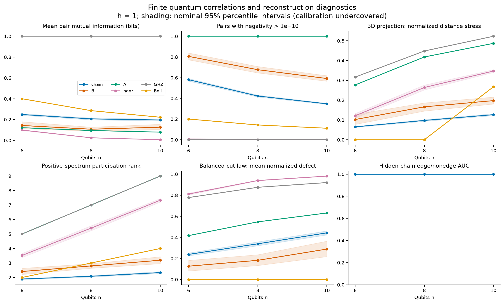
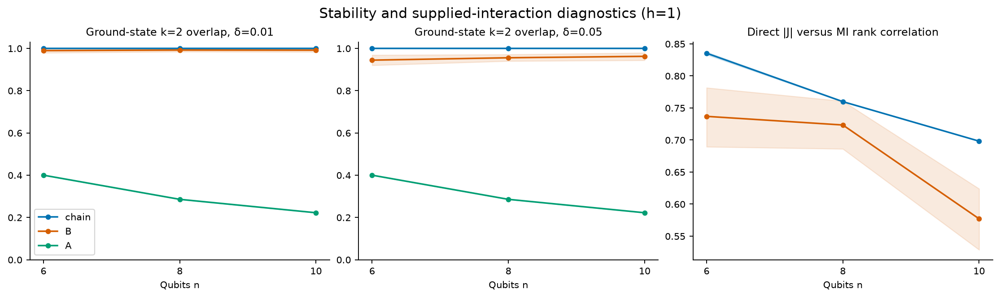
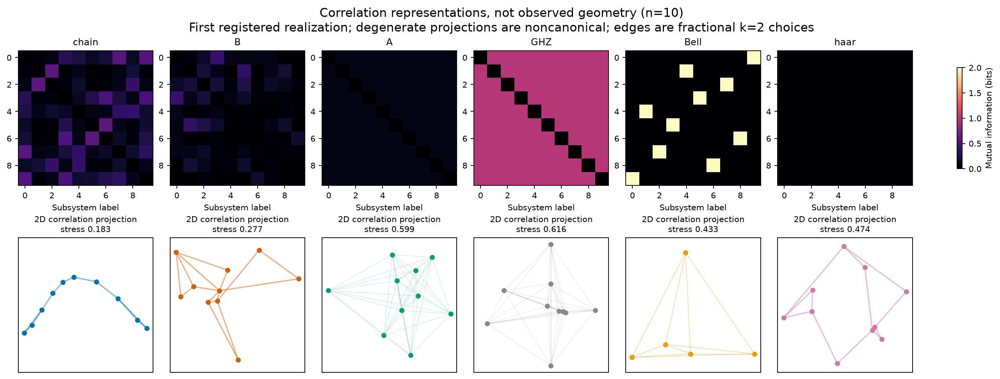
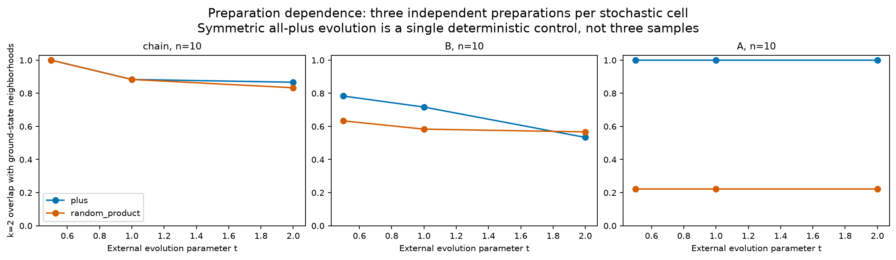

# Experiment 6: quantum information before spacetime

**Decision: useful reconstruction and proximity diagnostics; no limited GO for
geometric emergence from these fixed-coupling models.** Mutual information recovers
the supplied chain perfectly in the registered h=1 benchmark. Random all-to-all
interactions produce nonuniform rankings that survive small perturbations, but the
required advantage over physical phase-scrambled controls fails at two of three
sizes. Raw dissimilarities violate triangle inequalities, the information spectrum
does not establish a stable dimension, and the supplied interactions already explain
first-order propagation. The symmetric model has an exact finite-system obstruction
to distinguishable ground-state neighborhoods.

These are conclusions about a specified small quantum laboratory. They neither
prove nor disprove spacetime emergence in nature. No gravitational dynamics, emergent
time, Einstein equation or black-hole model has been demonstrated.

## 1. Registration, execution and evidence status

Experiment 5 PR #5 was merged into main at
`9bc5984c656271c247354e0079fd900702642064`; its
[post-merge push CI](https://github.com/raghammer1/causal-spacetime-lab/actions/runs/40169210699)
was green and all 813 inherited tests passed before implementation. The
[protocol](QUANTUM_EMERGENCE_PROTOCOL.md) was committed as `ee9ece7` before new
model implementation or primary outcomes. The [theory](QUANTUM_EMERGENCE_THEORY.md)
and [timing-selected workload](QUANTUM_EMERGENCE_WORKLOAD.md) were frozen with the
implementation at **`6dd659865973261ca4f2437d02f1f6bf4d088f69`**. The theory document
was completed during implementation, rather than in the protocol commit; the
workload record explicitly preserves that chronology.

The fixed study used n=6,8,10; h=.5,1,2; three independent seed batches and eight
realizations per batch. It produced **1,818/1,818 planned state records**, including
**873 ground-state solves**, with **zero numerical failures**. Correlated fields,
perturbations, phase scrambles and evolution snapshots are branches of one
realization, not extra independent samples. Deterministic controls are stored once.
All sizes and registered controls were retained. Phase 7 feedback was omitted
*before outcomes*: no justified autonomous interaction-update law was available.

Evidence is distinguished throughout:

- **Established mathematics / reproduced mechanisms:** density operators, entropy,
  local-unitary invariance, Perron–Frobenius uniqueness, Ising perturbation theory,
  and propagation through the supplied Hamiltonian.
- **Exact deductions for this design:** symmetry and sign-gauge ambiguities, explicit
  distance counterexamples and cut-law control values, derived below and tested.
  No claim of priority or new general quantum-gravity theorem is made.
- **Measured finite evidence:** reconstruction, robustness, field/size dependence,
  negative controls and numerical uncertainty in the registered ensembles.
- **Unestablished interpretation:** manifold selection, independent dynamical
  locality, a continuum limit and physical spacetime.

The distinction is essential in the literature. Ryu–Takayanagi relates entropy to
area in specified holographic settings; Van Raamsdonk uses states with an existing
holographic interpretation. Neither gives a general qubit-to-space theorem.
Quantum Graphity changes quantum **edge** degrees of freedom through a different
Hamiltonian; this lab keeps numerical couplings fixed. Cao–Carroll–Michalakis assumes
special redundancy-constrained states and imposes graph shortest paths. Our tests
probe those kinds of assumptions; they do not reproduce their entire construction.
See the qualified primary-source review in the [theory document](QUANTUM_EMERGENCE_THEORY.md),
[Ryu–Takayanagi](https://arxiv.org/abs/hep-th/0603001),
[Van Raamsdonk](https://arxiv.org/abs/1005.3035),
[Quantum Graphity](https://arxiv.org/abs/0801.0861), and
[Cao–Carroll–Michalakis](https://arxiv.org/abs/1606.08444).

## 2. Mathematical models and what is supplied

The Hilbert space is `(C²)⊗n`, with a specified tensor factorization and operational
subsystems. These are assumptions, even without spatial coordinates. In units
hbar=g=1,

```math
H=-h\sum_i X_i-\sum_{i<j}J_{ij}Z_iZ_j.
```

| Family | Couplings / state specification | Supplied structure |
|---|---|---|
| A | J_ij=1/(n−1) | Permutation-symmetric interaction |
| B | Independent unordered G_ij~Normal(0,1), J_ij=G_ij/√(n−1) | Exchangeable but heterogeneous all-to-all interactions |
| Chain | Nearest-neighbor bonds Uniform[.8,1.2], then random vertex relabeling | An open one-dimensional interaction graph |
| Product / random product | All-plus / independent Haar one-qubit factors | Factorized preparation |
| Bell product | Tensor product of Bell pairs, relabeled | Explicit disconnected pair structure |
| GHZ | (|0…0⟩+|1…1⟩)/√2 | Explicit multipartite preparation |
| Haar | Normalized independent complex Gaussian amplitudes | Uniform finite pure-state ensemble |
| Phase scramble | ψ_x→exp(iθ_x)ψ_x, independent uniform θ_x | Global basis-dependent operation preserving all Z probabilities |

The inference function receives **only MI**. A separate evaluator receives J,
withheld chain adjacency and other observables. It reports every fixed 1D/2D/3D
projection, while inference returns the complete positive MDS spectrum and
coordinates. Neither target dimension nor true coordinate ordering enters inference.

At h=1, perturbations add δK at δ=.01,.05, with the registered model-specific
normalization. Chain noise changes existing bonds only, so its locality remains
supplied. A's perturbations explicitly insert asymmetry. Each baseline and perturbed
state share the same phase-scramble vector and sampled cuts. Shared random edge
permutations make conditional null comparisons fair. Shuffled MI matrices preserve
weights but need not be physically realizable quantum marginals; phase scrambles
and Haar states are distinct physical controls.

Ground states use generic seeded sparse eigensolver starts, two lowest eigenpairs,
residual/gap/positivity checks, and independent dense/analytic validations. A low
residual alone is not a rigorous certificate of the global lowest eigenvalue.
Secondary unitary evolution uses `exp(-iHt)` on all-plus and random-product states
at externally specified t=.5,1,2, with only three independent preparations per
stochastic cell. There is no emergent time or equilibration claim.

## 3. Quantities and exact structural relationships

For normalized ψ, `ρ=|ψ⟩⟨ψ|`. With retained subsystem A and complement R,
`(ρ_A)_{a,a′}=Σ_r ρ_{ar,a′r}`. Reshaping pure amplitudes as M gives `ρ_A=MM†`;
its eigenvalues are squared Schmidt singular values. Thus a pure bipartition has
`S(A)=S(R)`, with

```math
S(\rho)=-\sum_k p_k\log_2p_k,\qquad
I(i:j)=S(i)+S(j)-S(ij),\qquad 0\le I(i:j)\le2\min(S(i),S(j)).
```

Pair negativity is `(||ρ_ij^(Tj)||₁−1)/2`; log-negativity is `log₂(1+2 negativity)`.
Connected ZZ is `⟨Z_iZ_j⟩−⟨Z_i⟩⟨Z_j⟩`. MI measures total correlations, including
classical correlations; it is not synonymous with pair entanglement. For a Bell pair,
MI=2 bits and negativity=.5. For GHZ with n≥3, every pair has MI=1 but negativity=0.
Local unitaries conjugate reduced density matrices and preserve their spectra,
MI and negativity; ZZ itself is basis dependent.

**Symmetry theorem.** For h>0, the off-diagonal entries of H connect every bit string
through negative one-bit flips. A sufficiently shifted `cI−H` is nonnegative and
irreducible. Perron–Frobenius therefore gives a unique positive finite-n ground
vector. In A, every subsystem permutation commutes with H, so uniqueness forces the
ground state to be permutation invariant. All pair marginals are identical: there
are no distinguishable ground-state neighbors. An index-based tie-break would
manufacture them. Random preparation or coupling disorder supplies symmetry breaking.

**Sign-gauge ambiguity.** A product of local X flips sends
`J_ij→s_i s_j J_ij`, s_i=±1, while preserving the transverse field. The corresponding
ground states are related by a local unitary. MI and negativity cannot identify
these coupling-sign choices. Comparing |J| is meaningful, but exact reconstruction
of signed J from those invariants is impossible in general.

**Why coupling copying is expected.** At fixed finite n,h and J→λJ, perturbation
theory about the all-plus state gives

```math
|\psi\rangle=|+\cdots+\rangle+
\lambda\sum_{i<j}\frac{J_{ij}}{4h}|-_i-_j\rangle+O(\lambda^2),
\quad
I(i:j)=\frac{\lambda^2J_{ij}^2}{4h^2}\log_2(1/\lambda)+O(\lambda^2).
```

The leading hierarchy copies J². The finite-field measurements are not presumed
asymptotic, and the error is not uniform in n. Collective paths and frustration
can alter direct-pair correlations without producing geometry.

**Propagation.** In the Heisenberg convention,
`[H,X_i]=−2iΣ_k J_ik Y_iZ_k`; therefore for i≠j,

```math
[X_i(t),X_j]=4itJ_{ij}Y_iY_j+O(t^2).
```

This operator identity, checked independently against matrix evolution, implies a
leading response of norm `4|tJ_ij|`. Nonzero all-to-all couplings produce direct
first-order influence at every pair. That is a supplied interaction mechanism,
not an independently established geometric light cone. It does not rule out every
possible large-n effective description.

### Distance and embedding are additional assumptions

The registered off-diagonal dissimilarity is
`d_ij=−ln(max(I_ij,epsilon)/2)`, with diagonal zero and epsilon=1e−12,1e−9,1e−6
(primary 1e−9). The map is symmetric and nonnegative but is not generally a metric.

- Bell partners have I=2 and d=0 despite being distinct subsystems.
- Product pairs have I=0, hence infinite unregularized distance. Their finite
  displayed distance is entirely the numerical floor.
- The pure five-qubit state `½Σ_(a,c)|a,a AND c,c,a,c⟩` has independent fair A,C,
  and B=A AND C after tracing the record qubits. Therefore I(A:C)=0 and
  I(A:B)=I(B:C)=H₂(1/4)−1/2=.311278124459…. The raw A–C distance is infinite while
  the other two sum to a finite value: triangle inequality fails. All registered
  epsilon values retain the failure.

Shortest-path closure repairs triangle inequalities by construction, not discovery.
For MDS, `B=−½ C D² C`, `C=I−11ᵀ/n`. Exact Euclidean distances require B positive
semidefinite; negative eigenvalues disclose an obstruction. Dropping them is an
approximation. Distance stress is `sqrt(Σ_(i<j)(d_ij−dhat_ij)² / Σ_(i<j)d_ij²)`.
Positive-spectrum participation rank is `(Σλ_+)²/Σλ_+²`, not physical dimension.
MDS optimizes a Gram approximation, not every distance-stress criterion.

GHZ gives an equilateral simplex: `B=(ln2)² C/2`, rank n−1. Uniform Model-A MI has
the same simplex structure up to scale. A truncated repeated eigenspace is
noncanonical; even its truncated distance stress can vary with arbitrary rotations.
Those flagged stresses and Model-A shuffle contrasts have no structural interpretation.
For Bell products, collapsing each zero-distance pair gives an equilateral quotient
with n/2 points and rank n/2−1, explaining perfect 3D fits at n=6 and8 without a
connected spatial model.

Fractional top-k membership shares boundary ties instead of choosing indices;
k=1,2,3. A homogeneous matrix assigns k/(n−1) to every candidate neighbor.
Its overlap with itself is one, while overlap with a fully selected non-tied set
is k/(n−1). These are tie identities, not stable local neighborhoods or their loss.

### A separately motivated multipartite diagnostic

The redundancy-constrained cut ansatz is

```math
Q(B)=\frac12\sum_{i\in B,j\notin B}I(i:j),\qquad
\Delta(B)=S(B)-Q(B).
```

We retain all singleton cuts and four randomly chosen balanced bipartitions per
realization. The absolute normalized defect is `|Δ|/max(S,Q,1e−12)`. If both terms
are numerically zero (≤1e−10), the normalized defect is zero with an explicit flag;
raw values remain. Product and Bell-product states have Δ=0 for every cut. GHZ has
`Δ=1−|B|(n−|B|)/2`. Thus satisfying the law is insufficient for connected geometry,
and failing it does not disqualify every geometric quantum system: it tests this
particular reconstruction ansatz. Four balanced cuts cannot verify all regions.
Full proofs, assumptions and source qualifications are in the
[mathematical theory](QUANTUM_EMERGENCE_THEORY.md).

## 4. Uncertainty: a retained calibration failure

**All bootstrap intervals below are nominal, descriptive percentile intervals,
not validated 95% coverage guarantees.** The independent calibration covered the
known normal mean in **365/400 trials (91.25%)**, Monte Carlo SE 1.41 percentage
points, using nominal 95% intervals at 24 units in three strata. For strata of eight
normal observations, the expected conditional bootstrap variance is 7/8 of the
true iid mean variance; this helps explain finite-sample undercoverage, but no
post-outcome correction was fitted. The six alpha=.05/6 stress bounds likewise do
not establish rigorous simultaneous coverage. Seeds, margins and methods were kept.

Resampling acts on whole realizations within fixed batches; paired effects are
formed first. Pairs, cuts and phase/null replicates never inflate the sample size.
Cells with any singleton usable stratum have no bootstrap interval. The secondary
three-preparation study is descriptive. Constant deterministic controls get no
sampling interval. Null/undefined correlations remain missing, with counts.

The chain benchmark separately uses an exact one-sided binomial lower bound for
Pr(AUC≥.75), at alpha=.05/3 per size. It is obtained by inverting the finite binomial
tail; with all 24 successes it is `(.05/3)^(1/24)=.843160717157`, not one. Exhaustive
finite-binomial calibration verifies the bound's stated conservative coverage.
All cohorts must be complete. Under the timing rule, R=2 or4 would have insufficient
power for this gate even with all successes; the selected R=8 permits it.

## 5. Supplied-chain reconstruction works, with regime limits

At registered h=1, **all 72 chain realizations** have AUC=1 and top-(n−1) edge recall=1.
Each size has 24/24 successes and the exact lower bound .84316>.8; the chain gate
passes. The all-one bootstrap interval does not imply certainty about future samples.
The evaluator's top-(n−1) recall uses the known edge count; inference does not.

| h | n=6 AUC / edge recall | n=8 AUC / edge recall | n=10 AUC / edge recall |
|---|---:|---:|---:|
| .5 | .9367 / .7833 | .8673 / .6369 | .8120 / .5463 |
| 1 | 1 / 1 | 1 / 1 | 1 / 1 |
| 2 | 1 / 1 | 1 / 1 | 1 / 1 |

The adverse h=.5 results are retained. Strong collective correlations obscure
individual bonds even in a system whose Hamiltonian is genuinely local. At n=10,
the participation ranks at h=.5,1,2 are 8.001,2.339,1.258 and 1D stresses are
.693,.294,.094. Thus even successful bond reconstruction does not make this
information-distance spectrum a reliable dimension estimator. The supplied chain
remains one-dimensional throughout.

## 6. Geometry-free models: stable proximity, missing geometric mechanism

### A: exact symmetry obstruction

At h=1, A's off-diagonal MI contrasts for n=6,8,10 are only
8.44e−15,9.27e−15,1.40e−14 bits; its positive-spectrum ranks are exactly 5,7,9
within numerical precision. Every pair can have entanglement, yet no pair is a
special neighbor. Perturbations and asymmetric preparations introduce distinguishable
relations by supplying asymmetry. Apparent low-dimensional A layouts and nonzero
shuffle-stress contrasts arise from noncanonical degenerate projections, not
spontaneous geometric organization. This finite-n ground-state no-go is exact;
it is not a theorem about every thermodynamic symmetry-breaking limit.

### B: robust relationships do not satisfy the geometric advancement conditions

At h=1, all three sizes meet the registered **descriptive proximity-only screen**.
The table shows ensemble means, with nominal 95% percentile intervals in brackets.

| n | k=2 overlap, δ=.01 | k=2 overlap, δ=.05 | MI contrast, bits | 3D stress |
|---|---:|---:|---:|---:|
| 6 | .9896 [.9792,1.0000] | .9444 [.9201,.9688] | .3425 [.3103,.3734] | .1021 [.0776,.1283] |
| 8 | 0.9922 [0.9844,1.0000] | 0.9557 [0.9401,0.9714] | .3708 [.3313,.4122] | .1662 [.1449,.1863] |
| 10 | .9917 [.9833,.9979] | .9625 [.9438,.9792] | .4287 [.3992,.4587] | .1976 [.1806,.2157] |

All epsilon-neighborhood agreements are one. Independent seed batches reproduce
nonuniform ensemble behavior; independent draws are not expected to share labeled
neighborhoods. This is finite structural stability, not a common emergent manifold.

The predeclared low-dimensional pattern requires 3D stress≤.25 and favorable
comparisons against **both** null types at **every** size. The physical-null condition
fails at n=6 and10, even before considering calibration undercoverage:

| n | Shuffled-weight minus ground stress: mean / adjusted lower | Phase-scrambled minus ground stress: mean / adjusted lower |
|---|---:|---:|
| 6 | .05375 / .02087 | .01149 / **−.02804** |
| 8 | .07973 / .05021 | .04602 / .01957 |
| 10 | .08985 / .05286 | .01742 / **−.00927** |

These are descriptive bounds, not calibrated significance statements. Failure to
establish an advantage is not proof of equality with phase-scrambled states. There
is no all-size limited GO.

Direct |J|–MI Spearman correlations at h=1 are .737,.723,.577; k=2 neighborhood
overlaps with |J| are .788,.742,.650. MI–|connected ZZ| correlations are
.949,.957,.975. Direct copying is imperfect, but dependence on supplied interactions
is substantial. At h=2, |J|–MI rank correlations rise to .869,.885,.839, consistent
with the weak-coupling mechanism. Lower direct association at h=.5 (.531,.480,.345)
does not identify a new law; collective interactions and frustration are alternatives.

Raw triangle inequalities fail in **12/24,21/24,21/24** baseline B states at h=1.
The mean fractions of violated inequalities are .0181,.0300,.0247 (denominator:
three inequalities per unordered triple). Negative MDS Gram mass occurs in
**20/24,23/24,22/24** states. Stable rankings therefore do not naturally define an
exact Euclidean metric. The participation rank increases 2.413→2.798→3.191 with n;
3D stress also rises. Three small sizes cannot establish stable continuum dimension.
Thresholds .25,.5,.75 of maximum MI change mean edge density by .353,.318,.323:
the correlation graph is sensitive to the imposed sparsification convention.





## 7. Controls and multipartite failures

**Bell products** have zero cut-law defect and perfect 3D distance fits at n=6,8,
yet contain only disconnected supplied entangled pairs and zero-distance collisions.
At n=10 they have five collisions and quotient rank four; 3D stress .2674. These are
exact counterexamples to interpreting a good low-dimensional fit as emergent space.

**GHZ** gives MI=1 for every pair with zero pair negativity. Its simplex dimension
n−1 grows with n; its normalized balanced-cut defects are .7778,.8750,.9200.
Uniform correlations do not select proximity. **Product states** give zero MI and
zero cut defect; regularization nevertheless produces a finite equilateral diagram.
Random-product MI at ~1e−15 and negativity at ~1e−16 are numerical residue, not
physical correlations. Relative thresholds can amplify such residue; the absolute
contrast test and tie flags prevent interpreting it as locality.

**Haar states** can also look attractive in a layout. Their 3D stresses at n=6,8,10
are .1212,.2640,.3470 and participation ranks 3.519,5.406,7.328. Mean pair MI falls
.0990→.0249→.00639 bits. At n=8 and10 no measured pair exceeds the 1e−10 negativity
threshold, while balanced subsystem entropy remains large. The normalized cut-law
defect grows .8111→.9393→.9813: the pairwise cut sum captures little of the balanced-cut entropy. A globally entangled state need not supply a useful pairwise space.

**Phase scrambles** preserve every computational-basis probability and connected-ZZ
observable, while changing coherence and generally MI/negativity. They retain
geometric-looking fits comparable to B at two sizes. Shared phase vectors preserve
the fairness of perturbation comparisons; the control was not artificially made
unstable by independent re-scrambling each member.

The balanced-cut defects for B at h=1 grow .1265→.1818→.2888; for the legitimate
chain they grow .2382→.3387→.4427. At n=10,h=.5 they are .7238 and .8944 respectively.
At h=2 they fall to .0780 and .0385. This is information about the *state and regime*,
not a general geometric/nongeometric classifier. A geometric Hamiltonian need not
satisfy the selected pair-redundancy ansatz. Conversely Bell products satisfy it
without extended spatial geometry. These two directions explain why the extra
observable is useful but insufficient.



Every panel above is the first registered realization at n=10, not a selected
success. Edges are fractional k=2 choices. Bell partners overlap at identical
coordinates; symmetric layouts depend on degenerate eigenspace choices. The image
is a representation of correlations, not an observation of microscopic space.
The [null contrasts](experiments/quantum-information-v1/null_contrasts.png) and
[coupling scatter](experiments/quantum-information-v1/coupling_scatter.png) show the
other registered comparisons, including unfavorable outcomes. In the coupling
scatter, blue denotes the chain and orange denotes B; dots within a state are
correlated and are not independent statistical samples.

## 8. Preparation and dynamical interpretation

At n=10, B's mean k=2 overlap with ground-state neighborhoods after all-plus quenches
at t=.5,1,2 is .783,.717,.533; for random-product preparations it is .633,.583,.567.
The chain's corresponding overlaps are 1,.883,.867 and 1,.883,.833. These are only
three independent preparations per stochastic cell; no bootstrap CI is supplied.
They show preparation/time dependence, not convergence to a universal neighborhood.

A's all-plus evolution remains symmetric, giving fractional overlap one without
identifiable neighbors. Random-product evolution produces overlap 2/(n−1) with its
uniform reference: this is the tie identity derived above. No existing neighborhood
has been destroyed. Its asymmetry was supplied through preparation.



No independent causal cone or propagation locality has been measured. The exact
short-time commutator already follows J. A later-time effective locality claim would
need an independently defined family of observables, a scale-dependent bound and
size-uniform control, not a correlation-derived distance chosen to fit propagation.
External t and externally supplied J remain part of the model.

## 9. Validation, archive and reproduction

The generating source passed **987 tests** and an end-to-end 47-record smoke run
before commit. Tests include independent partial traces, dense/sparse spectra,
Bell/GHZ/AND controls, local unitaries and relabeling, sign gauge, unitary evolution,
commutators, metric failures, degenerate embeddings, stream isolation, exhaustive
bootstrap/finite-binomial checks, manifest tampering and failed-cohort rendering.
Three expected empty-legend warnings in an intentionally failed-study figure test
have no numerical significance.

An independent statistical implementation imports no study statistics. It rebuilt
streams, bootstrap distributions through multiplicity weights, order-statistic
quantiles and exact binomial tail inversions. It verified **289,132 checks** over
**19,630 metric estimates in 141 cells**, with **zero discrepancies above 2e−12**;
maximum difference was **7.11e−15**. It also independently recomputed 630 raw chain
AUCs, 576 phase-paired effects and 441 conditional-null effects. Arithmetic agreement
does not repair the coverage failure. See the
[statistical audit](experiments/quantum-information-v1/statistics_audit.md).

An independent state-level auditor uses explicit basis-index reductions, cut-entropy
singular values, and bit-flip Hamiltonian action without importing the quantum core.
It checked all **1,818 states**, **873 ground vectors**, **53,328 pair reductions**,
**21,816 cut entropies**, **648 phase-source relationships** and **432 shared-phase
perturbation pairs**, with **zero failures**. Maximum disagreements were 6.61e−14
for MI, 5.05e−14 for cut entropy, 1.88e−12 for normalized cut defect and 4.26e−14 for
ground energy; maximum independently computed scaled ground residual was 3.57e−13.
The [state audit](experiments/quantum-information-v1/state_audit.json) records
thresholds, counts, auditor source hash and numerical errors. Fourteen additional
audit tests inject corrupted states, observables, schedules and provenance.

A third independent [geometry audit](experiments/quantum-information-v1/geometry_audit.json)
checked **5,454 inference records** (all states at all three epsilons), **2,137,968
raw/closure triangle inequalities**, thresholds, fractional ties, permutation
equivariance, spectral diagnostics, saved-coordinate stress and paired overlaps.
It used Dijkstra closure and explicitly centered Gram matrices, importing no
inference helpers. **468,387 comparisons passed with zero failures**; maximum
eigenvalue discrepancy was 5.00e−12 and positive-Gram reconstruction error 1.53e−12.
Projection-stress auditing uses saved coordinates so degenerate subspaces are not
mistakenly compared as unique embeddings. Conditional-null scalar records/means
are checked; their matrices are reproducible from frozen seeds/code, not individually
stored. The final local suite passes **1,001 tests** plus the end-to-end CLI smoke.
Current remote checks are available in the
[branch CI history](https://github.com/raghammer1/causal-spacetime-lab/actions?query=branch%3Aexperiment%2Fquantum-information-emergence-v1).

A full repeat from the same frozen source in a separate detached worktree reproduced
**all nine nonmetadata data/table/figure files byte for byte**, including all six
figures. Runtime metadata correctly differs. The raw data, JSON summary and CSV
scientific digest is

`016d5fbef1c4418779b61ffc578abad2162ccb1503e8bb10b06e0842d2fea55d`.

Primary computation took 59.684 seconds and postprocessing 28.532 seconds,
**88.216 seconds total**, peak RSS **430,899,200 bytes** (~411 MiB). The repeat took
86.047 seconds. Both satisfy the registered limits. Python3.14.4, NumPy2.5.4,
SciPy1.18.1 and Matplotlib3.11.2 were used on arm64 Darwin, with one BLAS/OpenMP
thread. Platform differences may change floating-point last bits; replay evidence
here concerns this recorded environment, not universal byte identity.

The [archive](experiments/quantum-information-v1/) contains full complex amplitudes,
couplings, perturbations, starting states, observables (with reduced density matrices reproducible from saved
amplitudes), all epsilon
inferences, cut records, conditional-null results and semantic random-stream keys
in `raw.jsonl.gz`; complete `summary.json` and `summary.csv`; source/package/runtime
metadata; pilot and calibration outcomes; audits; figures; and a SHA-256 manifest.
All failures would retain planned rows; none occurred in the primary run.

For exact reproduction, use a clean checkout/worktree at the generating commit:

```sh
git worktree add --detach ../quantum-reproduce 6dd659865973261ca4f2437d02f1f6bf4d088f69
cd ../quantum-reproduce
python3 -m venv .venv
. .venv/bin/activate
python -m pip install -e '.[dev]'
export OPENBLAS_NUM_THREADS=1 OMP_NUM_THREADS=1 VECLIB_MAXIMUM_THREADS=1
python -m pytest -q
python -m causal_lab.quantum_study --smoke --output results/smoke
python -m causal_lab.quantum_study --primary --repeats 8 --output results/primary
```

Use the recorded dependency versions for the demonstrated byte replay. The source
requires a clean tracked tree and no untracked scientific files before primary
execution. Output directories must be empty. Smoke, pilot, calibration, primary,
bootstrap and audit use separate versioned streams; there is no primary default.
The full workload is excluded from CI, which runs the bounded smoke study.
From the published branch, independently verify an archive with:

```sh
python -m causal_lab.quantum_audit docs/experiments/quantum-information-v1 --output results/state-audit.json
python scripts/audit_quantum_statistics.py docs/experiments/quantum-information-v1 --output results/statistics-audit
python scripts/audit_quantum_geometry.py --archive docs/experiments/quantum-information-v1 --output results/geometry-audit.json
```

## 10. Final research questions A–J

**A. Reconstruct supplied space?** Yes, all registered h=1 chain edges are recovered
at n=6,8,10; h=2 also works. At h=.5 recovery degrades, especially with n. This is
reconstruction of the supplied Hamiltonian, not emergence.

**B. Meaningful reproducible proximity without coordinates?** B has nonuniform,
perturbation-stable finite rankings in independently sampled ensembles. A has none
in its unique symmetric ground state. B's rankings are meaningful state diagnostics,
with supplied subsystem factorization and interactions, not established space.

**C. Effective locality or interaction encoding?** No independent effective locality
is established. Direct |J| explains much of the ranking, collective dependence on the
whole Hamiltonian remains, and first-order propagation explicitly follows J.
Non-perfect direct copying is not evidence of a new geometric mechanism.

**D. Can artificial states fool reconstruction?** Yes. Bell products have exact
low-dimensional quotient fits and zero cut defects, GHZ has nonzero pair MI without
pair entanglement, regularized products have finite diagrams, and scrambled/Haar
states can have attractive layouts. The full controls expose these ambiguities.

**E. Stable structure across sizes?** B's perturbation rankings persist in the finite
window; embedding stress/rank and cut-law defects change with size. No stable
continuum dimension, common manifold or scaling limit has been established.

**F. Missing conditions for continuum, metric and causality?** A justified operational
tensor factorization/coarse-graining; states selected by a specified dynamical law;
a metric satisfying controlled nondegeneracy and consistency; concentration/tightness
of a size sequence; scale separation and universality; approximate reconstruction
uniqueness; local propagation bounds uniform on the relevant scales; and temporal,
causal and Lorentzian structure. Finite MI agreement supplies none automatically.

**G. Already known mechanism?** Yes: transverse-field Ising correlations, local-unitary
gauge ambiguities and perturbative coupling dependence are established mechanisms.
The lab does not reproduce holographic gravitational dynamics or Quantum Graphity's
edge dynamics. The exact counterexamples are transparent checks, not novelty claims.

**H. New mathematical prediction?** No new physical prediction or new continuum
mechanism. The symmetry, gauge and perturbative consequences are explicit, falsifiable
model deductions verified here; the measurements add reproducible finite numerical
evidence and counterexamples to overinterpreting the reconstruction pipeline.

**I. Continue this approach?** Stop optimizing MI-based classifiers, layouts or
Hamiltonian parameters merely to make these baselines look geometric. A narrowly
scoped mathematical quantum-information program remains worthwhile only with a
new, independently justified state-selection/dynamical mechanism and prespecified
operational locality tests. First specify which subsystem algebras, coarse-graining
and propagation bounds are to emerge and under what assumptions. This is a proposal
for future theory, not an advancement of the present models to emergent spacetime.

**J. Connection to Einstein equations and black holes?** A controlled Lorentzian
continuum and matter sector; suitable symmetries, conservation laws and effective
action; a derivation of the gravitational equations with quantified corrections;
a semiclassical regime relating entropy, horizons and stress-energy; and empirical
predictions with units and uncertainties. A finite correlation graph, external-time
quench or missing divergent quantity does not resolve a singularity or establish
black-hole physics.

The useful result is a sharper account of assumptions and information loss:
quantum correlations can recover supplied relationships, but their stability,
embeddability and dynamical interpretation are separate mathematical questions.
